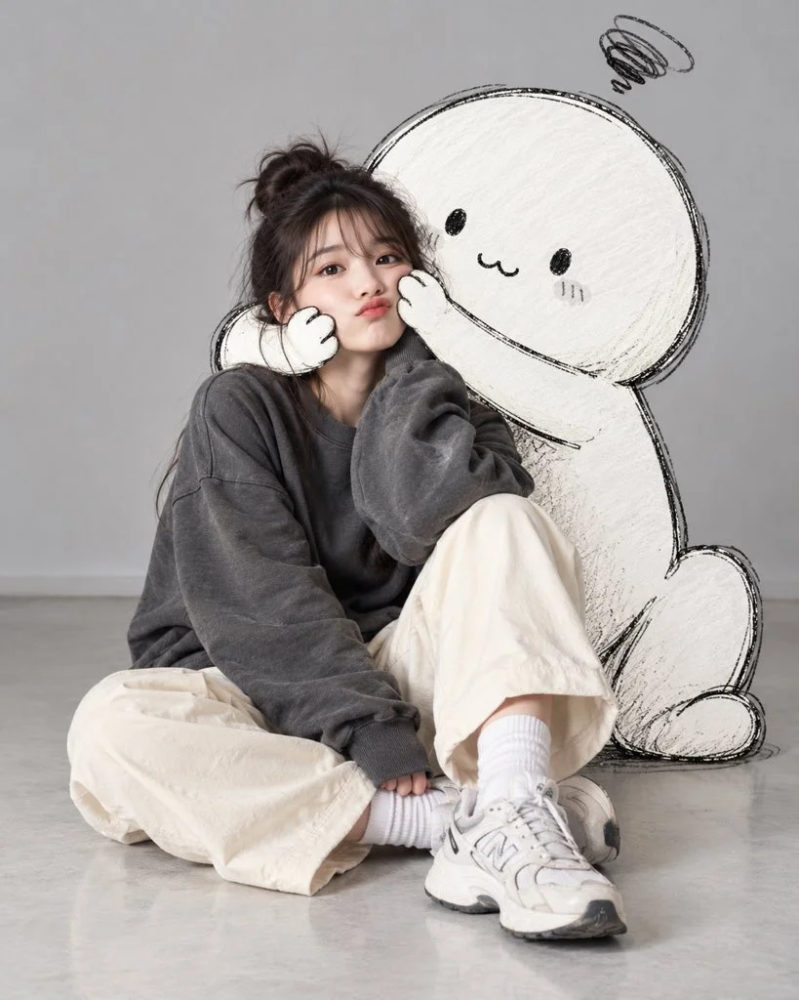

# Studio Floor Portrait with a Giant Doodle Character

**中文标题：** 影棚地板人像×巨型手绘涂鸦小怪  
**ID:** `gi25-x-1142` · **Mode:** `generate`  
**Categories:** `general`  
**Tags:** `x-twitter`, `community`, `gpt-image-2.5`, `x-direct`, `en`



### Studio Floor Portrait with a Giant Doodle Character

```text
Create an ultra-realistic editorial portrait of the same stylish young woman sitting on a pale gray studio floor, accompanied by a cute oversized hand-drawn doodle character.
The woman has dark brown hair in a loose messy bun with wispy bangs, natural makeup, and a playful pout. She wears an oversized dark gray sweatshirt, baggy ivory trousers, white socks, and chunky sneakers. Sitting with one knee raised, she looks into the camera while the cartoon character gently squeezes her cheeks with its long, sketchy arms.
Behind her, the adorable white cartoon has a round head, tiny black eyes, a simple mouth, rough marker outlines, and subtle white pencil shading. A small scribbled swirl above its head adds a humorous touch.
Use a minimalist gray studio backdrop, soft diffused lighting, natural shadows, and a cozy Korean editorial aesthetic. Blend photorealistic human photography with imperfect 2D hand-drawn illustration, keeping the woman completely realistic and the cartoon visibly sketched. Full-body vertical composition, 4:5 ratio, detailed skin and fabric textures, clean framing, no text, logos, or watermarks.
```

- **Recommended model:** `gpt-image-2.5-sunburst`
- **Settings:** _(defaults)_
- **Source:** [community](https://x.com/j_smeaton99/status/2115114887970218202) — @j_smeaton99
- **License note:** Original public X post; quoted with attribution — remix with attribution
- **Notes:** Collected directly from X; original post https://x.com/j_smeaton99/status/2115114887970218202; post text names GPT Image 2.5; discovered via Bin0754/gpt-image-gallery index, prompt re-verified against the original X post via api.fxtwitter.com; verified=True
- **Preview:** `previews/gi25-x-1142.webp`
