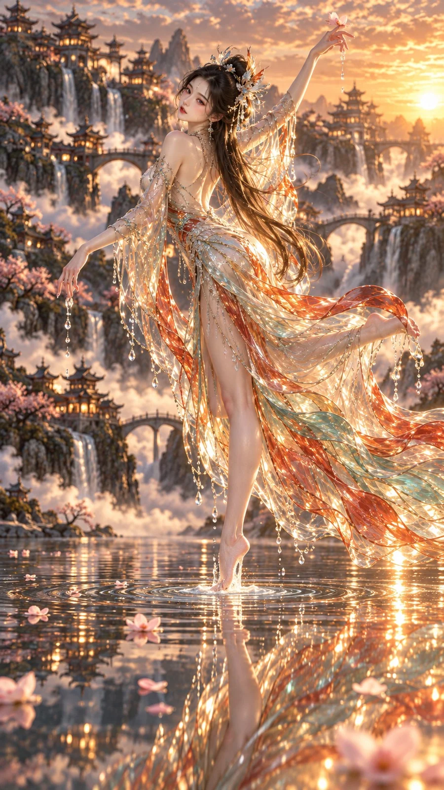

# Xianxia Liquid-Glass Gown Lake Dance

**中文标题：** 仙侠液态玻璃裙·湖面点水回眸  
**ID:** `gi25-x-1146` · **Mode:** `generate`  
**Categories:** `general`  
**Tags:** `x-twitter`, `community`, `gpt-image-2.5`, `x-direct`, `en`



### Xianxia Liquid-Glass Gown Lake Dance

```text
Vertical 9:16 cinematic Xianxia fantasy CG still. A young East Asian woman balances on one pointed toe on a mirror-calm mountain lake, body arched in a dance pose, looking back over her shoulder with a serene expression. Long dark hair with translucent phoenix hairpins and silver tassels. Floor-length translucent gown like liquid glass — iridescent amber, teal, soft crimson, crystal droplets on sleeves. Warm golden-hour backlight from the right, strong rim light, soft lens flare. Misty cliffs, multi-tiered pagodas, stone bridges, waterfalls into cloud. Peach blossom petals on the water with ripples at her toe. Ultra-detailed refraction, soft natural skin. No logos, no watermark, no text.
```

- **Recommended model:** `gpt-image-2.5-sunburst`
- **Settings:** _(defaults)_
- **Source:** [community](https://x.com/static_stare/status/2114996079813148722) — @static_stare
- **License note:** Original public X post; quoted with attribution — remix with attribution
- **Notes:** Collected directly from X; original post https://x.com/static_stare/status/2114996079813148722; post text names GPT Image 2.5; discovered via X search, prompt re-verified against the original X post via api.fxtwitter.com; verified=True; prompt for image 2 of the post
- **Preview:** `previews/gi25-x-1146.webp`
