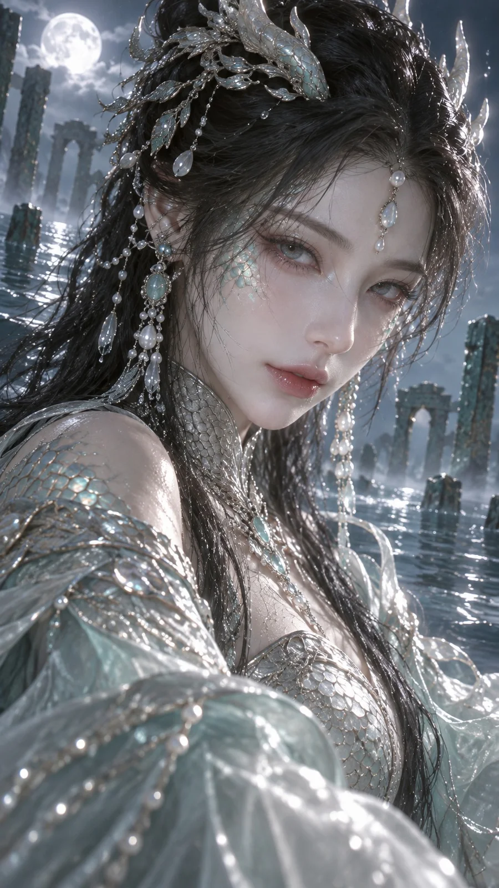

# Moonlit Dragon Maiden Fantasy Fashion Editorial

**中文标题：** 月下龙女·青银鳞片奇幻时装大片  
**ID:** `gi25-x-1147` · **Mode:** `generate`  
**Categories:** `general`  
**Tags:** `x-twitter`, `community`, `gpt-image-2.5`, `x-direct`, `en`



### Moonlit Dragon Maiden Fantasy Fashion Editorial

```text
Vertical 9:16 cinematic fantasy fashion editorial CG still, lover's mid-close framing. An adult East Asian dragon maiden faces the camera slightly off-center, cool serene gaze. Pale skin with soft natural texture. Long dark hair wet at the tips, crowned by a cold-moon silver diadem with tiny teal scale inlays and dangling pearl threads. She wears a high-collared silver-scale bodice merging into translucent celadon silk sleeves; dragon-scale plates catch hard specular highlights along the shoulder and collarbone. Soft cold moonlight from upper left, faint underwater caustic patterns across her cheek and neck. Background: deep indigo night water with distant ruined jade pillars half-sunk in mist. Ultra-detailed scale refraction, quiet intimacy, no logos, no watermark, no readable text, no collage.
```

- **Recommended model:** `gpt-image-2.5-sunburst`
- **Settings:** _(defaults)_
- **Source:** [community](https://x.com/static_stare/status/2115071000299606286) — @static_stare
- **License note:** Original public X post; quoted with attribution — remix with attribution
- **Notes:** Collected directly from X; original post https://x.com/static_stare/status/2115071000299606286; post text names GPT Image 2.5; discovered via X search, prompt re-verified against the original X post via api.fxtwitter.com; verified=True; prompt for image 1 of the post
- **Preview:** `previews/gi25-x-1147.webp`
