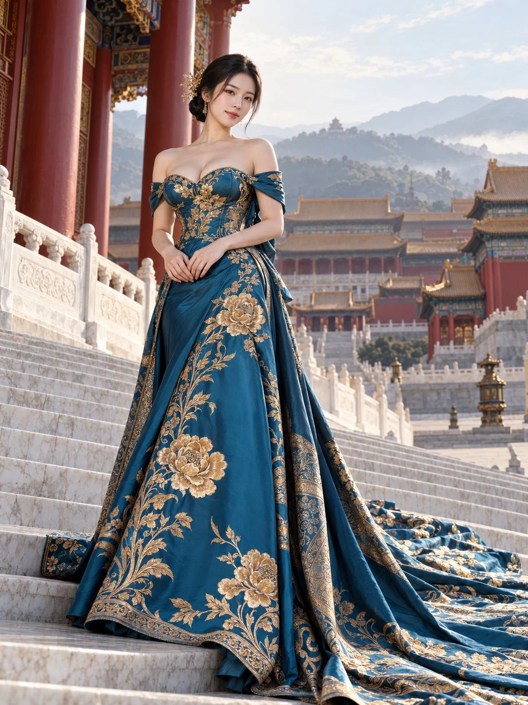

# Peacock-Blue Gold-Embroidered Gown on Palace Steps

**中文标题：** 孔雀蓝金绣礼服·宫阙玉阶  
**ID:** `gi25-x-1150` · **Mode:** `generate`  
**Categories:** `general`  
**Tags:** `x-twitter`, `community`, `gpt-image-2.5`, `x-direct`, `zh`



### Peacock-Blue Gold-Embroidered Gown on Palace Steps

```text
【画面风格】
3:4竖版，写实高端时装摄影，新中式高级定制礼服大片。真实成年东方女性，真实织物质感，自然摄影光影，庄重华丽、温婉典雅。人物与礼服清晰，远景有柔和的空气透视。

【人物与妆发】
一位25—30岁的成年东方女性，柔和鹅蛋脸，五官精致自然，白皙通透的肌肤，保留细微皮肤纹理。淡雅精致的妆容，自然眉形，柔和眼妆，玫瑰豆沙色嘴唇。黑色长发盘成低髻，侧分发型，脸侧垂落少量碎发，发髻侧面点缀精巧金色花枝发簪，佩戴细长金色耳饰。

【礼服】
身穿孔雀蓝偏深青蓝色的新中式高级定制长礼服。心形抹胸领口，一字露肩设计，上臂搭覆同色绸缎，露出肩颈与锁骨。胸型丰满自然，立体剪裁的上身贴合身体，腰线收束，身形比例协调。

礼服采用厚实、有分量的丝绸缎面，光泽柔和，呈现真实织纹和自然褶皱。裙身绣有大面积金色牡丹、枝叶与藤蔓纹样，刺绣细密立体，金线有细微反光；花纹沿胸前、腰侧和裙摆舒展分布，裙缘带繁复金色装饰纹边。

高腰线连接宽大落地裙摆，裙摆铺满前景。超长拖尾沿白色石阶向画面右下方延伸，形成层叠、厚重而流畅的绸缎褶皱，清晰展示金色刺绣。

【姿态与神情】
人物站在宽阔宫殿石阶上，身体略微侧转，面部朝向镜头，头部轻轻倾斜，神情温柔从容，嘴角带淡淡笑意。双臂自然弯曲，双手在小腹前轻轻交叠，手指舒展自然。站姿端庄，肩部放松。

【环境与构图】
中国皇家宫殿建筑群，前景为宽阔的白色大理石台阶，两侧有雕花汉白玉栏杆。画面左侧是高大的朱红色宫柱，顶部可见蓝绿与金色彩绘斗拱。中景层层展开红墙、金黄色琉璃瓦屋顶、宫殿庭院和石栏杆，右侧点缀古典宫灯。远处是笼罩薄雾的青灰色山峦，山脊上隐约可见一座楼阁，天空浅蓝，散布薄云。

全身远景人像，人物位于画面中央略偏左，头顶留有适度空间，完整呈现头饰、礼服及超长拖尾。摄影机位略低，轻微仰拍，保持自然透视。石阶、栏杆形成纵深引导线，拖尾向右下角展开，礼服占据画面下方大部分面积。

【光线与色彩】
晴朗天气的柔和侧逆光，从画面右上方照入，在头发、肩颈和礼服边缘形成细腻亮边，面部有柔和环境补光。石阶明亮，阴影自然。孔雀蓝裙身与金色刺绣形成鲜明配色，搭配朱红宫柱、暖金屋顶和冷灰远山。人物和裙身清晰，背景适度柔化，宫殿结构依然可辨。

【避免】
卡通、插画、塑料皮肤、过度磨皮、夸张眼睛、僵硬表情、身体比例失衡、畸形手指、多余肢体、廉价亮片、刺绣模糊、裙摆悬浮、拖尾断裂、建筑扭曲、背景过度虚化、强烈广角畸变、过曝、文字、水印。
```

- **Recommended model:** `gpt-image-2.5-sunburst`
- **Settings:** _(defaults)_
- **Source:** [community](https://x.com/krienknight/status/2115277380868792526) — @krienknight
- **License note:** Original public X post; quoted with attribution — remix with attribution
- **Notes:** Collected directly from X; prompt posted as the author's own reply https://x.com/krienknight/status/2115277380868792526 to https://x.com/krienknight/status/2115277380340396054, which carries the images; GPT Image 2.5 is named in the parent post; discovered via X search, prompt re-verified against the original X post via api.fxtwitter.com; verified=True
- **Preview:** `previews/gi25-x-1150.webp`
