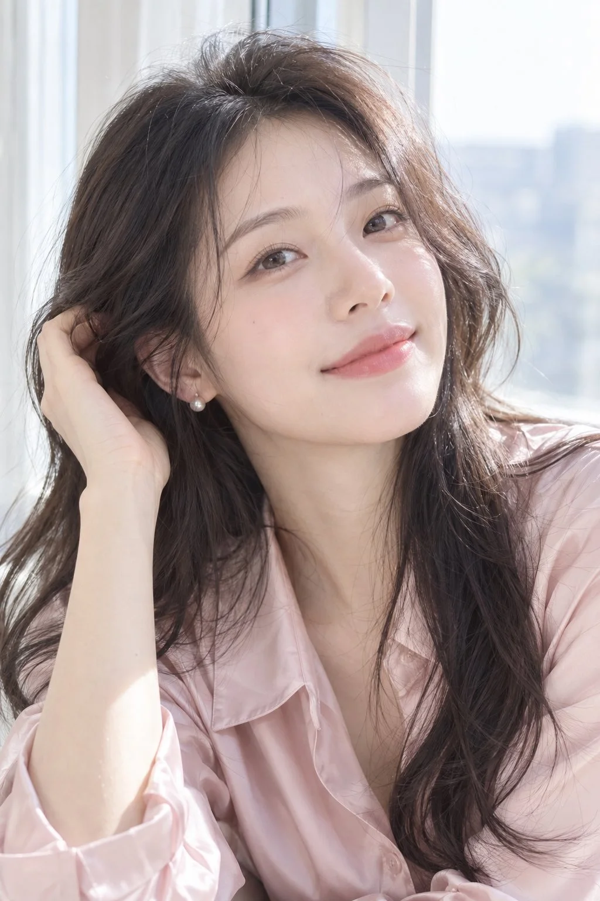

# Japanese-Style Airy Home Portrait Template

**中文标题：** 日系清透居家写真模板  
**ID:** `gi25-x-1152` · **Mode:** `generate`  
**Categories:** `general`  
**Tags:** `x-twitter`, `community`, `gpt-image-2.5`, `x-direct`, `zh`



### Japanese-Style Airy Home Portrait Template

```text
2:3竖版，日系清透居家人像写真，真实摄影质感，柔和明亮，带自然亲近的生活气息。

一位25岁的成年东亚女性，清秀甜美，柔和的小鹅蛋脸，面颊饱满适度，下颌自然收窄，下巴圆润。清澈杏眼，眼睛大小与面部比例真实，自然双眼皮，细致睫毛，小巧鼻梁，柔润淡粉色嘴唇，轻轻闭唇微笑，眼神放松、有交流感。

皮肤白皙透亮，带自然淡粉血色，保留细微毛孔、绒毛、唇纹与柔和明暗，面颊和鼻尖有轻微自然光泽。轻薄底妆，淡粉腮红，柔和眉形，整体干净清新。

深棕色长发，偏分，发根蓬松，松散的大波浪自然垂落肩前，保留细碎发丝与少量飞发，阳光照亮头发边缘。

穿着[奶白色露肩针织衫／浅粉色真丝衬衫／浅蓝色柔软开衫]，衣料纹理清晰，褶皱与垂坠自然。坐在[窗边浅色沙发／卧室床沿／明亮客厅的扶手椅]，姿势为[单手轻托脸颊／抬手拢耳边头发／身体微微前倾、双手自然搭放]，肩颈放松，头部轻微倾斜，[直视镜头／侧脸回望镜头]。

大窗户透入柔和自然日光，侧逆光勾勒发丝，室内反射光轻柔照亮脸部，眼睛有自然窗形高光。奶白、浅米与淡粉为主色，背景简洁，家具与花瓶轻微虚化，亮部保留层次。

镜头与眼睛接近同高，近距离拍摄，[胸部以上近景／腰部以上半身构图]，人物占据画面主体，面部与眼睛清晰，85mm人像镜头观感，适度浅景深。呈现真实皮肤、自然身体比例与轻度修饰的写真效果。

避免：动漫脸、夸张大眼、尖下巴、僵硬表情、厚重妆容、过度磨皮、蜡质皮肤、全脸油亮、发丝成块、手指畸形、过曝死白、过度锐化、文字和水印。
```

- **Recommended model:** `gpt-image-2.5-sunburst`
- **Settings:** _(defaults)_
- **Source:** [community](https://x.com/krienknight/status/2115020694891188629) — @krienknight
- **License note:** Original public X post; quoted with attribution — remix with attribution
- **Notes:** Collected directly from X; original post https://x.com/krienknight/status/2115020694891188629; post text names GPT Image 2.5; discovered via X search, prompt re-verified against the original X post via api.fxtwitter.com; verified=True
- **Preview:** `previews/gi25-x-1152.webp`
