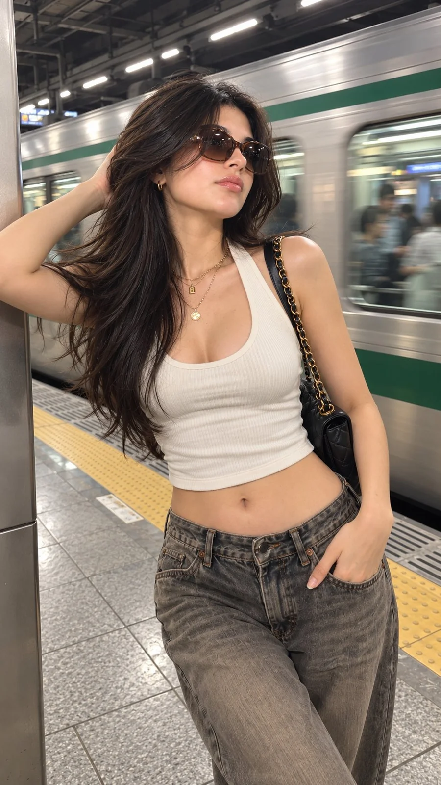

# Cinematic Y2K Subway Street-Style Portrait

**中文标题：** 电影感 Y2K 地铁街拍人像  
**ID:** `gi25-x-1158` · **Mode:** `generate`  
**Categories:** `general`  
**Tags:** `x-twitter`, `community`, `gpt-image-2.5`, `x-direct`, `en`



### Cinematic Y2K Subway Street-Style Portrait

```text
Cinematic Y2K Subway Street-Style Portrait 🚇🖤

Create an ultra-realistic, vertical 9:16 smartphone photograph of a stylish young woman posing on a modern urban subway platform as a silver train with a green stripe rushes past behind her.

Pose & Expression: She leans casually against a metallic pillar, with one arm raised behind her head, fingers running through her long hair, and the other hand tucked into the front pocket of her jeans. Her body is slightly angled toward the camera, with one hip relaxed, shoulders tilted naturally, and chin lifted. She looks slightly upward and to the side with a cool, confident, effortless expression.

Appearance: Long, voluminous, deep-black hair with soft layers and natural movement, gently swept by the station breeze. Oversized brown gradient sunglasses, glossy nude-pink lips, warm beige skin with realistic texture, delicate facial features, and subtle Y2K-inspired makeup.

Outfit & Accessories: A fitted cream-white ribbed cropped halter tank top with a flattering neckline, loose low-rise vintage gray-brown washed jeans, layered delicate gold necklaces, small gold hoop earrings, and a black quilted shoulder bag with a chunky gold chain strap.

Background: A busy metropolitan train station with a rushing silver-and-green train, blurred passengers visible through the windows, gray tiled flooring, yellow tactile paving, metal platform grates, and industrial ceiling lights.

Photography Style: Candid street-style fashion photography, slightly low camera angle, half-body to upper-thigh framing, natural handheld composition, realistic motion blur on the train, sharp focus on the woman, soft reflections on the sunglasses, authentic fabric wrinkles, natural skin pores, subtle mobile-camera grain, cool fluorescent lighting, balanced contrast, and cinematic realism.

Overall Mood: Effortlessly chic, confident, modern Y2K fashion, candid city-girl aesthetic, like a spontaneous street-style photograph captured during a busy commute.

Aspect Ratio: 9:16 vertical.
Quality: Photorealistic, high detail, natural anatomy, realistic hands, no excessive skin smoothing, no artificial CGI appearance, no text, no watermark.
```

- **Recommended model:** `gpt-image-2.5-sunburst`
- **Settings:** _(defaults)_
- **Source:** [community](https://x.com/Rose5303508870/status/2115035597001883986) — @Rose5303508870
- **License note:** Original public X post; quoted with attribution — remix with attribution
- **Notes:** Collected directly from X; original post https://x.com/Rose5303508870/status/2115035597001883986; post text names GPT Image 2.5; discovered via Bin0754/gpt-image-gallery index, prompt re-verified against the original X post via api.fxtwitter.com; verified=True
- **Preview:** `previews/gi25-x-1158.webp`
