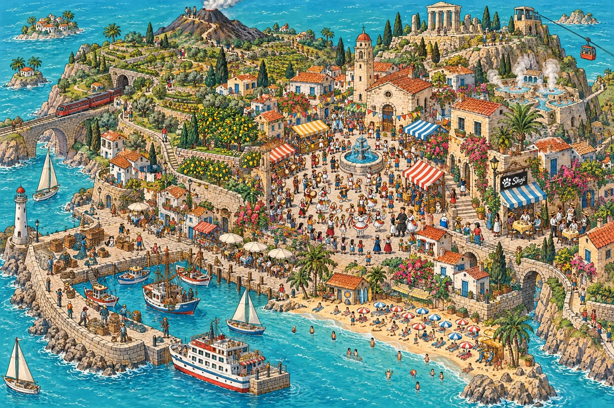

# Hand-Drawn Island Harbour Town Seek-and-Find Map

**中文标题：** 手绘岛屿港町观光寻物地图  
**ID:** `gi25-x-1165` · **Mode:** `generate`  
**Categories:** `general`, `poster-typography`  
**Tags:** `x-twitter`, `community`, `gpt-image-2.5`, `x-direct`, `en`



### Hand-Drawn Island Harbour Town Seek-and-Find Map

```text
A vintage hand-drawn illustrated tourist map, horizontal 3:2, in the spirit of a classic seek-and-find book: a whole small Mediterranean-style island with its harbour town, seen from an extremely high and wide oblique bird's-eye view, so that everything is tiny and there is an enormous amount to look at. In the middle a market square with a fountain, striped market stalls and a festival procession; a harbour with a stone quay, wooden crates, nets, fishing boats, a ferry and sailing boats; a lighthouse on a headland; steep terraced hillsides with lemon and olive groves, stone walls and stairways; a hilltop temple and a bell tower; hot-spring baths with steam; windmills; a cable car; a long beach with striped umbrellas and bathers; narrow lanes with washing lines, cafes with awnings, rooftop gardens, a small railway with a train and a stone bridge; a small volcano at the back and a few islets with palm trees. About 200 minuscule people, each doing something: dancers and drummers in the procession, market sellers, fishermen mending nets, bathers, hikers, cafe guests, kids running, a bride and groom. A standing person is only about 3% of the picture height.

The look is the point: slightly wobbly black pen outlines with a flat, matte gouache colour fill, a bright cheerful limited palette (turquoise sea, terracotta roofs, olive green, lemon yellow, coral, cream), tiny flat cast shadows, small stylised waves drawn as short curved lines, aged cream paper texture with faint creases. Hand-drawn, not a photograph, not 3D, no blurred painting. The drawing fills the whole picture to all four edges: no frame, no border, no title banner, no compass rose, no scale bar, no legend, no map pins.

Exactly one small logo: a small black hanging signboard in front of a cafe in the right half, about 4% of the picture width, with a white paw print whose big pad holds a swirling ocean wave, and the word "Shoji" in white cursive brush lettering to its right. Apart from that sign there are no letters, words or numbers anywhere: no place names, labels or signs with writing.

THE ONLY ANIMALS IN THE WHOLE PICTURE ARE FOUR CATS, and there are never more than four. Not five, not a spare one. No other animal at all: no whales, dolphins, fish, seagulls or other birds, no horses, donkeys, goats, sheep, dogs, chickens, no animal-shaped boats, signs, weathervanes or statues. No person wears an animal head or costume. The four cats are tiny, in the same middle band of the picture, each in the open and never hidden behind anything, none in the lower third. The three real cats are each only about 1.5% of the picture height, under half the height of a standing person, and wear a thin red collar with a tiny gold bell:
1. a black-and-white "hachiware" cat (black head and back, a white blaze splitting the face, white chest and paws) sitting upright on the stone quay beside a pile of wooden crates, in the left half;
2. a brown mackerel tabby (warm brown fur with dark stripes, white muzzle and chest) sitting upright on a low stone terrace wall among lemon trees, upper left;
3. a calico cat (white with orange and black patches) sitting on the steps at the foot of a striped market stall, right of centre;
4. Shoji Cat, an upright orange tabby cat about three heads tall in a black leather jacket, denim shorts, cream sneakers and black wayfarer sunglasses with blue and red lenses, dancing with one arm raised in the festival procession in the middle of the market square, about one and a half times as tall as each of the other three cats.
No dark round objects or dark animal-like shapes that could be mistaken for a cat. No watermark.
```

- **Recommended model:** `gpt-image-2.5-sunburst`
- **Settings:** _(defaults)_
- **Source:** [community](https://x.com/Shoji_ai/status/2115028237306798236) — @Shoji_ai
- **License note:** Original public X post; quoted with attribution — remix with attribution
- **Notes:** Collected directly from X; prompt posted as the author's own reply https://x.com/Shoji_ai/status/2115028237306798236 to https://x.com/Shoji_ai/status/2115028235855503822, which carries the images; GPT Image 2.5 is named in the parent post; discovered via Bin0754/gpt-image-gallery index, prompt re-verified against the original X post via api.fxtwitter.com; verified=True
- **Preview:** `previews/gi25-x-1165.webp`
