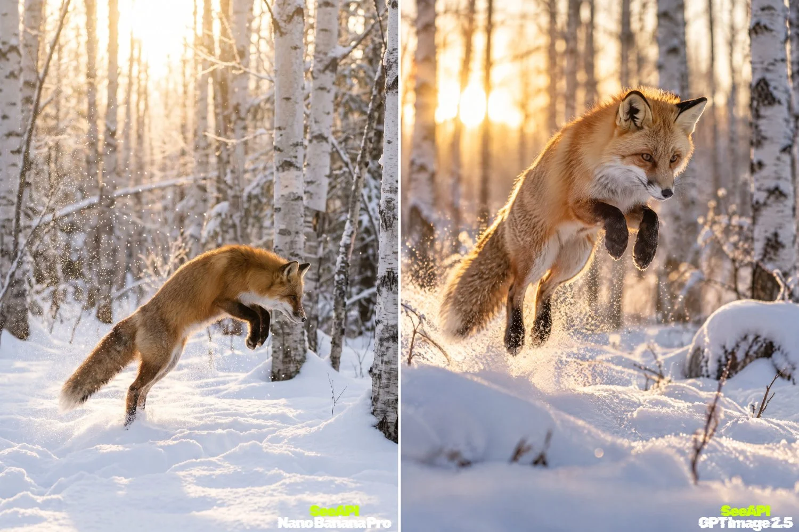

# Red Fox Mid-Leap in a Sunrise Birch Forest

**中文标题：** 日出桦林雪地跃起的赤狐  
**ID:** `gi25-x-1166` · **Mode:** `generate`  
**Categories:** `general`  
**Tags:** `x-twitter`, `community`, `gpt-image-2.5`, `x-direct`, `en`



### Red Fox Mid-Leap in a Sunrise Birch Forest

```text
A red fox mid-leap above fresh snow in a birch forest at sunrise, soft golden backlight, snow crystals in the air, 50mm, photorealistic, no text
```

- **Recommended model:** `gpt-image-2.5-sunburst`
- **Settings:** _(defaults)_
- **Source:** [community](https://x.com/SeeAPIcom/status/2114975244897407204) — @SeeAPIcom
- **License note:** Original public X post; quoted with attribution — remix with attribution
- **Notes:** Collected directly from X; prompt posted as the author's own reply https://x.com/SeeAPIcom/status/2114975244897407204 to https://x.com/SeeAPIcom/status/2114966083396620303, which carries the images; GPT Image 2.5 is named in the parent post; discovered via Bin0754/gpt-image-gallery index, prompt re-verified against the original X post via api.fxtwitter.com; verified=True; same-prompt comparison with Nano Banana Pro; preview is the side-by-side comparison image
- **Preview:** `previews/gi25-x-1166.webp`
