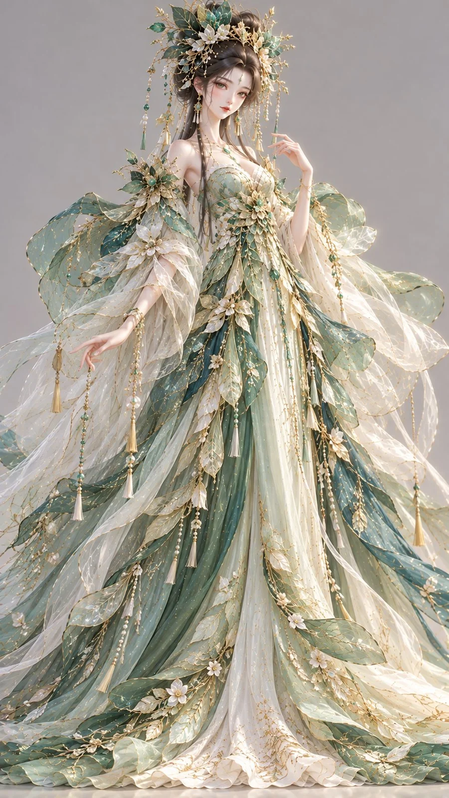

# Stylized 3D Oriental Fantasy Gown: Pine-Pollen Jade Gauze

**中文标题：** 3D 东方幻想礼裙·松花碧罗  
**ID:** `gi25-x-1168` · **Mode:** `generate`  
**Categories:** `general`  
**Tags:** `x-twitter`, `community`, `gpt-image-2.5`, `x-direct`, `zh`



### Stylized 3D Oriental Fantasy Gown: Pine-Pollen Jade Gauze

```text
9:16竖版，高精度风格化3D东方幻想女性角色原型，电影级CG渲染，鲜艳明亮的中国色与草木祭礼高级时装材质融合。

一位24–28岁的成年东方幻想女性，五官精致清雅，眼睛细长而明亮，鼻唇柔和自然，肌肤白皙细腻且具有生命感，神态轻灵、安静、带轻微神秘感。颈部修长，体态纤细挺拔。

发型雕塑： 乌黑长发盘成层叠叶扇式高髻，发束像叶片一样向上与向外舒展，形成鲜明的头部雕塑轮廓。发间镶嵌石青绿色玉叶饰、古金枝片、少量珍珠与细小贝母花片。耳侧垂下细长流苏与纤细长发。

服饰设计： 身穿松花色为主的东方幻想礼裙，主裙面料为带微光泽的柔软锦缎，细腻垂坠又不失精致结构。外层覆盖石青绿色半透明纱幕，纱料轻盈而略带珠光，在光线下呈现清澈梦幻的层次。肩部与腰侧有叶脉形叠片披饰，局部以牙白色纱层打底，制造通透的空气感。裙摆边缘采用古金叶脉浮绣、细珠绣与少量贝母片镶饰，质感高级而不繁乱。

色彩与材质控制： 松花色为主色，石青绿用于辅助层次和纱幕，牙白用于内层与透气感缓冲，古金用于叶脉绣线、发饰和边缘描线。整体鲜艳清透，突出锦缎柔光、纱层通透、浮绣与贝母饰片的精致梦幻华丽感。

高精度3D建模，真实发丝、柔亮锦缎、珠光纱幕、古金刺绣、珍珠与贝母细节清晰，明亮柔和影棚光，中性浅灰背景，正面全身完整展示。避免普通绿色古装、廉价森系、塑料感、普通游戏服装、文字水印。
```

- **Recommended model:** `gpt-image-2.5-sunburst`
- **Settings:** _(defaults)_
- **Source:** [community](https://x.com/liyue_ai/status/2115009844885512437) — @liyue_ai
- **License note:** Original public X post; quoted with attribution — remix with attribution
- **Notes:** Collected directly from X; original post https://x.com/liyue_ai/status/2115009844885512437; post text names GPT Image 2.5; discovered via Bin0754/gpt-image-gallery index, prompt re-verified against the original X post via api.fxtwitter.com; verified=True
- **Preview:** `previews/gi25-x-1168.webp`
