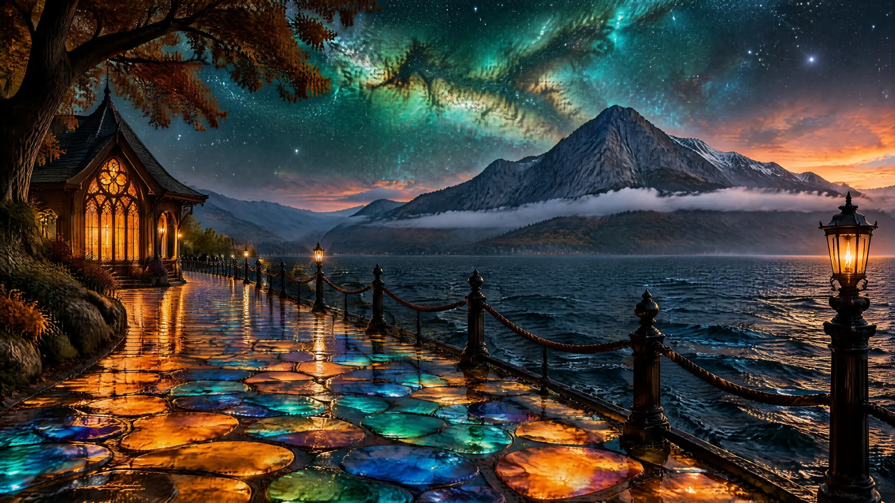

# Glowing Opal Flagstone Lakeside Promenade Under Nebula Sky

**中文标题：** 星云夜空下发光宝石石板湖畔步道  
**ID:** `gi25-x-1172` · **Mode:** `generate`  
**Categories:** `general`  
**Tags:** `x-twitter`, `community`, `gpt-image-2.5`, `x-direct`, `en`



### Glowing Opal Flagstone Lakeside Promenade Under Nebula Sky

```text
Photorealistic magical lakeside promenade at night, wide 16:9 panoramic composition, cinematic, ultra-detailed. Edge to edge, no frame, no border.

PATH: the entire foreground is a walkway of irregular rounded flagstones separated by dark joints, and every stone glows from within like stained glass or opal — molten orange, gold and ochre, then turquoise, emerald and cobalt, then deep midnight blue, each a separate luminous cell with wet cracks and bright glossy highlights. The path sweeps from the bottom right corner in a long curve toward the pavilion on the left.

LEFT: a small ornate wooden lakeside pavilion with a steep shingled roof and a tall pointed arched window, its panes glowing deep amber and fiery orange, lattice tracery visible, warm light spilling onto the path. A huge dark tree with rust-brown autumn foliage overhangs it from the top left.

FENCE: a black cast-iron railing with rope-strung posts and chunky turned finials runs along the right edge of the path, separating it from the water, receding in strong perspective with a lamp post at the near right.

WATER: the right third is a broad dark lake, choppy with short wind ridges, its surface catching faint blue and gold light, the far shore dissolving into haze.

MOUNTAINS: across the lake rises one dominant craggy mountain in grey-blue rock, its flanks forested, a snow-dusted ridge at its right shoulder, with a long flat band of white cloud lying low across its base. Softer forested slopes recede to the left.

SKY: the upper half is a star-filled night vaulted over the scene, seething with a vast emerald-green and turquoise nebula twisting diagonally across the centre, threaded with dust lanes and gold-brown star clouds. Low on the right horizon, a warm afterglow of apricot, rose and pale amber burns behind the mountain.

PALETTE: emerald, turquoise, cobalt, molten orange, amber, warm brown, near-black shadow, pale starlight. Sharp focus, glossy wet highlights, high dynamic range, clean and unmarked.
```

- **Recommended model:** `gpt-image-2.5-flare`
- **Settings:** _(defaults)_
- **Source:** [community](https://x.com/churvikv/status/2115498807400251803) — @churvikv
- **License note:** Original public X post; quoted with attribution — remix with attribution
- **Notes:** Collected directly from X; original post https://x.com/churvikv/status/2115498807400251803; post text names GPT Image 2.5; discovered via Bin0754/gpt-image-gallery index, prompt re-verified against the original X post via api.fxtwitter.com; verified=True; post names the model as GPT Image 2.5 Flare (via Dreamina)
- **Preview:** `previews/gi25-x-1172.webp`
