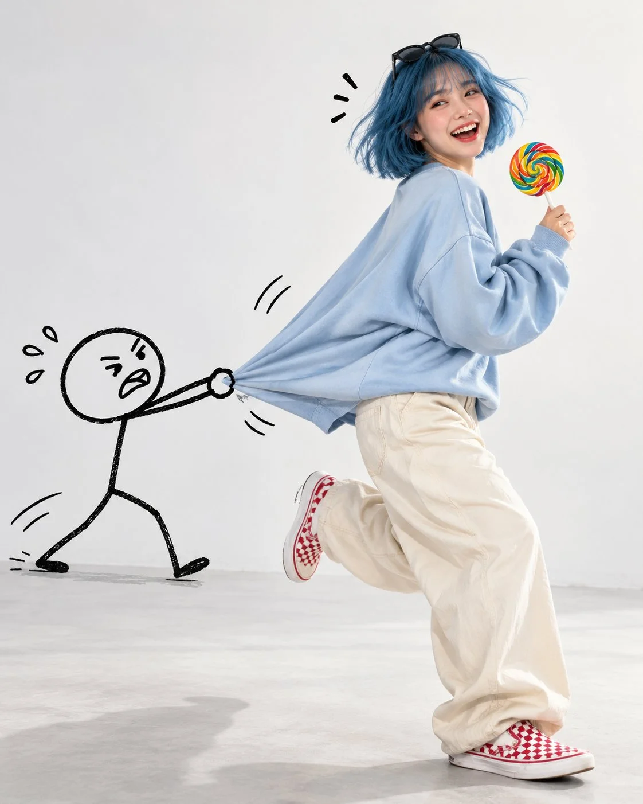

# Photoreal Woman Escaping a Doodle Stick Figure Fashion Shot

**中文标题：** 真人少女被手绘火柴人拽住·趣味时尚大片  
**ID:** `gi25-x-1173` · **Mode:** `generate`  
**Categories:** `general`  
**Tags:** `x-twitter`, `community`, `gpt-image-2.5`, `x-direct`, `en`



### Photoreal Woman Escaping a Doodle Stick Figure Fashion Shot

```text
Ultra-realistic, playful conceptual fashion photograph of a cheerful young woman with a short, vibrant blue bob haircut, wispy bangs, and sunglasses resting on top of her head. She is laughing joyfully with her mouth open, looking back toward the camera while running forward, holding a colorful rainbow swirl lollipop in one hand. She wears an oversized pastel blue sweatshirt, loose-fitting cream beige trousers, and red and white checkerboard slip-on sneakers.

Behind her, a simple black hand-drawn stick figure cartoon character grabs the back of her oversized sweatshirt, stretching the fabric dramatically as she tries to escape. The cartoon figure has a round head, minimal facial features, thin black outlined limbs, and a funny, slightly frustrated expression. Add small hand-drawn motion marks around the character, stretched fabric, and the woman's head to emphasize movement and humor.

Clean minimalist studio setting with a soft white background and pale gray floor, bright diffused studio lighting, gentle natural shadows, full-body composition, dynamic running pose, realistic fabric folds, detailed facial expression, pastel color palette, whimsical contrast between photorealism and 2D doodle art, creative advertising photography, modern social media aesthetic, sharp focus, high detail, vertical 4:5 aspect ratio. Keep the cartoon figure clearly illustrated in simple black line art while the woman remains completely photorealistic.
```

- **Recommended model:** `gpt-image-2.5-sunburst`
- **Settings:** _(defaults)_
- **Source:** [community](https://x.com/harboriis/status/2115417525177778485) — @harboriis
- **License note:** Original public X post; quoted with attribution — remix with attribution
- **Notes:** Collected directly from X; original post https://x.com/harboriis/status/2115417525177778485; post text names GPT Image 2.5; discovered via Bin0754/gpt-image-gallery index, prompt re-verified against the original X post via api.fxtwitter.com; verified=True
- **Preview:** `previews/gi25-x-1173.webp`
