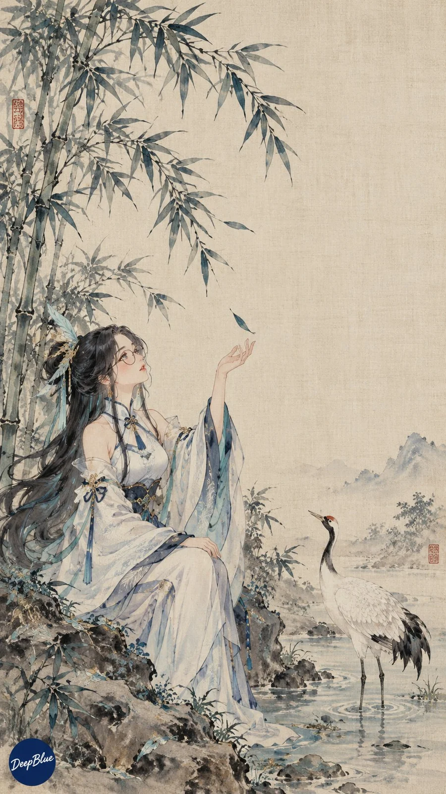

# Four-Module Gacha Prompt System (Subject × Style × Composition × Medium)

**中文标题：** 四模块抽卡生图玩法（主体×风格×构图×媒介）  
**ID:** `gi25-x-1180` · **Mode:** `generate`  
**Categories:** `general`  
**Tags:** `x-twitter`, `community`, `gpt-image-2.5`, `x-direct`, `zh`



### Four-Module Gacha Prompt System (Subject × Style × Composition × Medium)

```text
# 四模块抽卡生图玩法
## 一、核心公式
主体 × 风格 × 构图 × 媒介
主体：画谁，确定画面核心对象与身份识别特征。
风格：采用什么视觉语言，确定整体审美、色彩、造型和画面气质。
构图：如何安排画面，确定主体位置、景别、视角、空间关系和视觉重心。
媒介：用什么方式呈现，确定画面的材料、成像方式、制作痕迹和最终质感。
四个模块共同回答：
画谁 × 什么视觉语言 × 如何安排画面 × 用什么方式呈现
## 二、基本流程
每次执行时，按照以下顺序完成：
第一步：抽卡。
第二步：先输出本轮所有图片各自的完整提示词。
第三步：根据对应提示词，按顺序逐张生成图片。
如果我说“暂时不出图”，完成前两步后停止，等待我的后续指令。
## 三、抽卡规则
1. 每张图片独立抽取一组组合。
2. 每组包含：
主体卡 × 风格卡 × 构图卡 × 媒介卡
3. 如果我指定某个模块，该模块保持固定，其余模块继续抽取。
4. 如果我指定多个模块，按我的要求固定，其余模块继续抽取。
5. 如果我指定多个主体，可以按我的要求分配；没有指定分配方式时，合理安排各图片主体。
6. 如果我提供参考图，按照我的说明将参考图绑定到对应图片，并保留指定的角色形象、服装、构图或其他特征。
7. 同一轮中的不同图片，应尽量在风格、构图或媒介上形成可见差异，避免只更换少量细节。
8. 组合应具有明确的视觉重点。风格与媒介存在明显差异时，需要在提示词中说明两者各自承担的作用和主次关系。
9. 随机抽卡时，应优先选择能够共同构成清晰画面的组合。遇到冲突较大的组合，先调整画面关系；仍然无法协调时，可以重新抽取相应卡片。
## 四、四个模块的编写规则
### 1. 主体
明确画面核心对象，并保留能够识别主体的关键特征。
人物可以包括：
发型、发色、眼睛、面部特征、标志性服装、配饰及角色气质。
动作和神态可根据抽到的风格与构图自然补充。
角色造型可以适度融入对应风格，但应保持主体辨识度。
### 2. 风格
明确画面的整体视觉语言。
可以从以下方面描述：
艺术流派、设计流派、时尚方向、色彩倾向、造型规律和整体气质。
风格应体现在画面内容中，避免只写一个风格名称。
### 3. 构图
说明画面中各元素的位置和关系。
根据需要写清：
景别、视角、主体位置、主体占比、前景、背景、留白和视觉重心。
使用遮挡构图时，保留足够的主体识别信息。
使用文字或排版时，说明文字区域与主体之间的关系。
### 4. 媒介
将媒介名称转化为画面中可以看到的效果。
例如：
CCD直闪：正面硬光、明显阴影、轻微数码噪点、高光溢出。
木版套色：分层色块、纸张纤维、油墨变化、轻微套印偏差。
绢本设色：细微绢面纹理、薄层设色、柔和色彩和细腻笔触。
媒介质感应与主体和风格相配合，避免材质堆叠。
## 五、抽卡卡池
以下卡池可直接使用，也可以根据我的要求扩充或替换。
### 主体卡
雷电将军
八重神子
神里绫华
甘雨
魈
芙宁娜
纳西妲
原创人物
如果我指定其他人物或主体，优先使用我指定的内容。
### 风格卡
先锋时尚杂志
瑞士国际主义平面设计
日本传统浮世绘
宋代花鸟画
巴洛克绘画
装饰艺术风格
电影剧照
暗黑浪漫主义
波普艺术
极简主义
梦幻超现实主义
复古科幻
### 构图卡
局部遮挡构成
模块化网格构成
平面人物构成
花枝框景构成
中央对称构成
偏置留白构成
对角线构成
框中框构成
前景纵深构成
特写裁切构成
全身环境构成
重复图形构成
### 媒介卡
CCD直闪
35mm彩色胶片
即时成像照片
凹版印刷
木版套色
绢本设色
丝网印刷
水彩纸本
油画画布
粉彩纸本
雕塑摄影
像素艺术
## 六、提示词输出规则
1. 完成抽卡后，先给出本轮所有图片各自的完整提示词。
2. 每张图片单独编号，每组提示词都应可以独立复制使用。
3. 每组提示词首行展示抽卡结果，格式为：
主体 × 风格 × 构图 × 媒介
4. 首行下方直接给出完整提示词，不额外插入画面设定表或分析过程。
5. 提示词可以按照以下顺序分段：
第一段：主体的识别特征、动作与神态。
第二段：风格的视觉语言、色彩和整体气质。
第三段：构图、主体位置、空间关系和视觉重心。
第四段：媒介带来的材料、成像或制作质感。
最后一段：画幅与署名。
6. 各段内容应自然衔接，围绕同一张画面展开。
7. 如需在画面中加入文字，写明文字内容、位置与层级。没有文字需求时，不主动加入无关文字。
8. 默认竖版9:16。
9. 默认左下角署名：深蓝色实心圆点，内有白色手写体“DeepBlue”。
10. 如果我在当轮指定画幅、署名或其他要求，以当轮要求为准。
## 七、最终提示词格式示例
甘雨 × 宋代花鸟画 × 花枝框景构成 × 绢本设色
以甘雨为主体的人物与花鸟画，保留浅蓝色长发、红黑色角以及具有辨识度的服装元素。人物神态安静，微微低头，姿态自然。
采用宋代花鸟画的视觉语言，以细腻的花枝描绘、清雅的色彩和含蓄的意境组织画面。人物服装融入画面整体的设色方式，保留角色识别度。
人物位于画面中央偏下，梅枝从左上方和右侧边缘伸入，花枝疏密有致，形成不完全闭合的框景。几只小鸟停在枝头，花鸟与人物相互呼应，人物面部仍然是主要视觉焦点。背景保留适量留白，让花枝与人物有呼吸感。
模拟绢本设色的呈现效果，画面带有细微绢面纹理，色彩轻薄柔和，花瓣、枝叶和衣纹有细腻层次，整体呈现安静、雅致的古画气息。
竖版9:16，左下角署名：深蓝色实心圆点，内有白色手写体“DeepBlue”。
## 八、出图规则
1. 完成本轮所有提示词后，根据对应提示词按顺序逐张生成图片。
2. n=数字，表示生成对应数量的独立图片。例如：n=4，表示生成4张。
3. 每轮只生成一张独立图片，直到完成指定数量。
4. 每张图片对应一组独立提示词。
5. 不拼图、不做宫格、不分屏。
6. 如果我提出修改，先更新对应图片的完整提示词，再根据更新后的提示词生成。
7. 如果我说“暂时不出图”，只输出抽卡结果和完整提示词，等待后续指令。
8. 如果未能完成指定数量，说明已完成数量和剩余数量。
## 九、生成后检查
根据实际生成结果检查：
1. 主体是否可以识别，关键特征是否保留。
2. 风格是否在画面中有明确体现。
3. 构图是否符合提示词，主体与其他元素的位置关系是否清楚。
4. 媒介质感是否可见，是否与画面整体协调。
5. 人物、手部、服装、材质、光影和文字是否存在明显问题。
6. 签名是否符合要求。
7. 同一轮图片之间是否存在明显重复。
检查时，以实际画面为依据。优先指出最影响结果的问题，并提出对应修改。
## 十、每次使用时的填写方式
数量：
主体：
风格：
构图：
媒介：
画幅：
其他要求：
可以填写具体内容，也可以填写“随机”。
例如：
数量：n=10
主体：原神女性角色
风格：随机
构图：随机
媒介：随机
画幅：竖版9:16
其他要求：先给出10张图各自的完整提示词，再按顺序逐张出图。
```

- **Recommended model:** `gpt-image-2.5-sunburst`
- **Settings:** _(defaults)_
- **Source:** [community](https://x.com/DeepBlueX0/status/2115481245299909070) — @DeepBlueX0
- **License note:** Original public X post; quoted with attribution — remix with attribution
- **Notes:** Collected directly from X; original post https://x.com/DeepBlueX0/status/2115481245299909070; post text names GPT Image 2.5; discovered via Bin0754/gpt-image-gallery index, prompt re-verified against the original X post via api.fxtwitter.com; verified=True; a reusable system prompt that drafts per-image prompts before generating
- **Preview:** `previews/gi25-x-1180.webp`
