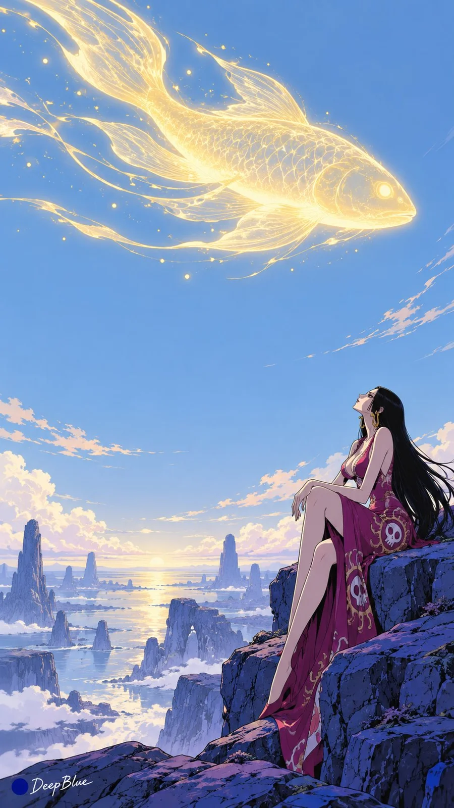

# French Sci-Fi Comic Anime Heroines Batch (n=10)

**中文标题：** 法式科幻漫画风动漫女角色批量出图（n=10）  
**ID:** `gi25-x-1187` · **Mode:** `generate`  
**Categories:** `general`  
**Tags:** `x-twitter`, `community`, `gpt-image-2.5`, `x-direct`, `zh`



### French Sci-Fi Comic Anime Heroines Batch (n=10)

```text
动漫或游戏成年女性角色 × 法式科幻漫画 × 简化构图与留白 × 线描平涂动画

每张随机选择一位不同的动漫或游戏成年女性角色，保留标志性发型、服装轮廓与关键配饰，转化为具有自然比例的动画人物。

人物与外星环境或异象产生自然互动，动作、表情和视线呈现一个连贯的电影瞬间。随机变化地貌、异象、人物动作、景别与构图。

以清晰线描、简洁色块和少量分层阴影表现人物与环境。人物面部、头发和服装具有经过概括的立体形体，整体线条与设色统一。

外星地貌以清楚的轮廓和少量结构线呈现。每张选择一个主要异象，画面保留大面积天空、地表或空旷空间。人物大小由景别决定，远景、中景与特写均保留适当留白。环境光自然影响人物与服装。

以硫黄色与蓝色辉光为色彩线索，结合橙色、蓝紫色及少量粉红或青色，每张自由调整色彩主次。画面简洁、空旷，具有孤独而迷幻的气氛。

每张采用不同角色与画面组合，变化地貌、异象、人物互动、景别和主要构图，减少同批重复。

n=10，连续生成10张独立单图，每次生成1张，不拼图、不宫格、不分屏。竖版9:16。

左下签名：深蓝色实心圆点在前，白色手写体「DeepBlue」在后。
```

- **Recommended model:** `gpt-image-2.5-sunburst`
- **Settings:** _(defaults)_
- **Source:** [community](https://x.com/DeepBlueX0/status/2115652859513757874) — @DeepBlueX0
- **License note:** Original public X post; quoted with attribution — remix with attribution
- **Notes:** Collected directly from X; original post https://x.com/DeepBlueX0/status/2115652859513757874; post text names GPT Image 2.5; discovered via X search, prompt re-verified against the original X post via api.fxtwitter.com; verified=True
- **Preview:** `previews/gi25-x-1187.webp`
