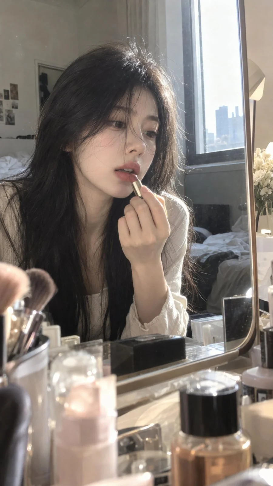

# Candid Korean-Style Vanity Lipstick Touch-Up Snapshot

**中文标题：** 韩系梳妆台补口红随拍  
**ID:** `gi25-x-1189` · **Mode:** `generate`  
**Categories:** `general`  
**Tags:** `x-twitter`, `community`, `gpt-image-2.5`, `x-direct`, `en`



### Candid Korean-Style Vanity Lipstick Touch-Up Snapshot

```text
Positive Prompt
9:16 vertical composition, realistic photography, Korean cool-toned atmospheric aesthetic, lifestyle-inspired Instagram selfie vibe.
The subject is an adult East Asian woman with delicate and natural facial features, clear refined skin with visible real texture, softly defined eyes, natural brows, and soft nude-pink lips. She has long black hair that looks naturally voluminous and slightly messy, with loose strands casually falling across her forehead, eyes, nose bridge, and cheeks. Some strands are backlit by sunlight, creating a soft translucent glow. Her makeup is polished but not heavy. Her expression is calm, relaxed, slightly dreamy, with a subtle cool and effortless mood.
Scene and action: The woman is sitting in front of a vanity mirror in an everyday setting. She leans slightly forward and is naturally touching up her lipstick with one hand. She is not posing in an overly deliberate way. Her gaze is directed toward her reflection or the lipstick, with her lips slightly parted, capturing a candid moment in the middle of applying makeup. The mirror edge, a few everyday beauty products on the vanity, and slightly blurred foreground objects are naturally included in the frame. The mirror reflection must follow realistic spatial logic, with no duplicated person or unnatural reflection.
Photography and lighting: The photo should feel as if it was casually taken by someone nearby using a normal smartphone, without a carefully arranged setup. Close-up half-body framing, the subject slightly off-center, with a naturally imperfect composition and subtle handheld feeling. One side of the frame is illuminated by bright window light or vanity light, creating slight overexposure in some highlights. A few hair strands catch the light and glow softly. The lighting on the face is not perfectly even, and the darker areas still retain natural detail. The overall image is bright, soft, and slightly hazy, but not overly smoothed or filtered.
Realism requirements: Preserve natural skin texture, fine facial hair, slight variations in skin tone, realistic hair strands, natural lip texture, and believable hand anatomy. Slight highlight blowout, subtle smartphone image grain, tiny focus imperfections, and casual framing are welcome. The image should feel like a real moment captured in everyday life, not a professionally staged portrait. Overall, it should have a natural, relaxed, slightly effortless Korean social-media photo aesthetic.
Negative Prompt
AI-generated look, plastic skin, excessive skin smoothing, waxy texture, over-sharpening, perfectly flawless face, overly symmetrical facial features, commercial advertising lighting, studio glamour portrait, cinematic poster look, excessive depth-of-field blur, artificial glow, heavy HDR, strong filter effect, exaggerated makeup, stiff pose, overly seductive expression, stiff fingers, broken hand anatomy, duplicated person, incorrect mirror reflection, floating objects, unnatural hair, readable text, watermark, logo.
```

- **Recommended model:** `gpt-image-2.5-sunburst`
- **Settings:** _(defaults)_
- **Source:** [community](https://x.com/yfyzk/status/2115643985373065521) — @yfyzk
- **License note:** Original public X post; quoted with attribution — remix with attribution
- **Notes:** Collected directly from X; prompt posted as the author's own reply https://x.com/yfyzk/status/2115643985373065521 to https://x.com/yfyzk/status/2115641809045250450, which carries the images; GPT Image 2.5 is named in the reply; discovered via X search, prompt re-verified against the original X post via api.fxtwitter.com; verified=True; includes the author's positive and negative prompt
- **Preview:** `previews/gi25-x-1189.webp`
