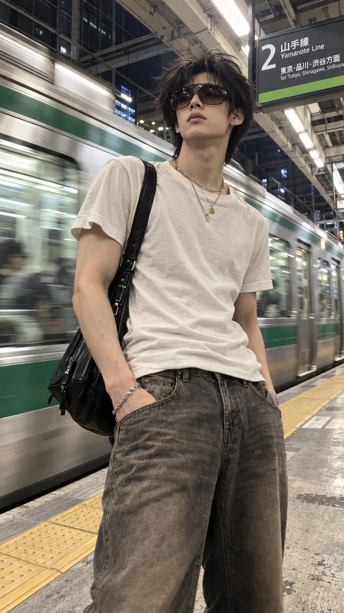

# Train Platform Y2K Menswear Vertical Phone Snapshot

**中文标题：** 火车站台 Y2K 男装竖屏手机街拍  
**ID:** `gi25-x-1190` · **Mode:** `generate`  
**Categories:** `general`  
**Tags:** `x-twitter`, `community`, `gpt-image-2.5`, `x-direct`, `zh`



### Train Platform Y2K Menswear Vertical Phone Snapshot

```text
城市火车站台上，一位年轻帅气的东亚男子站在画面中心稍偏右的位置，逼真的竖版手机街头快照。一列带有绿色条纹的银色列车在身后以水平运动模糊效果疾驰而过。从腰部高度的低角度拍摄，近距离半身至大腿中部构图，手持拍摄，略显不完美，呈现真实随性的街拍质感。

一头深黑色中长碎发，带有自然层次和蓬松纹理，发梢在站台风中向左飘扬。超大号棕色渐变墨镜遮住了他的眼睛；头部微微上扬，下颌线条清晰，嘴唇自然放松，带着冷峻、疏离又略显慵懒的表情。精致的东亚男性五官，立体鼻梁，干净利落的脸部轮廓，略微突出的颧骨，带有少年感的高级时尚气质。自然干净的皮肤，呈现真实的面部细节。

身穿暖白色修身短袖上衣，略微宽松的圆领设计，柔软的罗纹棉质面料，带有细微的自然褶皱，下摆自然停留在腰部附近，隐约展现修长的身体比例。低腰宽松复古灰棕色牛仔裤，裤腿自然垂落，带有轻微水洗做旧质感。颈部佩戴多层细金色项链，手腕搭配简约金属手链，肩上随意背着黑色皮革斜挎包，整体呈现高级复古 Y2K 男性街头穿搭风格。

暖米色皮肤，颈部、锁骨、手臂和面部保留自然皮肤纹理，身材修长匀称，肩膀略宽，肌肉线条自然不过分夸张。凉爽的荧光站台灯光，金属反光，黄色触觉铺装，混凝土地面，列车窗户中模糊的乘客。

真实的手机摄影噪点，轻微广角感，自然曝光，微弱的动态模糊，真实的环境阴影，没有刻意摆拍的感觉。整体呈现随手抓拍的电影感街头时尚摄影，冷调都市氛围，高级且自然的男性时尚大片质感。

画面比例：9:16，竖版构图，超写实摄影风格。
```

- **Recommended model:** `gpt-image-2.5-sunburst`
- **Settings:** _(defaults)_
- **Source:** [community](https://x.com/ChrisSlacker/status/2115616126310965370) — @ChrisSlacker
- **License note:** Original public X post; quoted with attribution — remix with attribution
- **Notes:** Collected directly from X; original post https://x.com/ChrisSlacker/status/2115616126310965370; post text names GPT Image 2.5; discovered via X search, prompt re-verified against the original X post via api.fxtwitter.com; verified=True
- **Preview:** `previews/gi25-x-1190.webp`
