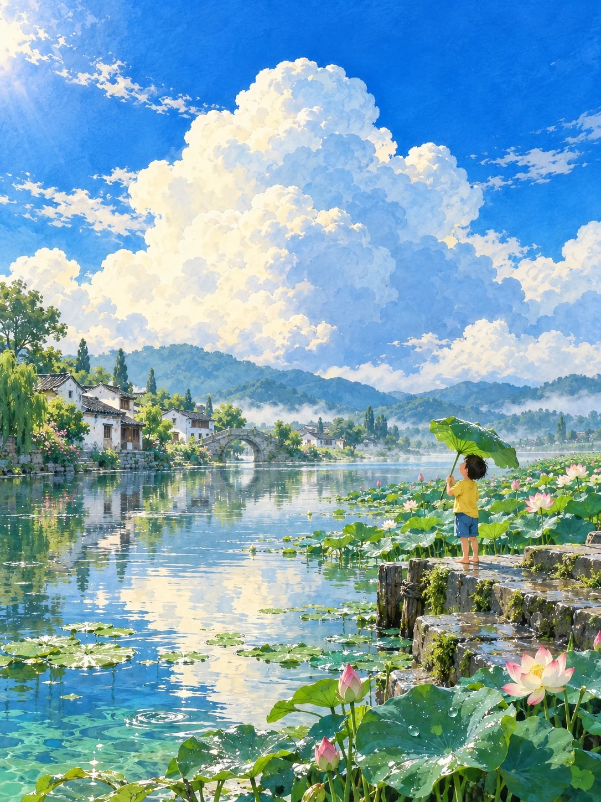

# Summer Cumulus Hand-Painted Anime Background (Lotus Pond Child)

**中文标题：** 夏日积云手绘动画背景·荷塘顶荷叶的小孩  
**ID:** `gi25-x-1197` · **Mode:** `generate`  
**Categories:** `general`  
**Tags:** `x-twitter`, `community`, `gpt-image-2.5`, `x-direct`, `zh`



### Summer Cumulus Hand-Painted Anime Background (Lotus Pond Child)

```text
Create an image with the following visual system. Replace the subject as specified.

Visual system (light, color, composition, medium, mood):
一幅竖幅 3:4 的手绘动画背景风景画，像动画电影里停住的一帧背景美术。环境是画面主角，人物或车很小，只占画面高度的十分之一左右，用来给出尺度和情绪落点，人物不画清五官。地平线压在画面下方三分之一附近，天空占上方一半以上，远处一团巨大的白色积云高高堆起，云体用柔软的渐变块面画出体积，受光的云缘是奶油白，背光面是淡青蓝和灰蓝，云的上方留出大片浓郁干净的钴蓝到天蓝。近景用疏密变化的草叶、花草或湿石压住底边，中景有一片平静的水面或湿地面，映出天空和云的倒影，倒影被细小的横向波纹拉散。明亮的夏日阳光从左上方照进来，光色中性偏暖，阴影是透明的青蓝和蓝绿，不发黑。颜色以天蓝、钴蓝、乳白云团、鲜亮的黄绿和草绿为主，浅水处用绿松石色过渡，奶油黄、杏黄、淡粉这些暖色只占很小的面积。媒介是水彩打底、再用不透明水粉叠色的手绘动画背景：轮廓清楚但有笔触起伏，草地是短促刷痕和不规则色块，越远细节越少，带空气透视，保留轻微的纸面颗粒。这是一幅手绘画，不是照片，也不是 3D 渲染。整体清凉、明朗、安静，带一点夏天午后的怀旧和梦境感。画面里不要任何文字、招牌、站牌、标志、签名、水印或边框，不要出现任何已有动画作品里的角色、精灵或吉祥物。

New subject:
江南水乡的一片荷塘，夏天的阵雨刚停，太阳出来了，荷叶和水面上还挂着亮晶晶的水珠，空气里有一层薄薄的水汽。右下近景是一段长着青苔的石埠头，一个五六岁的小孩光脚站在石阶上，穿黄色短袖和蓝色短裤，两只手举着一片比自己还大的荷叶当伞，仰头看天，只看到侧面轮廓。密密的荷叶和几朵粉白荷花从右边向中景铺开，左侧远处是白墙黛瓦的民居和一座小石拱桥，都倒映在水里，后面一大团积云。
```

- **Recommended model:** `gpt-image-2.5-sunburst`
- **Settings:** _(defaults)_
- **Source:** [community](https://x.com/static_stare/status/2116041299279163893) — @static_stare
- **License note:** Original public X post; quoted with attribution — remix with attribution
- **Notes:** Collected directly from X; original post https://x.com/static_stare/status/2116041299279163893; post text names GPT Image 2.5; discovered via X search, prompt re-verified against the original X post via api.fxtwitter.com; verified=True; prompt for image 1 of 4 (the author shares the other three on request); preview is image 1
- **Preview:** `previews/gi25-x-1197.webp`
