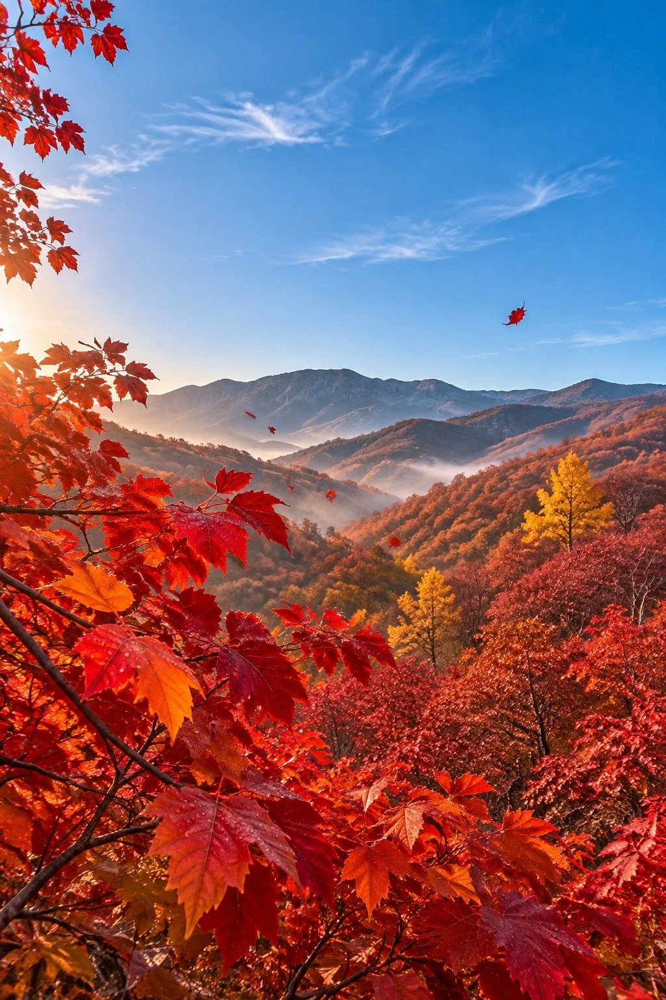

# Beijing Western Hills Autumn Red Leaves Under Blue Sky

**中文标题：** 深秋北京西山红叶蓝天风光  
**ID:** `gi25-x-1202` · **Mode:** `generate`  
**Categories:** `general`  
**Tags:** `x-twitter`, `community`, `gpt-image-2.5`, `x-direct`, `zh`



### Beijing Western Hills Autumn Red Leaves Under Blue Sky

```text
写实风光摄影，深秋北京的红叶与湛蓝天空。地点与时间：深秋清晨的北京西山红叶林，晴空万里，空气清透，阳光刚漫过山脊。主体物细节：漫山遍野的黄栌与元宝枫，叶片红得浓烈而有层次，深红、绯红、橙红交错，近处几枝红叶伸入画面，叶脉与叶缘清晰，叶片上带着清晨的薄露；山坡上红叶林成片铺展，林间点缀着几棵金黄银杏。氛围粒子：山谷间一层极淡的薄雾，阳光里有细微浮尘，几片红叶正从枝头飘落。光线：清晨低角度暖阳光斜射，色温约4500K，红叶被照得透亮，阴影处是冷调的蓝灰。背景分层：前景是伸入画面的红叶枝条，中景是整片红叶山坡，远景是连绵的青灰色远山，头顶是大面积澄澈的北京蓝天空，飘着几缕细云。相机：35mm焦段，f/8光圈，低机位仰拍，竖构图，景深从前景红叶到远山都清晰。调色：Eastmancolor胶片模拟，红与蓝冷暖对撞，饱和度自然不溢出，带轻微film grain颗粒感。构图：三分法，红叶山坡占画面下三分之二，蓝天留白占上三分之一，视线从前景红叶引向远山。质量标签：ultra detailed, photorealistic, high dynamic range, sharp focus。负面约束：No oil painting, No anime, No 3D render, No people, No text, No watermark, No oversaturation.
```

- **Recommended model:** `gpt-image-2.5-sunburst`
- **Settings:** _(defaults)_
- **Source:** [community](https://x.com/JimmyCarsttle/status/2115975555971739846) — @JimmyCarsttle
- **License note:** Original public X post; quoted with attribution — remix with attribution
- **Notes:** Collected directly from X; prompt posted as the author's own reply https://x.com/JimmyCarsttle/status/2115975555971739846 to https://x.com/JimmyCarsttle/status/2115975463508283405, which carries the images; GPT Image 2.5 is named in the parent post; discovered via X search, prompt re-verified against the original X post via api.fxtwitter.com; verified=True; the same prompt is also run on two other models in the post; preview is image 1, the GPT Image 2.5 result
- **Preview:** `previews/gi25-x-1202.webp`
