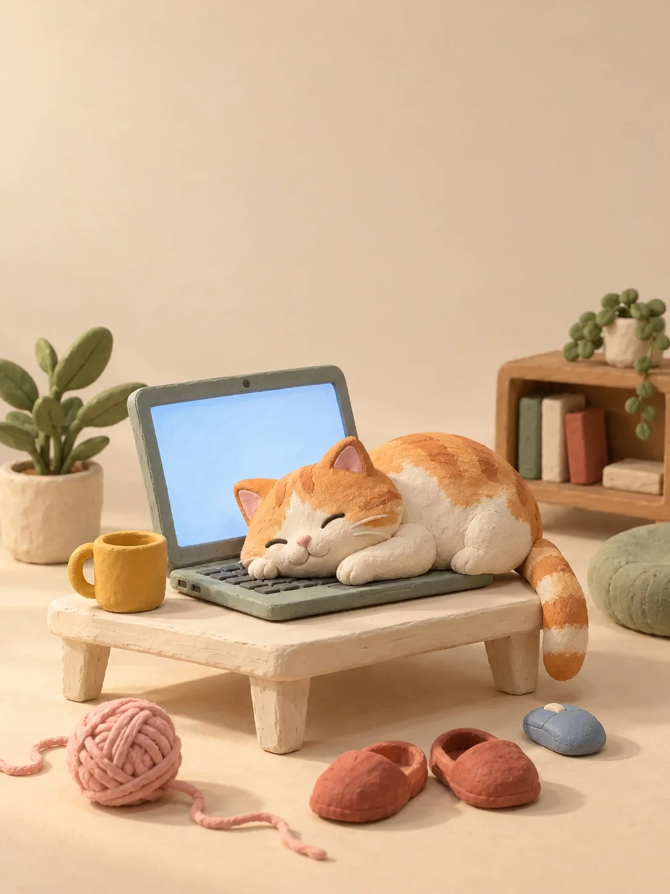

# Handmade Clay Diorama: Cat Asleep on a Laptop

**中文标题：** 黏土微缩场景·趴在电脑上睡着的猫  
**ID:** `gi25-x-1206` · **Mode:** `generate`  
**Categories:** `general`  
**Tags:** `x-twitter`, `community`, `gpt-image-2.5`, `x-direct`, `zh`



### Handmade Clay Diorama: Cat Asleep on a Laptop

```text
Create an image with the following visual system. Replace the subject as specified.

Visual system (light, color, composition, medium, mood):
制作一幅手工黏土微缩场景的棚拍作品，竖幅 3:4 构图。中景、正面略偏侧的轻微俯视机位，主体集中在画面下半部，上方保留接近一半的干净留白；前景散落的小物、中央主体与后方家具形成清楚的纵深层次。背景与地面连成无接缝的暖杏米色空间。主光从左上方斜向照入，光源宽大柔和，带温暖奶油色调；右侧自然渐暗，接触阴影呈柔软的暖灰褐色，避免强烈明暗反差。大面积低饱和杏米色统领画面，约占六成以上，以灰绿和象牙白构成主要形体，少量芥末黄、砖红、浅粉与雾蓝只用在下方小物上。所有物件保留哑光黏土的细小指纹压痕、浅划纹、微微不平的边缘与手捏起伏，轮廓清楚但不锐利。画面呈真实搭建后拍摄的完成态，安静、温暖，带一点笨拙可爱的慵懒感。

New subject:
一只圆滚滚的橘白色黏土小猫，趴在一台打开的灰绿色黏土笔记本电脑键盘上睡着了，脑袋压在键盘上，尾巴从电脑一侧垂下来，眼睛眯成两条弯线。电脑放在一张矮矮的奶油白小木桌上。地上散落几件小东西：一只芥末黄马克杯、一团浅粉毛线、一双砖红小拖鞋、一个雾蓝色小鼠标。电脑屏幕是一片柔和的浅蓝光，屏幕和所有物件上都没有文字、图标或品牌标志。
```

- **Recommended model:** `gpt-image-2.5-sunburst`
- **Settings:** _(defaults)_
- **Source:** [community](https://x.com/static_stare/status/2115817543327711425) — @static_stare
- **License note:** Original public X post; quoted with attribution — remix with attribution
- **Notes:** Collected directly from X; original post https://x.com/static_stare/status/2115817543327711425; post text names GPT Image 2.5; discovered via X search, prompt re-verified against the original X post via api.fxtwitter.com; verified=True; prompt for image 1 of 4 (the author shares the other three on request); preview is image 1
- **Preview:** `previews/gi25-x-1206.webp`
