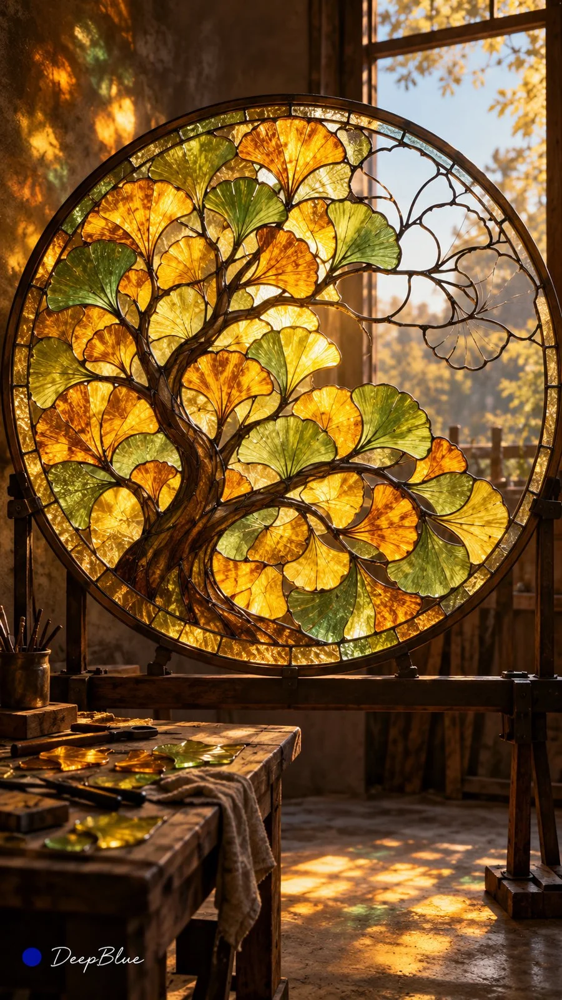

# 'Beauty of the Unfinished' Open Gacha Art Series (n=10)

**中文标题：** 未竟之美·具象主题开放抽卡（n=10）  
**ID:** `gi25-x-1209` · **Mode:** `generate`  
**Categories:** `general`  
**Tags:** `x-twitter`, `community`, `gpt-image-2.5`, `x-direct`, `zh`



### 'Beauty of the Unfinished' Open Gacha Art Series (n=10)

```text
未竟之美 × 具象主题开放抽卡 × 完整与缺失的视觉关系 × 多元艺术媒介

从《石头记》的未完成性、断臂维纳斯的残缺之美及艺术史中的未完成作品获得启发，探索形体、结构、材料与时间中的未竟美学。

优先选择能在单张画面中直观呈现未完成状态的具象主题，让已完成或保存的部分与未竟部分形成审美张力。

【开放式抽卡】

每张独立组合以下变量，各组保持开放。

1. 具象主体：
自由探索具有鲜明形态与审美价值的主体，优先选择未完成状态容易通过单张画面辨识的对象。

2. 未竟机制：
根据主体自由探索不同的未完成状态，每张确定一种主要机制。机制应与主体及所选媒介的逻辑相符。

3. 完整与未竟：
根据主体和未竟机制，设计已完成或保存的部分与未竟部分之间的关系。自由变化其位置、比例、边界和过渡方式，使未竟状态融入主体自身的形态与结构。

4. 艺术媒介：
自由选择与主体及未竟机制相适应的真实或实验性媒介，遵循对应的制作方式、物理特征与变化逻辑。

5. 构图与呈现：
根据主体与未完成状态，自由选择景别、视角、空间、背景和光线，呈现作品的形态及其未竟特征。

【核心视觉逻辑】

未完成状态清晰可辨，主体保持可识别性与审美价值。未竟状态具有合理的结构与材料依据，并保留与其形成过程相符的痕迹。

完整与未竟的比例自由变化，不固定对半分割，也不要求每张都有破损。边界、过渡与空间关系自然可信，让观众能够想象未呈现的部分或最终完成的样子。

叙事、象征与情绪可以自然产生，以具象视觉表现为优先，不依赖文字说明。

【视觉品质】

遵循所选媒介的造型、材质、光影与制作逻辑。形体清晰，完成部分具有可信的精细度，未完成部分保留真实材料或工艺特征。

细节的来源、尺度与分布合理，减少无意义碎纹、异常斑驳、密集杂点、过度锐化和装饰堆积。避免随机破坏、人体结构错误、画面模糊及缺乏依据的材质混杂。

【系列规则】

n=10，连续生成10张独立单图，每次生成1张。每张探索不同的具象主题、未竟机制、艺术媒介与构图。

优先形成不同的整体轮廓、材料关系与视觉结构，减少主体类型、未竟呈现方式及画面组织的重复。每张都是独立成立的艺术作品，共同呈现未竟之美的不同形式。

竖版9:16，不拼图、不宫格、不分屏。

左下签名：深蓝色实心圆点在前，白色手写体「DeepBlue」在后。
```

- **Recommended model:** `gpt-image-2.5-sunburst`
- **Settings:** _(defaults)_
- **Source:** [community](https://x.com/DeepBlueX0/status/2115812999349129643) — @DeepBlueX0
- **License note:** Original public X post; quoted with attribution — remix with attribution
- **Notes:** Collected directly from X; prompt posted as the author's own reply https://x.com/DeepBlueX0/status/2115812999349129643 to https://x.com/DeepBlueX0/status/2115812967271055362, which carries the images; GPT Image 2.5 is named in the reply; discovered via Bin0754/gpt-image-gallery index, prompt re-verified against the original X post via api.fxtwitter.com; verified=True
- **Preview:** `previews/gi25-x-1209.webp`
