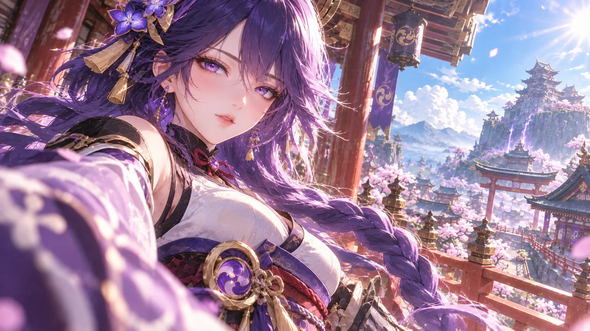

# Niji-Style Semi-Real Anime Film Portrait (Raiden Shogun)

**中文标题：** Niji 系半写实动漫电影人像·雷电将军  
**ID:** `gi25-x-1211` · **Mode:** `generate`  
**Categories:** `general`  
**Tags:** `x-twitter`, `community`, `gpt-image-2.5`, `x-direct`, `zh`



### Niji-Style Semi-Real Anime Film Portrait (Raiden Shogun)

```text
16:9横版，高精度Niji系半写实日系动漫电影摄影风格，

Niji-inspired anime aesthetics,
premium semi-realistic anime illustration,
cinematic 2.5D anime portrait,
high-end Japanese fantasy anime character art,
exquisite anime facial design,
luminous soft anime skin,
ultra-detailed expressive eyes,
fine wispy individual hair,
cinematic fashion photography,
premium painterly material rendering.

整体融合高级日系动漫美型设计、
精致半写实人物渲染、
近距离电影摄影构图与明亮真实的自然光影。

【角色主体】

画面主体为《原神》雷电将军。

一位视觉年龄25–27岁的明确成年东方动漫美型女性。

身份为掌控雷霆与永恒的稻妻最高统治者。

整体气质高贵、清冷、神秘、威严，
具有安静而强大的神明气场。

人物采用高级日系半写实动漫美型设计，
保留雷电将军标志性的发型、五官与神明礼服。

人物五官颜值与独特辨识度为最高视觉优先级。

【人物五官｜第一视觉优先级】

高贵冷艳型东方动漫美人。

脸型为精致修长的柔美鹅蛋脸，
面颊自然饱满，
下颌线柔和流畅，
下巴小巧但不过分尖锐。

面部骨骼结构自然，
具有柔软细腻的真实体积。

眉形纤细自然，
眼窝与眉骨具有精致立体结构。

双眼为深紫晶色的细长杏眼，
眼尾轻微上挑，
眼睛略大于真实人类比例，
保留成熟高级的日系动漫美型特征。

紫晶色虹膜晶莹通透，
内部具有精细放射状纹理，
瞳孔清晰，
存在丰富的自然环境高光。

上下眼睑结构完整，
睫毛纤长浓密，
眼缘具有细腻自然的湿润高光。

双眼自然凝视近处镜头，
眼神冷静、神秘，
带有轻微的高贵疏离感。

鼻梁秀挺自然，
鼻尖小巧柔和，
鼻翼结构精致。

嘴唇柔软精致，
唇色为淡玫瑰粉色，
嘴唇微微自然分开，
唇部具有细腻柔和的真实光泽。

皮肤奶白、细腻、柔软、通透。

面颊与鼻尖存在极轻微的自然血色。

眼周、鼻梁、面颊和嘴唇
具有丰富而细腻的摄影式明暗过渡。

皮肤融合高级动漫绘画美感
与真实摄影式柔和体积光影。

人物五官美丽、协调、自然，
具有成熟东方动漫女性的独特魅力。

【发型与发饰】

深紫色浓密长发。

保留雷电将军标志性的侧分刘海、
紫金花卉发饰、金色发簪
以及背后粗长麻花辫。

长发从头顶向肩颈自然垂落，
发根具有真实的蓬松度。

大量高精度独立发丝
沿着额头、耳侧与脸颊自然分布。

部分细碎发丝受到高处微风影响，
轻盈地向画面两侧飘散。

深紫色粗长麻花辫
从人物肩部向画面右下方自然延伸。

麻花辫结构清晰，
具有自然的编织层次与真实重量感。

强烈清晨阳光从画面右上方照射，
深紫色头发形成明亮的粉紫色轮廓光。

大量纤细发丝呈现半透明透光效果。

头发保留深紫色、紫罗兰色
与少量粉紫色高光层次。

整体精致、柔软、轻盈，
避免整块塑料发束。

【服装造型】

雷电将军标志性的紫黑色稻妻神明礼装。

保留经典和风衣领、
白紫色胸前衣装结构、
黑紫色装饰、
深紫色宽腰封、
金色雷电神纹与华丽金属配饰。

人物身形成熟自然，
胸部饱满圆润，
服装贴合身体形成自然协调的成年女性曲线。

胸前白紫色衣料具有精致织纹，
衣领结构自然，
保留符合服装设计的胸部轮廓。

衣服面料采用高级丝缎、
紫黑色织锦与轻薄半透明纱质。

深紫色宽腰封
采用层叠编织与精致金色纹样。

腰封中央为大型紫金色圆形雷电纹章，
配有精细金属结构与金色流苏。

肩部和宽袖具有精致的金色装饰边缘。

所有服装材质分别保留独立的反光效果。

丝缎具有明亮柔和的流动高光，
织锦具有细密真实的纹理，
金属具有精致锐利的局部反射，
轻纱具有柔和半透明层次。

服装华丽、精致、富有神明威严，
但不遮挡人物面部。

【人物姿态与表情】

雷电将军站在稻妻天守阁高层木质回廊。

身体略微向镜头侧转，
肩部自然前倾。

头部轻微倾转，
面部以三分之四角度朝向镜头。

人物从稍高的位置
自然俯视近处的摄影机。

深紫色眼睛平静凝视观众。

眉眼放松，
神情清冷、神秘、从容，
带有轻微的神明威严。

嘴唇自然微启，
表情柔和而富有生命感。

靠近摄影机的一侧肩膀
与宽大和风衣袖向前自然延伸。

宽袖进入镜头近前景，
形成富有冲击力的空间透视。

人物动作自然，
肩颈与躯干连接合理。

整体像电影摄影机
在近距离捕捉到的自然人物瞬间。

【电影摄影构图】

16:9横版。

极近距离电影人像摄影构图。

采用28–35mm广角人像的视觉透视。

摄影机位置略低于人物面部，
形成轻微仰视的近距离镜头语言。

人物位于画面左侧及中部，
面部处于画面左上方视觉中心。

头部、肩部、胸腰结构完整，
人物身体向画面下方自然延伸。

人物脸部清晰锐利，
双眼拥有极高细节完成度。

画面左下方为巨大的浅紫色和风宽袖前景。

宽袖距离镜头极近，
产生明显的广角透视放大效果。

前景衣袖自然虚化，
呈现柔和的紫色与白色高光。

人物脸部和眼睛保持最高清晰度。

深紫色粗长麻花辫
从人物肩部延伸至画面右下方。

画面右侧保留较大面积的环境空间，
完整呈现远处稻妻建筑与山峦。

形成巨大虚化前景、
清晰人物主体、
精致中景建筑与辽阔远景的多层空间关系。

整体具有强烈的电影摄影临场感，
避免普通居中角色立绘构图。

【场景环境】

稻妻天守阁外的高层木质回廊。

画面左上方与中景
呈现深色木质立柱、
传统日式横梁、
精致金色建筑装饰
与悬挂的紫色稻妻纹章旗帜。

人物身后为木质栏杆与宽阔平台。

画面右侧呈现宏大的稻妻幻想城镇。

中景具有层叠日式楼阁、
朱红色鸟居、
传统神社建筑与盛开的粉色樱花树。

远景为巨大的青灰色山峦、
山顶宏伟的稻妻天守阁建筑群、
漂浮白云与辽阔蓝天。

远处山体与建筑之间
存在少量细微的紫色雷电。

天空明亮湛蓝，
白色云层具有柔和立体的体积感。

樱花树林与传统日式建筑
形成丰富的空间层次。

远景具有自然距离感，
细节适度柔化。

环境精致壮观，
但人物五官始终为第一视觉中心。

【电影光影】

明亮清透的清晨自然光。

强烈阳光从画面右上方照射。

光线穿过深紫色发丝，
形成大量精细明亮的粉紫色边缘高光。

人物面部受到柔和自然光照射。

额头、鼻梁、鼻尖、面颊和嘴唇
形成细腻自然的皮肤高光。

眼窝、鼻翼与下颌
具有柔软而真实的立体阴影。

皮肤奶白通透，
面颊具有轻微自然血色。

紫晶色虹膜具有清澈明亮的眼神光。

深紫色头发存在丰富的明暗层次。

紫色丝缎形成强烈但自然的高光反射。

金属配饰具有精细锐利的局部闪光。

近前景衣袖产生柔和的高光虚化。

远景天空与建筑受到明亮自然阳光照射，
空气感清爽通透。

整体光影明亮、高级，
具有丰富的高光与阴影反差。

高光明亮但不过曝，
阴影细腻但不出现死黑区域。

【色彩控制】

人物头发以深紫色为主体，
保留紫罗兰色与粉紫色的自然高光层次。

服装以深紫、浅紫、黑色与金色构成。

人物皮肤独立保持奶白色，
面颊具有自然淡粉色血色。

建筑采用深木色、
朱红色与青灰色。

远景山峦呈现自然青灰色，
天空保持明亮蓝色，
云层保持自然白色。

樱花为柔和自然的粉色。

紫色雷电仅作为远景局部强调色。

人物、服装、建筑与天空
保留各自独立的固有色。

避免整个画面被紫色滤镜覆盖。

整体色彩鲜活、明亮、干净、通透，
具有丰富的冷暖色彩关系。

【最终风格锁定】

高精度Niji系半写实日系动漫电影摄影美学。

极致精美的成年东方动漫美型五官，
柔软通透的半写实动漫肌肤，
晶莹湿润的紫晶眼睛，
超高密度精细独立发丝，
高级真实丝缎与金属材质，
明亮高反差的自然电影光影，
近距离广角人像摄影透视，
巨大虚化前景与丰富空间纵深。

角色具有强烈生命感、
自然微表情与沉静神明威严。

整体保持高级2.5D动漫数字绘画质感。

不要转化为真人摄影。
不要转化为普通3D游戏人物。
不要转化为传统二维平涂动漫。

最终画面如同一部高预算日系东方幻想动画电影中，
摄影机在近距离捕捉到雷电将军
站在稻妻天守阁高处的绝美瞬间。
```

- **Recommended model:** `gpt-image-2.5-sunburst`
- **Settings:** _(defaults)_
- **Source:** [community](https://x.com/liyue_ai/status/2115794498005672269) — @liyue_ai
- **License note:** Original public X post; quoted with attribution — remix with attribution
- **Notes:** Collected directly from X; original post https://x.com/liyue_ai/status/2115794498005672269; post text names GPT Image 2.5; discovered via Bin0754/gpt-image-gallery index, prompt re-verified against the original X post via api.fxtwitter.com; verified=True; fan-art prompt for the Genshin Impact character Raiden Shogun
- **Preview:** `previews/gi25-x-1211.webp`
