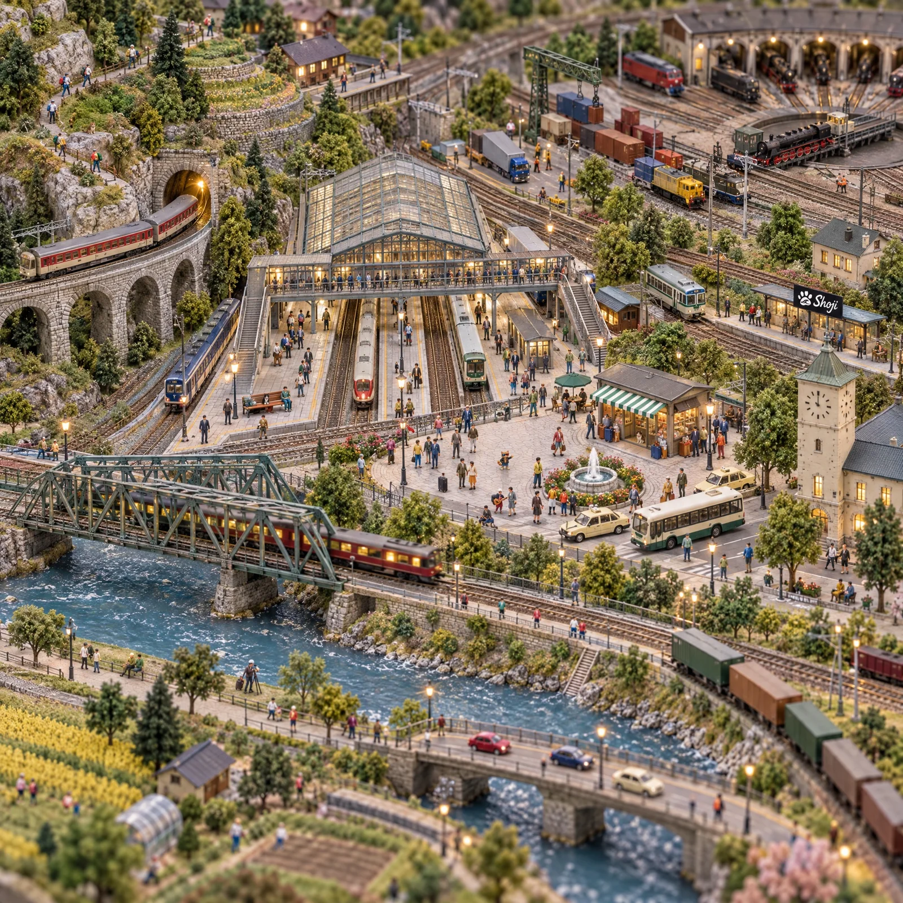

# Seek-and-Find Hand-Built N-Gauge Model Railway Town

**中文标题：** 找猫·手工 N 轨铁道模型小镇（俯瞰寻物图）  
**ID:** `gi25-x-1212` · **Mode:** `generate`  
**Categories:** `general`  
**Tags:** `x-twitter`, `community`, `gpt-image-2.5`, `x-direct`, `en`



### Seek-and-Find Hand-Built N-Gauge Model Railway Town

```text
A photograph of a huge, lovingly hand-built Japanese N-gauge model railway layout, square 1:1, in the spirit of a classic seek-and-find book: seen from an extremely high and wide oblique angle, as if from a ladder above the whole layout, so that everything is tiny and there is an enormous amount to look at. The layout is divided into clear districts by tracks, a river and hills. Left: a plaster mountain with a stone-arch viaduct, a lit tunnel mouth of light grey stonework (never black), terraced fields, hiking paths and a small mountain village with a wooden station. Centre: a big terminal station with a glass-roofed train shed, several platforms with waiting passengers, a footbridge across the tracks, a station plaza with a fountain, buses and taxis, a small kiosk with a green-and-white striped awning, and a clock tower. Right: a freight yard with a crane and plain unmarked containers, a roundhouse and turntable with steam locomotives, and a small unmanned halt with a platform shelter. Lower part of the picture: a river with a steel girder rail bridge and a road bridge, riverbank paths with strolling people and a photographer, fields, a road with cars, rows of trees and passing trains. About eight model trains (an express, a local train, freight trains, a steam train, a tram) run on the tracks. About 180 minuscule hand-painted figurines of people, each doing something: passengers, a station master, porters with luggage carts, people queueing at the kiosk, workers in the freight yard, hikers, farmers, strollers, children. A standing person is only about 3% of the picture height.

The look is the point: it must look like a real photograph of a handmade model railway: static-grass flocking, foam lichen trees, painted plaster hills and rock faces, ballasted track, plastic buildings with a slight sheen, tiny figurines with faces made of dabs of paint, soft studio lighting and a true tilt-shift miniature look: sharp in the middle band, with a gentle blur only in the top and bottom 12%. Not a real city, not a flat illustration, not a CG render. The picture fills the whole frame to all four edges: no table edge, no room, no hands, no frame, no border, no caption.

Exactly one small logo: a small black station name board on the little unmanned halt in the right half of the picture, about 4% of the picture width, with a white paw print whose big pad holds a swirling ocean wave, and the word "Shoji" in white cursive brush lettering to its right. Apart from that board there are no letters, words, numbers or digits anywhere: no station names, no destination boards, no timetables, no train numbers, no advertisements, no signs; the clock face has plain tick marks only.

THE ONLY ANIMALS IN THE WHOLE PICTURE ARE FOUR CATS, and there are never more than four. Not five, not a spare one, and no look-alike twin of any cat. No other animal at all: no cows, horses, sheep, ducks, birds, dogs or fish, no animal figurines or animal pictures. No person wears an animal head or costume. The four cats are tiny hand-painted model figurines like the people, all in the upper and middle part of the picture: their feet are between about 15% and 60% of the picture height measured from the top, and NONE is in the lower third (the lower third is only river, bridges, riverbank paths, fields, roads, trees and trains). Each cat is in the open, never hidden behind anything. The three real cats are each TINY: only about 0.7% of the picture height (about 14 pixels in a 2048-pixel-high picture), about a quarter of the height of a standing person, and wear a thin red collar with a tiny gold bell:
1. a black-and-white "hachiware" cat (black head and back, a white blaze splitting the face, white chest and paws) sitting upright on a platform bench of the central station, in the left half;
2. a brown mackerel tabby (warm brown fur with dark stripes, white muzzle and chest) sitting upright on a flat grey rock on the grassy hillside above the tunnel beside the mountain path, upper left;
3. a calico cat (white with orange and black patches) sitting upright in the doorway of the station kiosk with the striped awning, right of centre;
4. Shoji Cat, an upright standing orange tabby cat figurine about three heads tall in a black leather jacket, denim shorts, cream sneakers and black wayfarer sunglasses with blue and red lenses, standing in the crowd on the station plaza with one arm pointing, in the middle of the picture, about one and a half times as tall as each of the other three cats.
No dark round objects, no black tunnel mouths, no piles of black cloth or coal, and no dark animal-like shapes that could be mistaken for a cat. No watermark.
```

- **Recommended model:** `gpt-image-2.5-sunburst`
- **Settings:** _(defaults)_
- **Source:** [community](https://x.com/Shoji_ai/status/2115753009506345295) — @Shoji_ai
- **License note:** Original public X post; quoted with attribution — remix with attribution
- **Notes:** Collected directly from X; prompt posted as the author's own reply https://x.com/Shoji_ai/status/2115753009506345295 to https://x.com/Shoji_ai/status/2115753007606325367, which carries the images; GPT Image 2.5 is named in the parent post; discovered via Bin0754/gpt-image-gallery index, prompt re-verified against the original X post via api.fxtwitter.com; verified=True
- **Preview:** `previews/gi25-x-1212.webp`
