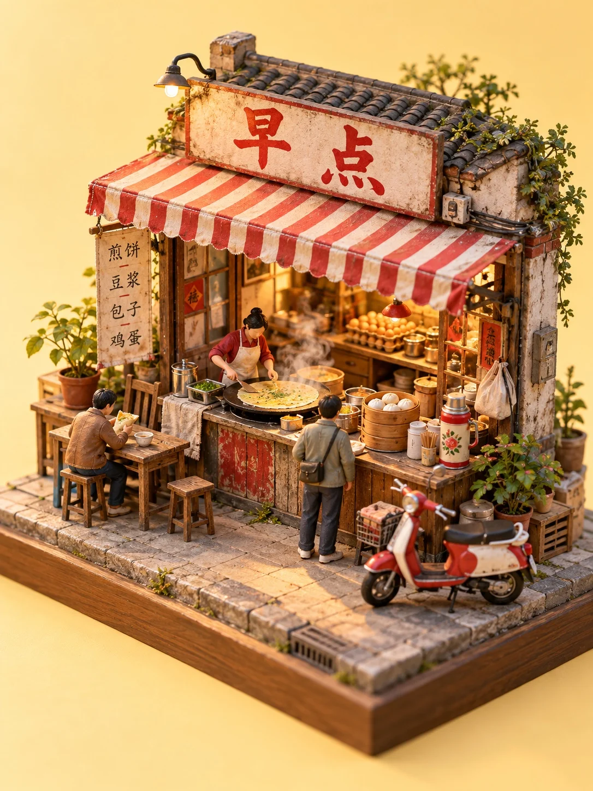

# Tilt-Shift Miniature Chinese Street-Corner Shop (Jianbing Stall)

**中文标题：** 微缩模型街角小店·早点煎饼摊  
**ID:** `gi25-x-1219` · **Mode:** `generate`  
**Categories:** `general`  
**Tags:** `x-twitter`, `community`, `gpt-image-2.5`, `x-direct`, `en`



### Tilt-Shift Miniature Chinese Street-Corner Shop (Jianbing Stall)

```text
Vertical 3:4 miniature diorama photo of a tiny Chinese street-corner shop built as a handmade scale model, sitting on a square wooden display base about 20 cm wide, seen from a 45-degree isometric angle slightly above. Real macro photography with tilt-shift shallow depth of field, crisp detail in the center and soft blur at the edges. Handcrafted materials: painted resin, tiny wooden planks, real fabric awnings, miniature potted plants, hand-lettered paper signs, small warm LED lights inside the shop. A few tiny painted figurines about 2 cm tall, plain everyday clothes, faces too small to see detail. Clean seamless plain background in a soft matching color, soft studio key light from the upper left. Cozy, detailed, tidy, no real brands, no logo, no watermark. Shop: a breakfast jianbing stall with a red-and-white striped awning, a round iron griddle with a half-made crepe, stacks of egg cartons, a thermos and steamed buns in a bamboo steamer, a tiny scooter parked in front. Time: early morning, pale golden sunrise light, a thin wisp of steam rising. Palette: tomato red, cream, warm yellow. Background: soft butter yellow. Shop sign reads 早点.
```

- **Recommended model:** `gpt-image-2.5-sunburst`
- **Settings:** _(defaults)_
- **Source:** [community](https://x.com/static_stare/status/2115708621149389198) — @static_stare
- **License note:** Original public X post; quoted with attribution — remix with attribution
- **Notes:** Collected directly from X; original post https://x.com/static_stare/status/2115708621149389198; post text names GPT Image 2.5; discovered via Bin0754/gpt-image-gallery index, prompt re-verified against the original X post via api.fxtwitter.com; verified=True; prompt for image 1 of 4 (the author shares the other three on request); preview is image 1
- **Preview:** `previews/gi25-x-1219.webp`
