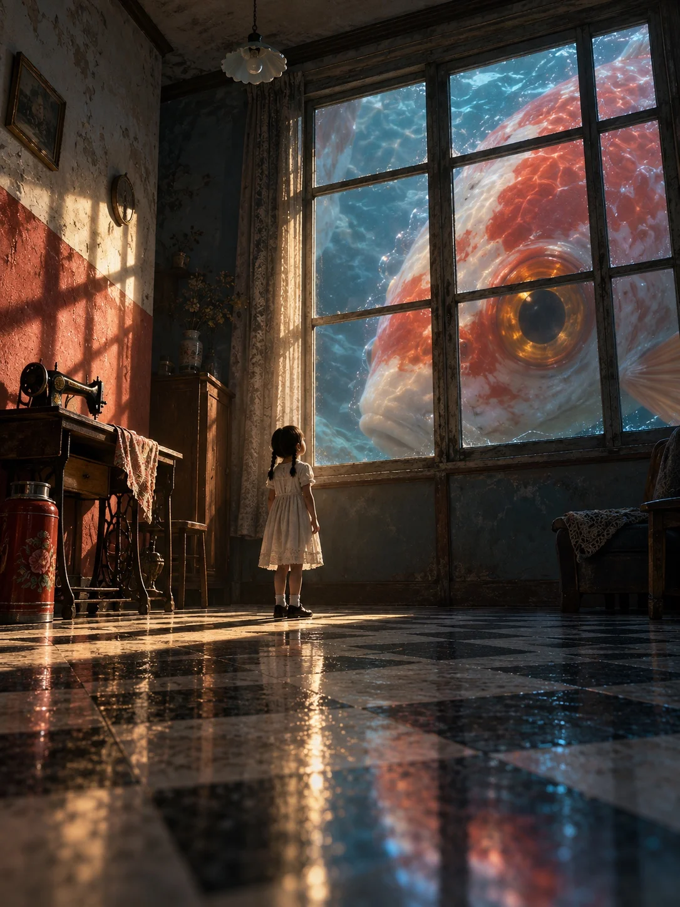

# Surreal Scale-Contrast Scene: Giant Goldfish Outside an Old Apartment

**中文标题：** 超现实尺度反差·老楼窗外的巨型金鱼  
**ID:** `gi25-x-1222` · **Mode:** `generate`  
**Categories:** `general`  
**Tags:** `x-twitter`, `community`, `gpt-image-2.5`, `x-direct`, `zh`



### Surreal Scale-Contrast Scene: Giant Goldfish Outside an Old Apartment

```text
Create an image with the following visual system. Replace the subject as specified.

Visual system (light, color, composition, medium, mood):
一幅竖幅 3:4 的超现实电影感画面，像一部电影里定格的一帧。核心是尺度反差：一个普通的、很小的人物，只占画面高度的十分之一左右，背影或侧影，看不清五官，面对一个大得不可能的东西，这个东西被画框裁切，体积溢出画面边界。场景本身是真实可信的日常地方，只有这一处不可能，其余一切照常、安静，没有人惊慌。机位低，广角，轻微仰视，用前景、人物、巨物三层拉开纵深，并留出一大块低细节的空白区域让画面透气。光是电影布光：只有一处明确的主光源，低角度硬光、逆光或透射光，在环境里投下清楚的光影形状，其余区域沉进有颜色的阴影，暗部保留层次，不是死黑。颜色用大面积的冷色（灰青、墨蓝、深绿）包住一小块集中的暖色焦点（琥珀、朱红、奶油黄），冷暖面积大约八比二。材质写实：墙面斑驳，地面微湿反光，衣服有织物纹理，巨物表面有可信的微质感。完成态是写实电影合成加数字绘景，带细胶片颗粒，远景轻微柔焦和空气透视。气氛寂静、神秘、有点孤独，带一点童话感。画面里不要任何文字、招牌、广告牌、品牌、logo、站名、签名或水印，也不要可识别的真实地标。

New subject:
一间九十年代老居民楼的客厅，下午。左侧是刷成朱红色的墙裙和斑驳的白墙，地面是黑白相间的水磨石格子地砖，墙边放着一台老式缝纫机和一只红色铁皮暖水瓶。右侧整面老式木框窗户外，一条巨大的红白相间金鱼正贴着窗户缓缓游过，只露出半个头和一只金色的大眼睛，单片鱼鳞都比一格窗玻璃还大，窗外的空气像水一样泛着波光。屋子中间站着一个扎两个小辫、穿白色连衣裙的小女孩，仰头看着窗外的大眼睛，只占画面高度的八分之一。低角度的暖白阳光从左上方斜射进来，在红墙和地砖上投下清楚的窗格影子；金鱼身上反着冷蓝的水光，屋子深处沉进墨蓝色阴影。
```

- **Recommended model:** `gpt-image-2.5-sunburst`
- **Settings:** _(defaults)_
- **Source:** [community](https://x.com/static_stare/status/2116073221820764241) — @static_stare
- **License note:** Original public X post; quoted with attribution — remix with attribution
- **Notes:** Collected directly from X; original post https://x.com/static_stare/status/2116073221820764241; post text names GPT Image 2.5; discovered via Bin0754/gpt-image-gallery index, prompt re-verified against the original X post via api.fxtwitter.com; verified=True; prompt for image 1 of 4 (the author shares the other three on request); preview is image 1
- **Preview:** `previews/gi25-x-1222.webp`
