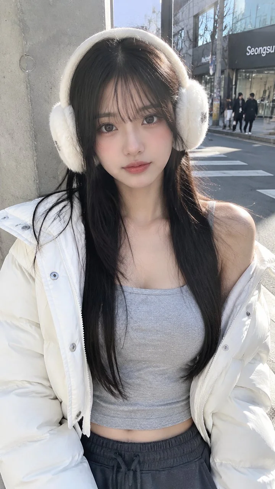

# Seongsu-dong Winter Street Smartphone Travel Snapshot

**中文标题：** 圣水洞冬日街角手机旅拍  
**ID:** `gi25-x-1226` · **Mode:** `generate`  
**Categories:** `general`  
**Tags:** `x-twitter`, `community`, `gpt-image-2.5`, `x-direct`, `en`



### Seongsu-dong Winter Street Smartphone Travel Snapshot

```text
A real vertical smartphone travel snapshot of a young adult Korean woman in her early 20s at a trendy Seongsu-dong street corner, framed from the top of her fluffy cream-white faux-fur earmuffs to the lower waist in a close front-facing medium portrait. She stands or leans near a minimalist industrial concrete pillar, very close to the camera, at sidewalk.

She wears a light heather-grey fitted thermal square-neck ribbed crop top and an oversized puffy cloud-white cropped down jacket casually slipping off her left shoulder, with visible micro-matte nylon fabric texture, fluffy down volume, clean metal snap-buttons, hidden silver zipper pull details, and a faint hint of toned midriff above a wide-leg charcoal sweatpants waistband.

Her hair is jet black, long and silky straight with face-framing layered cut (hush cut), loosely falling over both shoulders with a few flyaway strands caught in the cold winter air. She has a refined V-line jawline, delicate Korean facial features, clear dewy glass-skin makeup with natural flushed-cold pink cheeks, glossy muted rose water-tinted lips, and a calm, quiet expression with lips closed.

Her eyes look gently and warmly straight into the camera from beneath the soft shadow of her bangs. Keep a tiny metallic silver designer badge detail on the outer headband of the plush earmuffs, not flipped and not oversized. Crisp winter afternoon sunlight from the upper right creates sharp rim highlights on the jacket and cool natural outdoor fill shadows.

Natural skin texture with visible micro-pores and genuine skin luster, slightly imperfect casual framing, subtle phone sensor compression, deep smartphone depth of field. Avoid plastic skin, studio polish, heavy makeup, exaggerated proportions, wrong logo, app UI, cartoon or CGI style.
```

- **Recommended model:** `gpt-image-2.5-sunburst`
- **Settings:** _(defaults)_
- **Source:** [community](https://x.com/yaokict/status/2116102023632568529) — @yaokict
- **License note:** Original public X post; quoted with attribution — remix with attribution
- **Notes:** Collected directly from X; original post https://x.com/yaokict/status/2116102023632568529; post text names GPT Image 2.5; discovered via Bin0754/gpt-image-gallery index, prompt re-verified against the original X post via api.fxtwitter.com; verified=True
- **Preview:** `previews/gi25-x-1226.webp`
