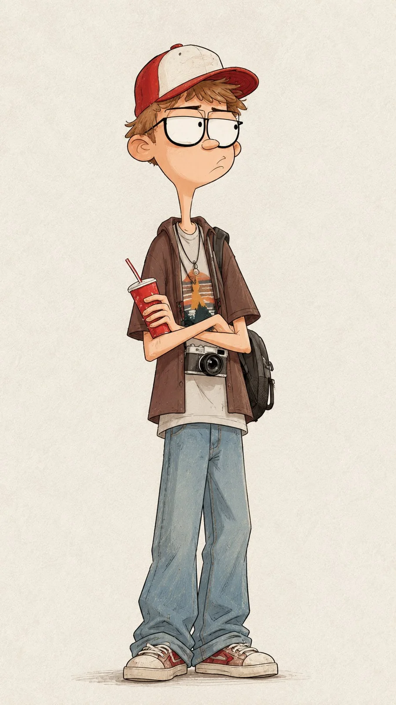

# Hand-Drawn Nostalgic Cartoon Character (Quirky Teen Boy)

**中文标题：** 手绘怀旧动画角色·怪趣眼镜少年  
**ID:** `gi25-x-1229` · **Mode:** `generate`  
**Categories:** `general`  
**Tags:** `x-twitter`, `community`, `gpt-image-2.5`, `x-direct`, `en`



### Hand-Drawn Nostalgic Cartoon Character (Quirky Teen Boy)

```text
Create a highly detailed, hand-drawn 2D cartoon character illustration in a charming, nostalgic animated movie style.

Character: A quirky, slim teenage boy with an oversized head, a long narrow neck, slightly messy light brown hair, large rectangular black-framed glasses, a small nose, and a subtle awkward expression. His eyes are wide and slightly looking to the side, giving him a thoughtful, curious personality.

Outfit: A vintage red and cream baseball cap, oversized brown short-sleeve shirt worn open over a light grey graphic T-shirt, faded blue jeans, and a casual backpack. A small vintage camera hangs around his neck. He holds a red takeaway soda cup with a straw in one hand while casually crossing his arms.

Art Style: Beautiful hand-drawn 2D animation, expressive cartoon anatomy, slightly exaggerated proportions, delicate sketchy black outlines, soft watercolor textures, subtle colored pencil shading, imperfect hand-painted details, warm muted colors, and a nostalgic illustrated storybook aesthetic.

Background: Minimal plain warm ivory textured paper background with subtle grain, no distracting elements.

Composition: Full-body vertical character portrait, character standing naturally in the center, relaxed posture, entire outfit visible, generous negative space around the character.

Lighting and Texture: Soft natural lighting, gentle shadows, matte paper texture, slightly imperfect traditional illustration finish.

Aspect Ratio: 9:16 portrait.

Quality: Extremely detailed character design, polished traditional 2D animation illustration, consistent anatomy, beautiful facial expression, no photorealism, no 3D rendering, no text, no watermark.
```

- **Recommended model:** `gpt-image-2.5-sunburst`
- **Settings:** _(defaults)_
- **Source:** [community](https://x.com/Ziha_ai/status/2116117087206941048) — @Ziha_ai
- **License note:** Original public X post; quoted with attribution — remix with attribution
- **Notes:** Collected directly from X; original post https://x.com/Ziha_ai/status/2116117087206941048; post text names GPT Image 2.5; discovered via Bin0754/gpt-image-gallery index, prompt re-verified against the original X post via api.fxtwitter.com; verified=True
- **Preview:** `previews/gi25-x-1229.webp`
