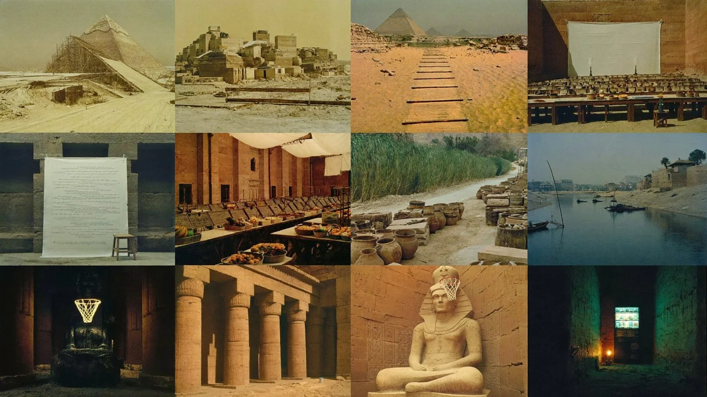

# Eight-Panel 90s Film Location Reference Board (Ancient Egypt)

**中文标题：** 八宫格 90 年代胶片场景参考板（古埃及）  
**ID:** `gi25-x-1233` · **Mode:** `generate`  
**Categories:** `general`  
**Tags:** `x-twitter`, `community`, `gpt-image-2.5`, `x-direct`, `en`



### Eight-Panel 90s Film Location Reference Board (Ancient Egypt)

```text
Location reference board, 16:9, eight panels in a 4x2 grid, mid-90s 35mm film look, warm faded colour, grain:
1. Pyramid under construction with a wooden scaffolding ramp.
2. Plank road beside cut limestone blocks.
3. Scribes' hall with a white photo backdrop and a stool.
4. Ancient market with linen awnings and clay pots.
5. Nile riverbank with feluccas and palms.
6. Temple courtyard with giant carved columns.
7. Colossal pharaoh statue head with a basketball hoop on its headdress.
8. Dark tomb corridor with a glowing vending machine.
No people, no text.
```

- **Recommended model:** `gpt-image-2.5-sunburst`
- **Settings:** _(defaults)_
- **Source:** [community](https://x.com/socialwithaayan/status/2116136867339067758) — @socialwithaayan
- **License note:** Original public X post; quoted with attribution — remix with attribution
- **Notes:** Collected directly from X; original post https://x.com/socialwithaayan/status/2116136867339067758; post text names GPT Image 2.5; discovered via Bin0754/gpt-image-gallery index, prompt re-verified against the original X post via api.fxtwitter.com; verified=True; step of a GPT Image 2.5 Sunburst short-film workflow thread
- **Preview:** `previews/gi25-x-1233.webp`
