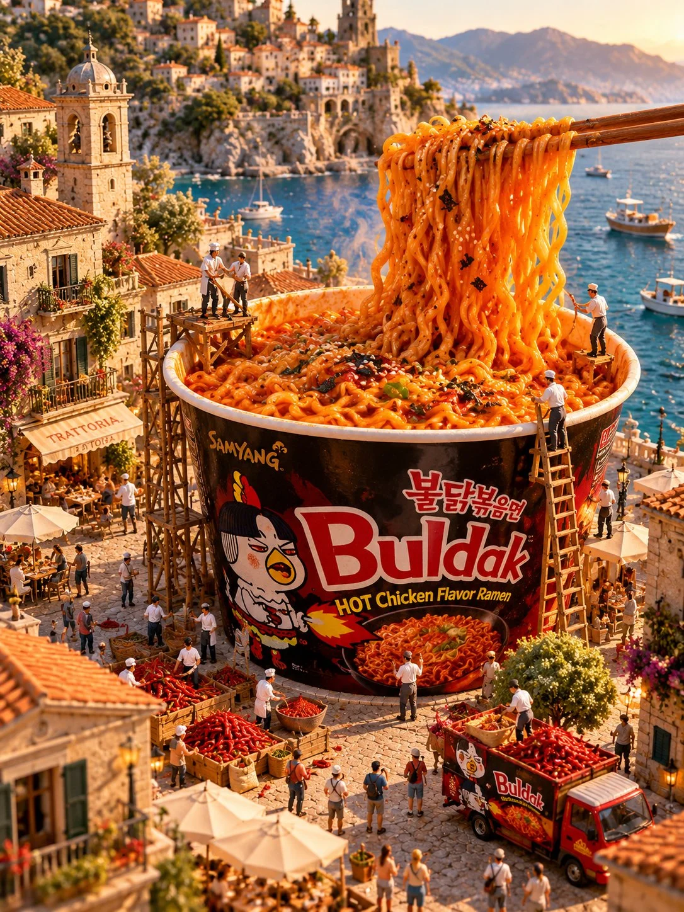

# Surreal Giant Food Over a Miniature Mediterranean Town

**中文标题：** 超现实巨型美食×地中海微缩小镇  
**ID:** `gi25-x-1237` · **Mode:** `generate`  
**Categories:** `general`, `ecommerce`  
**Tags:** `x-twitter`, `community`, `gpt-image-2.5`, `x-direct`, `en`



### Surreal Giant Food Over a Miniature Mediterranean Town

```text
UNIVERSAL PROMPT -SURREAL GIANT FOOD MINIATURE WORLD | 3:4

Create an extraordinarily detailed, whimsical surrealist miniature world featuring [FOOD / DISH / CUISINE] as the central subject, transformed into an enormous, larger-than-life installation within a beautiful Mediterranean-inspired town.

1. MAIN SUBJECT — MONUMENTAL FOOD

Transform the selected food into a gigantic, visually recognizable centerpiece. Preserve its authentic ingredients, textures, colors, shape, and distinctive details while dramatically exaggerating its scale.

The food should interact naturally with the surrounding environment. For example:

- Giant pizza slices resting across a sunlit stone plaza.
- Oversized pasta emerging from an elegant public fountain.
- Monumental sushi displayed along a picturesque waterfront.
- Enormous pastries, tacos, desserts, or other dishes integrated into village streets and public squares.

The food must look incredibly appetizing, tactile, realistic, and visually impressive.

2. ENVIRONMENT — MEDITERRANEAN MINIATURE TOWN

Build a beautiful, richly detailed Mediterranean setting featuring warm terracotta rooftops, historic European architecture, narrow cobblestone streets, stone fountains, charming balconies, flower-covered buildings, outdoor cafés, and picturesque coastal scenery.

Make the environment feel like a beautifully constructed miniature architectural diorama, with the oversized food seamlessly incorporated into the landscape.

3. SCALE CONTRAST — TINY HUMAN FIGURES

Populate the environment with tiny realistic human figures interacting with the gigantic food.

Include miniature pedestrians, chefs, vendors, café visitors, delivery workers, and curious onlookers. Some should walk around the food, examine it, serve it, or interact with it.

The dramatic difference between the enormous food and miniature people must immediately communicate the surreal scale of the scene.

4. VISUAL STYLE — PHOTOREALISTIC SURREALISM

Create a sophisticated blend of photorealistic 3D rendering, miniature architectural photography, whimsical surrealism, and premium cinematic environmental art.

Emphasize:

- Extremely realistic food textures and ingredients.
- Intricate architectural details and tiny environmental elements.
- Natural material textures, stone, brick, terracotta, and wood.
- Convincing shadows, reflections, and atmospheric depth.
- Beautifully composed miniature-world perspective.
- Exceptional realism with a playful, imaginative concept.

Avoid cartoon aesthetics, flat illustrations, plastic-looking food, or artificial-looking environments.

5. LIGHTING & COLOR

Use warm golden-hour sunlight with soft directional shadows, beautiful ambient illumination, and subtle atmospheric depth.

Create a rich Mediterranean color palette featuring warm orange, terracotta, golden yellow, creamy whites, natural greens, and coastal blues.

The overall atmosphere should feel inviting, magical, nostalgic, and cinematic.

6. COMPOSITION & CAMERA

Vertical 3:4 composition.

Use an elevated three-quarter perspective or cinematic aerial-oblique viewpoint, allowing the viewer to appreciate the enormous food centerpiece and the surrounding miniature town.

Make the main food subject immediately recognizable and visually dominant while retaining enough environmental detail to establish the miniature world.

Use sophisticated depth of field, realistic perspective, and professional architectural photography composition.

FINAL RESULT

An astonishingly detailed, photorealistic surreal miniature world where enormous [FOOD / DISH] transforms an enchanting Mediterranean town into a magical culinary landscape.

The result should look like a premium, professionally art-directed miniature-world photograph, with extraordinary scale contrast, appetizing food realism, cinematic lighting, and imaginative environmental storytelling.
```

- **Recommended model:** `gpt-image-2.5-sunburst`
- **Settings:** _(defaults)_
- **Source:** [community](https://x.com/Goodmanprotocol/status/2116179318384869491) — @Goodmanprotocol
- **License note:** Original public X post; quoted with attribution — remix with attribution
- **Notes:** Collected directly from X; original post https://x.com/Goodmanprotocol/status/2116179318384869491; post text names GPT Image 2.5; discovered via Bin0754/gpt-image-gallery index, prompt re-verified against the original X post via api.fxtwitter.com; verified=True
- **Preview:** `previews/gi25-x-1237.webp`
