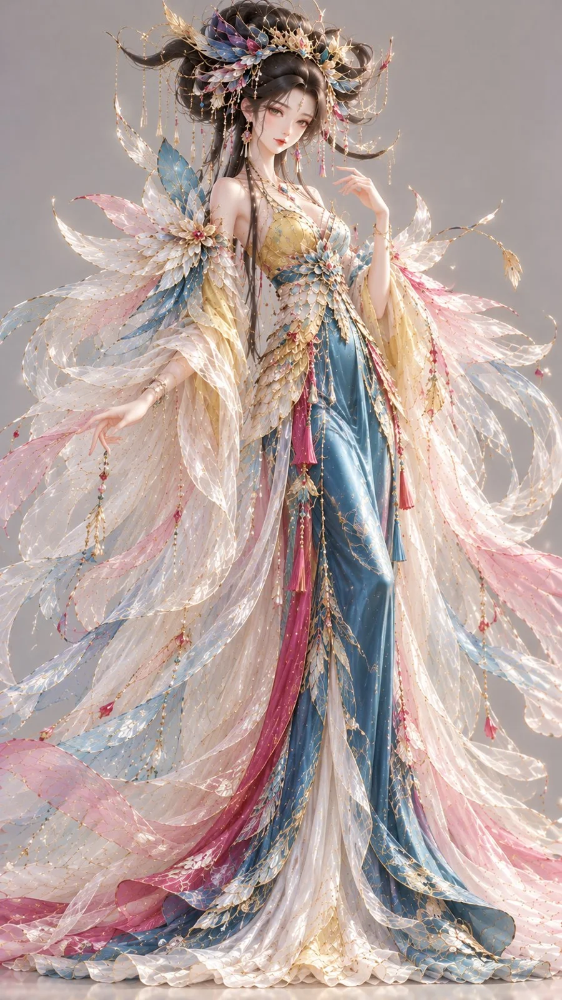

# Golden-Feather Stylized 3D Oriental Fantasy Character

**中文标题：** 金羽幻梦·风格化 3D 东方幻想角色  
**ID:** `gi25-x-1239` · **Mode:** `generate`  
**Categories:** `general`  
**Tags:** `x-twitter`, `community`, `gpt-image-2.5`, `x-direct`, `zh`



### Golden-Feather Stylized 3D Oriental Fantasy Character

```text
9:16竖版，高精度风格化3D东方幻想女性角色原型，动画电影级CG人物设计，鲜艳中国色，轻盈梦幻的羽纱幻想时装。

人物设定： 一位24–27岁的成年东方幻想女性，精致灵动的东方动漫化五官，小巧鹅蛋脸，微微上扬的清亮杏眼，自然秀气的鼻唇。肌肤白皙细腻，具有柔和真实的生命感。颈部修长，肩膀纤窄，腰身纤细，身形异常高挑但协调优雅。

自然表情： 眉毛自然舒展，一侧嘴角轻轻扬起，眼睛里带有愉快而好奇的神采，表情略带俏皮。头部自然微微侧转，颈部与肩线保持舒适，避免夸张眨眼、僵硬假笑。

发型雕塑： 乌黑浓密长发在头顶形成巨大的风檐式大发髻。发束分成数层宽阔弧形，自头顶向左右两侧翻卷展开，如被风托起的层层飞檐，具有非常清晰的高低错落结构。部分细长发束沿两侧垂落。发髻间镶嵌少量霁蓝色细羽形珐琅、玫红小宝石与极细金丝流苏。

服饰设计： 身穿鹅黄色修身东方幻想短上衣，采用柔和交领、窄长袖与精致短腰封，衣身贴合自然体态，下摆连接高腰霁蓝色修长直筒裙。

裙身以纤长纵向线条为主，一侧加入不对称玫红丝绸裙片，形成鲜明的视觉节奏。

肩背与袖口延伸出多层极其细腻的半透明羽纱披饰，羽纱沿身体两侧呈细长弧形舒展，形成轻盈而巨大的外围轮廓，腰部和主裙仍然清晰可见。

材质细节： 鹅黄短上衣使用高密度柔亮真丝，微细的织物纹理清晰。霁蓝主裙采用流动光泽的缎面织物，局部有细密金丝羽纹。

羽纱由纤细柔软的羽丝与透明幻彩薄膜纤维交织组成，具有可辨识的柔软纤维边缘和轻盈分叉结构。羽纱表面在不同角度产生非常细微的蓝紫、粉金、浅绿色干涉反射，但仅出现在局部材料，不改变主裙原本颜色。

羽纱根部缝制细小珍珠和金色珠链，连接处精巧自然。

整体轮廓： 顶部夸张的横向风檐大发髻，中段极度纤细的修身短衣与高腰长裙，外围羽纱形成轻柔展开的翼状曲线。整体富有速度感、轻盈感和优雅的艺术比例。

鹅黄用于修身上衣，霁蓝用于主裙，玫红用于局部裙片与饰件，月白用于透明羽纱基底。鲜艳干净，避免全局虹彩罩染。

高精度3D CG渲染，真实细密发丝、柔亮丝绸、细致羽丝、透明幻彩纤维、珍珠和精工金属连接件。明亮影棚柔光，中性浅暖灰背景，完整全身展示。

避免真实鸟类翅膀、廉价塑料羽毛、普通仙侠服饰、幼态脸、夸张动漫表情、衣料颜色混杂、文字与水印。
```

- **Recommended model:** `gpt-image-2.5-sunburst`
- **Settings:** _(defaults)_
- **Source:** [community](https://x.com/liyue_ai/status/2116194250492924315) — @liyue_ai
- **License note:** Original public X post; quoted with attribution — remix with attribution
- **Notes:** Collected directly from X; original post https://x.com/liyue_ai/status/2116194250492924315; post text names GPT Image 2.5; discovered via Bin0754/gpt-image-gallery index, prompt re-verified against the original X post via api.fxtwitter.com; verified=True
- **Preview:** `previews/gi25-x-1239.webp`
