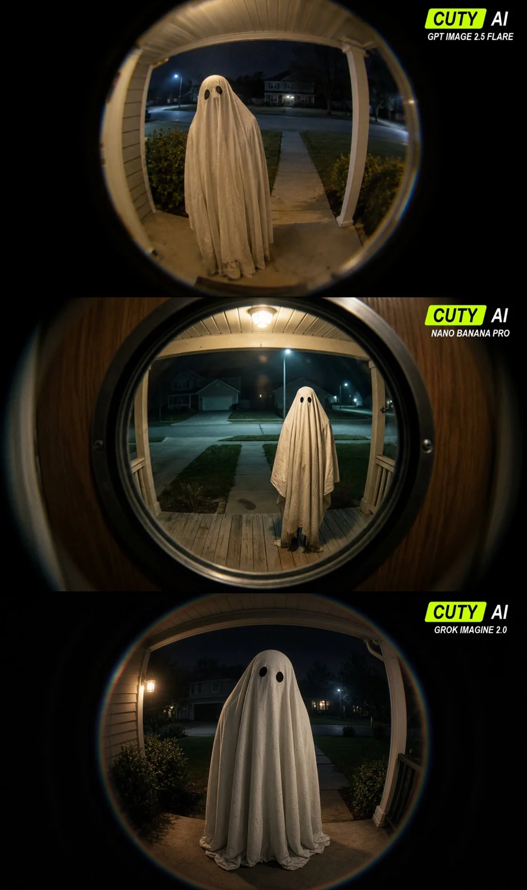

# Halloween Night Front-Door Peephole View

**中文标题：** 万圣夜猫眼视角·门外来客  
**ID:** `gi25-x-1240` · **Mode:** `generate`  
**Categories:** `general`  
**Tags:** `x-twitter`, `community`, `gpt-image-2.5`, `x-direct`, `en`



### Halloween Night Front-Door Peephole View

```text
A realistic photograph seen directly through the optical peephole of the FRONT DOOR of an American suburban detached house at night. The viewer is inside the house, looking OUTSIDE. Beyond the door is an open-air covered front porch and a typical American front yard: a concrete path leading across a lawn toward a quiet residential street, a driveway off to one side, shrubs beside the porch, and a neighboring detached house faintly visible across the street. NOT an apartment hallway, enclosed corridor, or interior room.

About one meter outside the front door, a single adult-height ghost stands on the porch facing the peephole, head slightly tilted. An old opaque white cotton bedsheet completely covers its body, with believable weight, fine fabric texture, irregular folds and a slightly dirty hem touching the porch floor. Only two roughly cut black eye holes; no visible face, skin or glowing eyes. Hands hidden beneath the sheet. It stands physically on the ground with a plausible contact shadow; no floating or transparency.

Authentic optical door-peephole view: a large circular image centered within a 16:9 landscape frame, surrounded by deep black optical vignette, filling most of the frame height. Strong natural fisheye barrel distortion bends porch posts, roof edges and the walkway near the image perimeter. Center relatively sharp, edges softly blurred with slight chromatic aberration. We see THROUGH the peephole, not a picture OF a door or peephole. No observer, camera or phone visible.

One ordinary porch light casts uneven warm light onto the sheet and porch boards. Beyond the porch, the yard is dim, with weak cool streetlight. Natural low-light noise, limited dynamic range, imperfect exposure, slightly off-center composition. An unsettling everyday snapshot, not a polished horror movie. Real materials, coherent perspective and shadows. No fog, smoke, neon, dramatic cinematic lighting, CGI, illustration, text, timestamps, logos or watermarks. Landscape 16:9.
```

- **Recommended model:** `gpt-image-2.5-flare`
- **Settings:** _(defaults)_
- **Source:** [community](https://x.com/heyitskevinai/status/2116232866631917896) — @heyitskevinai
- **License note:** Original public X post; quoted with attribution — remix with attribution
- **Notes:** Collected directly from X; prompt posted as the author's own reply https://x.com/heyitskevinai/status/2116232866631917896 to https://x.com/heyitskevinai/status/2116232858880868785, which carries the images; GPT Image 2.5 is named in the parent post; discovered via Bin0754/gpt-image-gallery index, prompt re-verified against the original X post via api.fxtwitter.com; verified=True; parent post names GPT Image 2.5 Flare; preview is the parent post image
- **Preview:** `previews/gi25-x-1240.webp`
