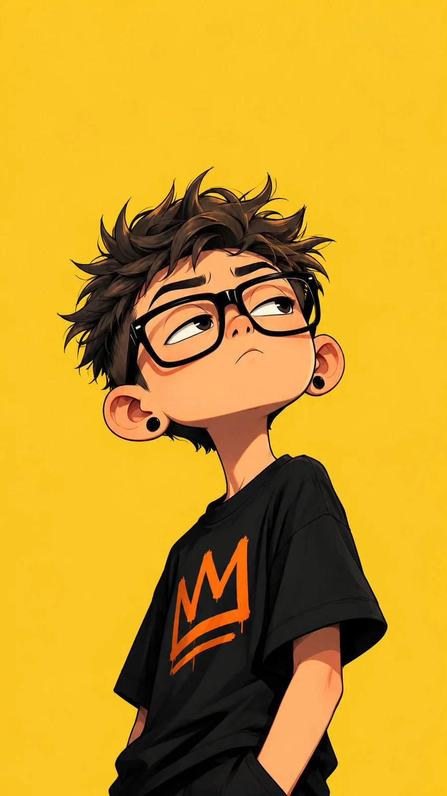

# Edgy Graphic-Novel Cartoon Character

**中文标题：** 潮酷图像小说风卡通角色  
**ID:** `gi25-x-1241` · **Mode:** `generate`  
**Categories:** `general`  
**Tags:** `x-twitter`, `community`, `gpt-image-2.5`, `x-direct`, `en`



### Edgy Graphic-Novel Cartoon Character

```text
Create a highly detailed, hand-drawn 2D cartoon character illustration in a stylish, edgy, modern animated graphic novel aesthetic.

Character: A quirky young man with an oversized head, slim body, slightly messy spiky hair, thick oversized black glasses, small black ear studs, and a confident, slightly unimpressed expression. Exaggerated facial features with expressive eyes, a small nose, and a subtle smirk.

Pose: Waist-up portrait, body turned slightly sideways, head tilted upward, eyes looking off to the side, relaxed and casual posture.

Outfit: Oversized black streetwear T-shirt with bold orange graphic lettering, natural fabric folds, and subtle shading.

Art Style: Clean bold black ink outlines, exaggerated cartoon proportions, smooth cel shading, warm skin tones, crisp highlights, subtle textured brushwork, polished hand-drawn animation aesthetic.

Background: Solid vibrant mustard yellow, minimal and uncluttered, with generous negative space around the character.

Composition: Vertical 9:16 poster, character positioned in the center, slightly below the middle, head and upper torso fully visible.

Quality: High-resolution digital illustration, professional character design, expressive personality, consistent linework, cinematic lighting.

No watermark, no extra objects, no border, no photorealism.
```

- **Recommended model:** `gpt-image-2.5-sunburst`
- **Settings:** _(defaults)_
- **Source:** [community](https://x.com/Ziha_ai/status/2116358392579338599) — @Ziha_ai
- **License note:** Original public X post; quoted with attribution — remix with attribution
- **Notes:** Collected directly from X; original post https://x.com/Ziha_ai/status/2116358392579338599; post text names GPT Image 2.5; discovered via Bin0754/gpt-image-gallery index, prompt re-verified against the original X post via api.fxtwitter.com; verified=True
- **Preview:** `previews/gi25-x-1241.webp`
