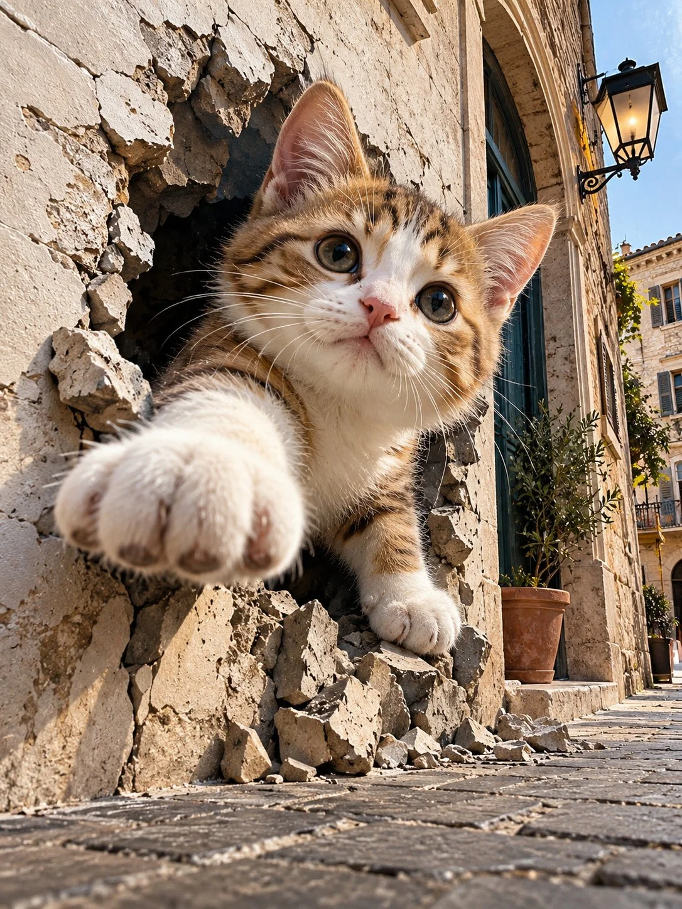

# Trompe-l'Œil 3D Optical Illusion Brand Visual

**中文标题：** 错视 3D 破框品牌视觉  
**ID:** `gi25-x-1242` · **Mode:** `generate`  
**Categories:** `general`, `poster-typography`  
**Tags:** `x-twitter`, `community`, `gpt-image-2.5`, `x-direct`, `en`



### Trompe-l'Œil 3D Optical Illusion Brand Visual

```text
UNIVERSAL PROMPT - MAGICAL TROMPE-L'ŒIL 3D OPTICAL ILLUSION

[SUBJECT / THEME]

Create an extraordinary magical trompe-l'œil optical illusion featuring [SUBJECT / THEME], designed to create a breathtaking visual effect that appears to break through the boundaries between the depicted surface and the real world.

Make the main subject appear to dramatically emerge from the surface into the surrounding environment, creating an astonishing illusion of extreme three-dimensional depth and physical presence.

Seamlessly blend fantasy with reality using hyperrealistic textures, perfectly aligned perspective, natural environmental lighting, precisely rendered cast shadows, dramatic scale, and realistic spatial integration.

Set the scene within a photorealistic urban or interior environment. Make the subject appear physically integrated into its surroundings, as though it is genuinely breaking through the architectural surface.

VISUAL STYLE: Magical realism, hyperrealistic trompe-l'œil, extreme 3D depth, seamless fantasy-to-reality transition, cinematic atmosphere, photorealistic rendering, intricate details, realistic lighting and shadows, surreal yet believable composition, and astonishing visual impact.

FINAL RESULT: An exceptionally convincing optical illusion that makes the subject appear physically present in the real world, making it almost impossible to distinguish the illusion from reality. Generate for coca cola
```

- **Recommended model:** `gpt-image-2.5-sunburst`
- **Settings:** _(defaults)_
- **Source:** [community](https://x.com/Goodmanprotocol/status/2116389496627364114) — @Goodmanprotocol
- **License note:** Original public X post; quoted with attribution — remix with attribution
- **Notes:** Collected directly from X; original post https://x.com/Goodmanprotocol/status/2116389496627364114; post text names GPT Image 2.5; discovered via Bin0754/gpt-image-gallery index, prompt re-verified against the original X post via api.fxtwitter.com; verified=True
- **Preview:** `previews/gi25-x-1242.webp`
