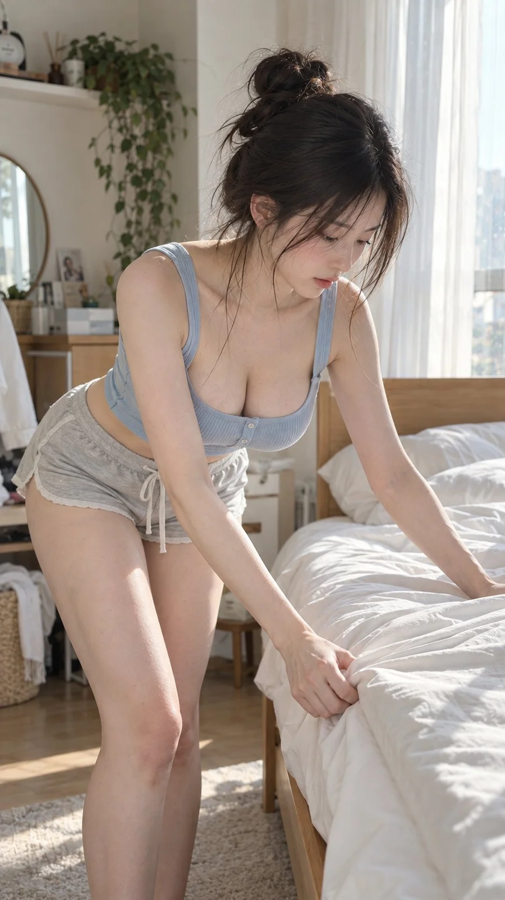

# Morning Bed-Making Candid Lifestyle Photo

**中文标题：** 清晨整理床铺写实生活照  
**ID:** `gi25-x-1246` · **Mode:** `generate`  
**Categories:** `general`  
**Tags:** `x-twitter`, `community`, `gpt-image-2.5`, `x-direct`, `zh`



### Morning Bed-Making Candid Lifestyle Photo

```text
风格方向： 清晨整理房间情绪
场景方向： 明亮卧室 / 木质床架 / 刚换的白色床单 / 半开的窗帘
服装方向： 浅冰蓝色修身短款针织背心 + 柔雾灰色低腰柔软家居短裤
气质标签： 松弛、清醒未满、安静、柔和、生活化
五官方向： 真实温柔自然脸，面颊轻微饱满，清亮杏眼，五官秀气耐看
发型方向： 慵懒高丸子头，少量碎发自然垂落
身形方向： 纤细柔美曲线，胸部自然饱满，腰线清楚
线条强调： 强
镜头方向： 女生站在床侧，一只手拉平床单边缘，另一只手扶在床垫上，身体轻微前倾，双腿自然分开约一个脚掌宽度，膝盖略微放松，低头认真整理床单。
光线氛围： 早晨高亮中性自然窗光，白色床品反射柔和补光。
画幅比例： 9:16
曲线重点： 自然俯身时衣服贴合上半身，胸腰比例明显，腰臀轮廓连续，避免刻意挺胸、塌腰或翘臀。
```

- **Recommended model:** `gpt-image-2.5-sunburst`
- **Settings:** _(defaults)_
- **Source:** [community](https://x.com/liyue_ai/status/2116429037883281920) — @liyue_ai
- **License note:** Original public X post; quoted with attribution — remix with attribution
- **Notes:** Collected directly from X; original post https://x.com/liyue_ai/status/2116429037883281920; post text names GPT Image 2.5; discovered via Bin0754/gpt-image-gallery index, prompt re-verified against the original X post via api.fxtwitter.com; verified=True
- **Preview:** `previews/gi25-x-1246.webp`
