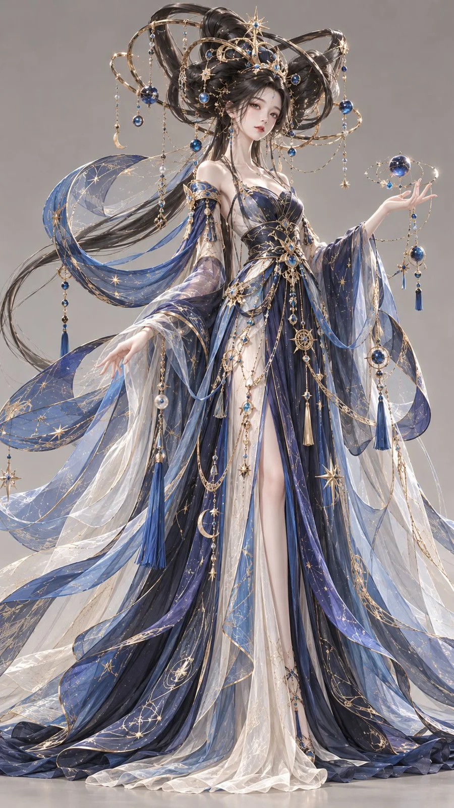

# Star-Orbit Stylized 3D Oriental Fantasy Character

**中文标题：** 星环月华·风格化 3D 东方幻想角色  
**ID:** `gi25-x-1247` · **Mode:** `generate`  
**Categories:** `general`  
**Tags:** `x-twitter`, `community`, `gpt-image-2.5`, `x-direct`, `zh`



### Star-Orbit Stylized 3D Oriental Fantasy Character

```text
9:16竖版，高精度风格化3D东方幻想女性人物原型，high-end stylized 3D oriental fantasy character design，电影级动画角色CG渲染，融合中国古代星象美学与幻想高级时装设计。

一位视觉年龄25–27岁的成年东方幻想女性，精致原创的东方动漫电影式美型五官，小巧心形鹅蛋脸，清亮微挑的细长杏眼，秀挺小巧的鼻梁，柔润自然的唇形，面颊柔和饱满，肌肤细腻通透，神情冷静、聪慧、神秘。人物颈部异常修长，肩膀纤窄，躯干细长，腰线极细，四肢修长，头部相对较小，整体呈现超现实却协调的纵向美感。

发型雕塑： 浓密乌黑长发在头顶与脑后盘绕成巨大的交错环轨式发髻。三组大小不同的椭圆弧形发束从头顶向左右及后方交叉延伸，犹如古代浑天仪的环轨结构，但全部由真实细密的发束编织塑形，环轨之间保留清晰的镂空空间。局部嵌入细小金色星点与蓝色琉璃珠，耳侧垂落两缕极细长发。

服装设计： 身穿深靛蓝与亮群青组合的东方幻想星象礼服。上身采用修长贴体的交叠斜领结构，肩部向两侧延伸出两道宽阔的半透明弧形披帛，如缓缓运行的星轨。纤细腰部由精密金线束带收束，裙身狭长，外层多条极细的丝绸长带沿不同弧线向下延伸，形成流星尾迹般的层次。局部织有抽象星宿连线与细密云气纹。

整体轮廓： 头部巨大环轨结构形成横向空间张力，中段身体极度纤细，下方长裙与弧线披帛向地面延伸，具有空灵、精密、神圣的雕塑美感。

深靛蓝用于主裙，亮群青用于部分丝缎与披帛，香槟金用于发饰和刺绣，月白用于少量透明内纱。颜色分别落实于不同材质，避免整图蓝紫色罩染。

真实发丝结构，高精度丝绸PBR材质，半透明轻纱，细密织金，电影级柔和影棚照明，中性浅灰背景，正面略微侧转，全身完整展示，发型与裙摆不得裁切。

避免人偶感、手办感、塑料皮肤、普通古装、真实天文仪器直接戴在头上、过度发光、结构混乱、文字水印。
```

- **Recommended model:** `gpt-image-2.5-sunburst`
- **Settings:** _(defaults)_
- **Source:** [community](https://x.com/liyue_ai/status/2116462055825801260) — @liyue_ai
- **License note:** Original public X post; quoted with attribution — remix with attribution
- **Notes:** Collected directly from X; original post https://x.com/liyue_ai/status/2116462055825801260; post text names GPT Image 2.5; discovered via Bin0754/gpt-image-gallery index, prompt re-verified against the original X post via api.fxtwitter.com; verified=True
- **Preview:** `previews/gi25-x-1247.webp`
