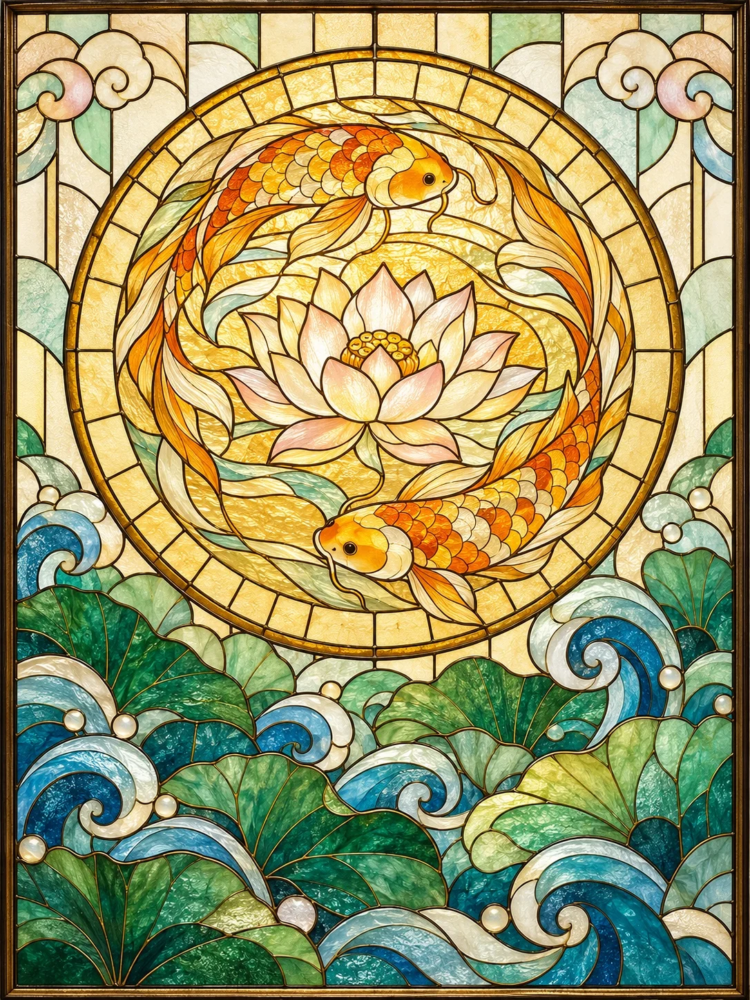

# Stained-Glass Window With Chinese Motifs

**中文标题：** 东方纹样彩色玻璃窗  
**ID:** `gi25-x-1254` · **Mode:** `generate`  
**Categories:** `general`  
**Tags:** `x-twitter`, `community`, `gpt-image-2.5`, `x-direct`, `zh`



### Stained-Glass Window With Chinese Motifs

```text
Create an image with the following visual system. Replace the subject as specified.

Visual system (light, color, composition, medium, mood):
一扇完整入画的竖幅 3:4 铅条镶嵌彩色玻璃窗板，正面平视、四边平行、没有透视倾斜，细窄的古铜色窗框围住整幅画面，窗外和室内环境都不出现。画面核心是一个大型圆形徽章，居中偏上，直径约占窗板宽度的七成，主体就放在这个圆里，圆内有一圈放射状的细分割线和浅色透光底；圆外上方是疏朗的浅奶油色和浅水绿几何玻璃片，两个上角各有一小团螺旋卷云呼应；下半部是一层层大尺度的卷曲波浪和卷云向上托住圆盘，越往下越密，前景的大涡卷互相遮挡形成层次。光从窗板背后均匀透进来，是温暖的日光色温，浅色玻璃柔亮、厚色玻璃透出浓郁色泽，没有投影，没有镜面高光，亮部也保留纹理不过曝。颜色秩序：暖琥珀金和蜂蜜黄集中在圆形徽章和主体上，约两成五，是全画最亮的视觉中心；青绿、湖蓝、浅水绿集中在下半部卷浪和角落，约三成五；暖象牙白和浅香槟米色做背景拼片和留白，约三成；低饱和贝壳粉只在少数卷云里做冷暖过渡，不超过一成，不要平均混铺。深褐色细铅线连续勾出每一块玻璃，主结构线略粗，边缘带一点柔和的古金色反光，铅线不要纯黑也不要太粗。每块玻璃各有不同的手工肌理：水波纹、细气泡、颗粒斑驳、冰裂纹，局部嵌乳白透光小颗粒，相邻玻璃片纹理交替变化，不要整幅一种噪点滤镜。主体本身也用铅条和分片玻璃拼出来，造型概括成平面装饰图案，曲线流畅，带新艺术风格的有机卷曲，不要写实刻画、不要立体浮雕感。整体明朗、安静、有流动感，像一扇老教堂侧窗被午后的光照透。画面里不要任何文字、字母、签名、水印。

New subject:
圆形徽章里是两尾锦鲤首尾相接绕成一个圆，围着中间一朵盛开的莲花游动，锦鲤用琥珀金和浅橙色玻璃拼出，鳞片是一片片小弧形玻璃，莲花是浅奶油白带一点贝壳粉的花瓣，圆底是浅金透光的水纹玻璃；圆外下半部的卷浪换成层叠的青绿莲叶和湖蓝水波涡卷，两个上角是小螺旋卷云。
```

- **Recommended model:** `gpt-image-2.5-sunburst`
- **Settings:** _(defaults)_
- **Source:** [community](https://x.com/static_stare/status/2116503372408684632) — @static_stare
- **License note:** Original public X post; quoted with attribution — remix with attribution
- **Notes:** Collected directly from X; original post https://x.com/static_stare/status/2116503372408684632; post text names GPT Image 2.5; discovered via Bin0754/gpt-image-gallery index, prompt re-verified against the original X post via api.fxtwitter.com; verified=True; prompt for image 1 of 4 (the author shares the other three on request); preview is image 1
- **Preview:** `previews/gi25-x-1254.webp`
