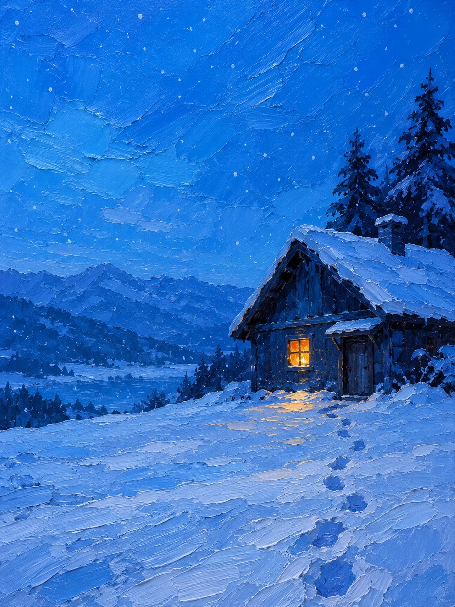

# Blue Night Impasto Oil Painting

**中文标题：** 蓝色夜景厚涂油画  
**ID:** `gi25-x-1255` · **Mode:** `generate`  
**Categories:** `general`  
**Tags:** `x-twitter`, `community`, `gpt-image-2.5`, `x-direct`, `zh`



### Blue Night Impasto Oil Painting

```text
Create an image with the following visual system. Replace the subject as specified.

Visual system (light, color, composition, medium, mood):
一幅竖幅 3:4 的蓝色夜景厚涂油画，用调色刀堆出来的完成态手绘油画。接近人眼高度的平视远景，主体建筑体量偏在画面一侧，占约一半宽度、可以局部出框，另一侧留出大片低细节的夜空和开阔地面或水面做负空间；地平线或水平线压在画面下三分之一附近，前景是粗粝的地面，中景是主体，远景高度概括。整体明度中等偏亮，是刚入夜的蓝调时刻那种饱和的青蓝、蔚蓝，天空像一整片明亮的钴青色颜料，不要暗沉的藏青、午夜深蓝或接近黑色的大面积暗部；冷青蓝的环境光柔和地罩住全画，天上不出现月亮、星星或强逆光；全画只有一到两处暖光：主体的一扇窗或一扇门透出橙黄灯光，在门口近处地面或水面投下一小片短而破碎的金橙反光，暖光不扩散、不照亮整片环境，不要路灯串、霓虹或多扇亮窗。颜色秩序：明亮饱和的青蓝到湖蓝铺满天空和开阔处，约五成五；钴蓝、群青和深海蓝塑造建筑、地面和阴影，约四成，建筑的墙面、屋顶、树和地面也都画成蓝色调，不要米色、棕色、灰色的墙或木头本色；琥珀橙到金黄只有约百分之四，集中在那一两处亮窗和它的反光里；最深处是深靛蓝不是中性黑，蓝色内部靠明度和冷暖差拉开远近，不要被处理成一层统一的蓝色滤镜。颜料很厚：刀脊、压痕、横向拖抹、刮痕和断续露底清楚可见，天空用宽而交叠的刮面，水面和地面用横向短刮痕，墙面有粗拙的块面，建筑轮廓略带手工的歪斜，形体高度概括成几个大色块，不画砖缝、木纹、瓦片、书脊和石板这类细节，远景只是一两道蓝色块面，暖光区域也保留厚涂痕迹，不要光滑的数字渐变、照片质感或均匀的浮雕滤镜。人物如果出现只是很小的深色背影，不画五官。整体安静、孤独，像深夜里只剩这一盏灯还醒着。画面里不要任何文字、招牌字、签名或水印。

New subject:
雪夜的山间小屋：画面右侧一座斜顶小木屋，屋顶压着厚厚的蓝白积雪，只有一扇小方窗亮着橙黄灯光，窗下雪地上映出一小块暖色；屋后是两三棵概括成深蓝块面的杉树，左侧是大片缓缓起伏的蓝色雪坡和远山，天空还在飘细小的雪片，雪地上一串浅浅的脚印通向门口。
```

- **Recommended model:** `gpt-image-2.5-sunburst`
- **Settings:** _(defaults)_
- **Source:** [community](https://x.com/static_stare/status/2116531744400679242) — @static_stare
- **License note:** Original public X post; quoted with attribution — remix with attribution
- **Notes:** Collected directly from X; original post https://x.com/static_stare/status/2116531744400679242; post text names GPT Image 2.5; discovered via Bin0754/gpt-image-gallery index, prompt re-verified against the original X post via api.fxtwitter.com; verified=True; prompt for image 1 of 4 (the author shares the other three on request); preview is image 1
- **Preview:** `previews/gi25-x-1255.webp`
