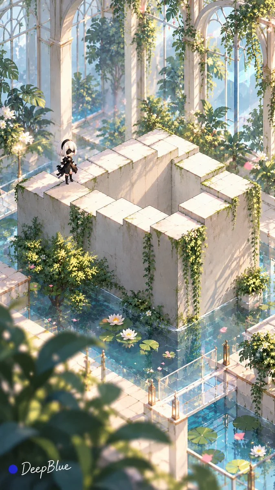

# Monument Valley-Style Impossible Space Illusion (Gacha, n=10)

**中文标题：** 纪念碑谷式空间悖论错觉抽卡（n=10）  
**ID:** `gi25-x-1258` · **Mode:** `generate`  
**Categories:** `general`  
**Tags:** `x-twitter`, `community`, `gpt-image-2.5`, `x-direct`, `zh`



### Monument Valley-Style Impossible Space Illusion (Gacha, n=10)

```text
空间悖论与视觉错觉 × 事物与场景开放抽卡 × 《纪念碑谷》式游戏美术 × 风格化三维渲染 × 随机Q版角色彩蛋

深入借鉴《纪念碑谷》的空间解谜设计与埃舍尔的不可能空间作品，将主体转译为局部看似合理、整体无法成立的视觉奇观。

【开放式抽卡】

1. 主体

自由探索不同领域、时代、文化与尺度的具象主题，涵盖独立对象、复合结构及完整场景，保留鲜明辨识度。

优先选择适合承载清晰空间矛盾的主体。主体或相关空间须具有可辨认的结构、连接与参照，能够在单张画面中呈现矛盾。

可先设计悖论再选择主体，也可从主体自身结构出发构思悖论；若两者难以自然结合，重新设计或抽取。

2. 空间悖论

每张设计一种核心空间矛盾。明确参与悖论的部位、各部位的连接、空间参照与局部关系，说明沿结构如何追踪，以及哪些空间判断无法同时成立。

悖论形式根据主体变化，保持开放。单纯弯曲、成环或悬浮，不能直接作为空间悖论的依据。

3. 结构转译

借鉴《纪念碑谷》与埃舍尔对视角、透视、遮挡和深度的组织，将矛盾融入主体自身的结构或与主体相关的空间。

局部连接看似合理，整体关系相互矛盾。关键边缘、连接点和判断所需的参照清楚可见，观众能够在同一视角下沿结构追踪，并指出具体冲突，无需依靠文字说明或想象补全。

4. 场景与叙事

随机探索环境、事件、空间层次与尺度关系，营造奇妙的探索感。场景造型与元素随主体变化，自然融入整体，并服务于空间矛盾的呈现。

5. 视觉风格

采用《纪念碑谷》式极简几何游戏美术与风格化三维渲染。造型简洁，体块与空间层次清楚，保留主体特征；配色、材质表现与光线随主体和场景变化，保持统一的风格化处理。

6. 构图与视角

选择能清楚呈现悖论的观察角度，随机探索景别、主体位置、留白与画面组织。关键连接和参照关系清晰可辨。

7. 随机彩蛋

每张随机选择一位不同的动漫或游戏成年女性角色，以小巧可辨的Q版造型隐藏在画面次要区域。保留角色标志性特征，随机变化位置、动作、表情及与空间的趣味互动，视觉风格与画面统一。

【视觉原则】

第一眼辨认主体，第二眼发现空间悖论，第三眼寻找隐藏彩蛋。

优先保证空间矛盾成立。同批主体、悖论设计、场景、构图与彩蛋角色保持差异，避免固定几何结构和重复组合。

生成前先给出本轮每张图片的完整提示词，逐张写清主体、局部关系、关键连接、空间参照与具体矛盾，再按顺序逐张生成。

成图后依据画面检查矛盾是否成立；若无法指出具体冲突，重新设计结构、生成并复检。若仍无法确认，明确说明问题。

n=10，9:16竖版，每张独立生成，不拼图、不宫格、不分屏。

左下签名：深蓝色实心圆点在前，白色手写体「DeepBlue」在后。
```

- **Recommended model:** `gpt-image-2.5-sunburst`
- **Settings:** _(defaults)_
- **Source:** [community](https://x.com/DeepBlueX0/status/2116159896026525960) — @DeepBlueX0
- **License note:** Original public X post; quoted with attribution — remix with attribution
- **Notes:** Collected directly from X; original post https://x.com/DeepBlueX0/status/2116159896026525960; post text names GPT Image 2.5; discovered via Bin0754/gpt-image-gallery index, prompt re-verified against the original X post via api.fxtwitter.com; verified=True
- **Preview:** `previews/gi25-x-1258.webp`
