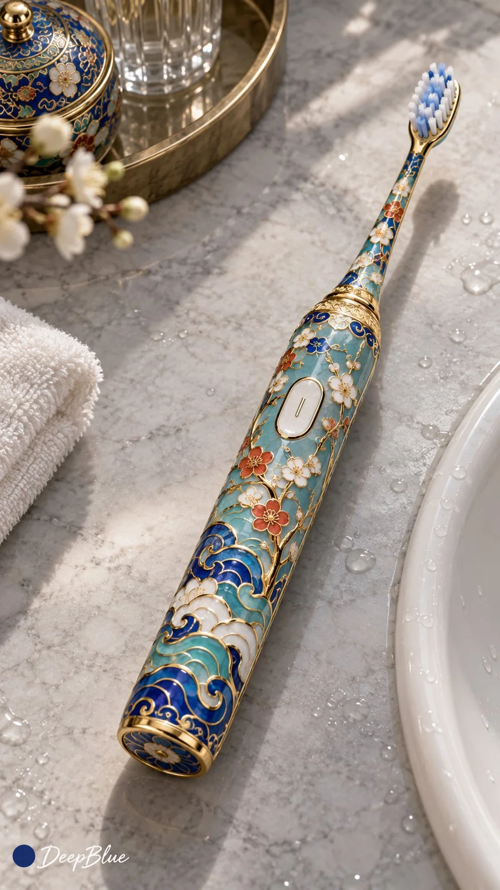

# Cloisonné Enamel Modern Objects (Gacha, n=10)

**中文标题：** 掐丝珐琅×现代物件抽卡（n=10）  
**ID:** `gi25-x-1259` · **Mode:** `generate`  
**Categories:** `general`, `ecommerce`  
**Tags:** `x-twitter`, `community`, `gpt-image-2.5`, `x-direct`, `zh`



### Cloisonné Enamel Modern Objects (Gacha, n=10)

```text
掐丝珐琅万物 × 现代物件开放抽卡 × 明清宫廷景泰蓝风格 × 工艺品产品摄影

每张随机选择一个不同的现代物件，保留清晰可辨的外形与结构，转译为完整的掐丝珐琅工艺品，形成宫廷工艺与当代生活的趣味反差。

鎏金铜丝分隔纹样，珐琅釉色鲜明，釉面温润反光，局部保留轻微的工艺痕迹。铜丝与填色贴合物件表面，转折、接缝与厚度合理。

随机探索配色、纹样、装饰疏密、陈列环境、观察角度、景别与构图。装饰呼应物件自身特征，保留结构与功能的辨识度。

柔光呈现金线与釉面，陈列方式随主体变化，突出工艺品本身。

同批保持统一的掐丝珐琅工艺语言，主体、轮廓与主要构图差异明显。

n=10，9:16，每次生成一张独立图片，逐张输出，不拼图。

左下签名：深蓝色实心圆点在前，白色手写体「DeepBlue」在后。
```

- **Recommended model:** `gpt-image-2.5-sunburst`
- **Settings:** _(defaults)_
- **Source:** [community](https://x.com/DeepBlueX0/status/2116123810105815412) — @DeepBlueX0
- **License note:** Original public X post; quoted with attribution — remix with attribution
- **Notes:** Collected directly from X; original post https://x.com/DeepBlueX0/status/2116123810105815412; post text names GPT Image 2.5; discovered via Bin0754/gpt-image-gallery index, prompt re-verified against the original X post via api.fxtwitter.com; verified=True
- **Preview:** `previews/gi25-x-1259.webp`
