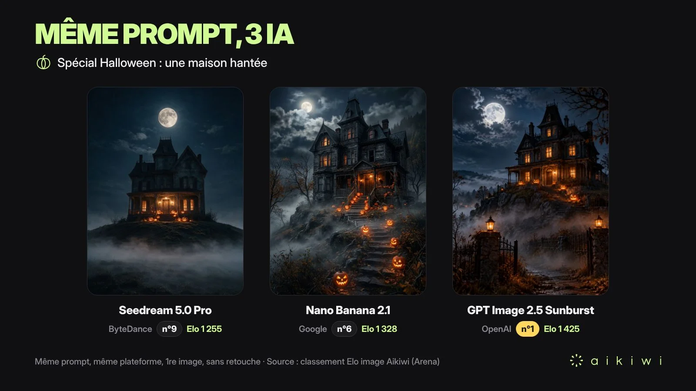

# Haunted Hilltop House on Halloween Night (French Prompt)

**中文标题：** 万圣夜山顶鬼屋（法语提示词）  
**ID:** `gi25-x-1260` · **Mode:** `generate`  
**Categories:** `general`  
**Tags:** `x-twitter`, `community`, `gpt-image-2.5`, `x-direct`, `en`



### Haunted Hilltop House on Halloween Night (French Prompt)

```text
Une maison hantée en haut d'une colline, la nuit d'Halloween, pleine lune, citrouilles allumées sur le perron, brume au sol. Photo réaliste, format portrait. Aucune personne, aucune silhouette, aucun fantôme.
```

- **Recommended model:** `gpt-image-2.5-sunburst`
- **Settings:** _(defaults)_
- **Source:** [community](https://x.com/aikiwi_com/status/2116576533183685010) — @aikiwi_com
- **License note:** Original public X post; quoted with attribution — remix with attribution
- **Notes:** Collected directly from X; prompt posted as the author's own reply https://x.com/aikiwi_com/status/2116576533183685010 to https://x.com/aikiwi_com/status/2116576531564687779, which carries the images; GPT Image 2.5 is named in the parent post; discovered via Bin0754/gpt-image-gallery index, prompt re-verified against the original X post via api.fxtwitter.com; verified=True; comparison post (Seedream 5.0 Pro / Nano Banana 2.1 / GPT Image 2.5 Sunburst); preview is the parent post image
- **Preview:** `previews/gi25-x-1260.webp`
