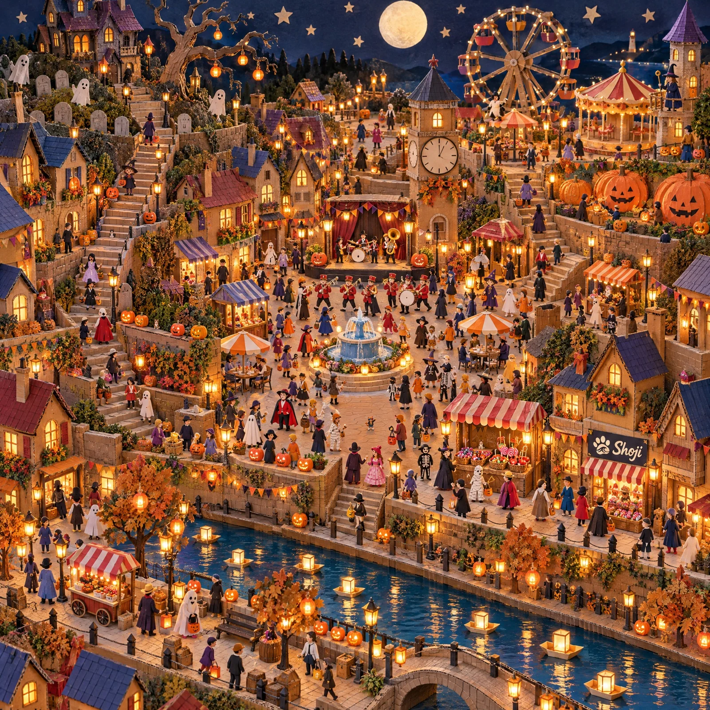

# Seek-and-Find Cardboard Craft Halloween Festival Town

**中文标题：** 找猫·纸板手工万圣夜小镇（寻物图）  
**ID:** `gi25-x-1262` · **Mode:** `generate`  
**Categories:** `general`  
**Tags:** `x-twitter`, `community`, `gpt-image-2.5`, `x-direct`, `en`



### Seek-and-Find Cardboard Craft Halloween Festival Town

```text
A handmade cardboard-and-paper craft diorama of a Halloween night festival in a whole town, square 1:1, in the spirit of a classic seek-and-find book: photographed from above in sharp focus from an extremely high and wide oblique angle so that the whole town fits in one picture, everything is tiny and there is an enormous amount to look at. The town is divided into clear districts by long stairways, terrace walls, a winding parade road and a canal. Top left: a hill with a big crooked haunted mansion, a graveyard with blank rounded gravestones and friendly white sheet-ghosts, and a twisted dead tree hung with paper lanterns. Top right: a lit-up Ferris wheel, a small funfair with a carousel of plain chairs, a pumpkin patch with huge orange pumpkins and a witch's tower. Centre: a big festival square on a wide stepped terrace with a stage, a fountain, striped-awning stalls (candy, caramel apples, pumpkin soup, masks, lanterns), cafe tables, a clock tower and a parade. Left and right of the square: cardboard houses with pointed roofs packed up the hillside with jack-o'-lanterns, string lights, paper garlands, narrow lanes and steep stairs with people on them. Lower right: a candy shop and a row of small shops. The lower third of the picture is only the canal side: a lantern-lit canal with paper boats, a little bridge, a promenade with lantern-hung trees, a pumpkin-lantern walkway, food carts and strolling people. About 180 minuscule paper-doll people, each doing something: trick-or-treating children in costumes, stall keepers, a marching band, cafe guests, kids on the stairs, people carving pumpkins, painters, riders on the Ferris wheel, strollers. A standing person is only about 3% of the picture height.

The look is the point: real corrugated cardboard in layers, kraft paper, coloured card, visible hand-cut edges, hot-glue dots, masking tape, acrylic paint strokes, paper garlands and tiny warm LED fairy lights glowing inside the buildings, figures as little cut-out paper dolls with painted faces on small card bases. Not a flat digital vector, not a 3D render, not a painting. The sky is deep indigo painted cardboard with a big cream full moon and cut-out paper stars, but the whole town is brightly lit by hundreds of warm orange lanterns so every figure stays readable. The picture fills the whole frame to all four edges: no table edge, no border, no caption.

Exactly one small logo: a small dark navy cardboard signboard above the door of the candy shop in the lower right of the town, about 4% of the picture width, with a cream-coloured cat paw print whose big pad holds a swirling ocean wave, and the word "Shoji" in cream cursive brush lettering to its right. Apart from that board there are no letters, words, numbers or digits anywhere: no shop signs, no "trick or treat" signs, no banners, no gravestone writing; the clock face has plain tick marks only.

Halloween things that are allowed: orange pumpkins and jack-o'-lanterns with simple triangle eyes and a smile, white sheet-ghosts with plain black eye holes, witches with pointed hats, wizards, vampire capes, mummies, skeletons, candy, lanterns. Costumes are only human costumes. THE ONLY ANIMALS IN THE WHOLE PICTURE ARE FOUR CATS, and there are NEVER MORE THAN FOUR: not five, not a spare one, no look-alike twin of any cat, and no cat in a costume, cape or ghost sheet. No other animal at all: no bats, spiders, owls, crows, black cats, snakes, dogs, horses or any bird; no animal-shaped lanterns, balloons or statues; no pumpkin carved with an animal face; nobody wears an animal head, animal ears, a tail or cat ears. The four cats are tiny paper figures like the people, all in the upper and middle part of the picture: their feet are between about 30% and 62% of the picture height measured from the top, and NONE is in the lower third. Each cat is in the open, never hidden behind anything, and each appears only ONCE. The three real cats are each TINY: only about 0.7% of the picture height (about 14 pixels in a 2048-pixel-high picture), about a quarter of the height of a standing person, a bare cat with only a thin red collar with a tiny gold bell:
1. ONE black-and-white "hachiware" cat (black head and back, a white blaze splitting the face, white chest and paws) sitting upright on a step of the stairway up to the haunted mansion, in the left half. This is the only hachiware cat;
2. ONE brown mackerel tabby (warm brown fur with dark stripes, white muzzle and chest) sitting upright on a low garden wall beside a row of jack-o'-lanterns, left of centre. This is the only tabby;
3. ONE calico cat (white with orange and black patches) sitting upright on the shelf of a candy stall with a striped awning among baskets of sweets, right of centre. This is the only calico;
4. Shoji Cat, an upright standing orange tabby cat about three heads tall in a black leather jacket, denim shorts, cream sneakers and black wayfarer sunglasses with blue and red lenses, dancing with one arm raised in the crowd of the festival square, in the middle of the picture, about one and a half times as tall as each of the other three cats.
No black or dark round objects, no piles of black cloth, and no dark animal-like shapes that could be mistaken for a cat. No watermark.
```

- **Recommended model:** `gpt-image-2.5-sunburst`
- **Settings:** _(defaults)_
- **Source:** [community](https://x.com/Shoji_ai/status/2116477786114175220) — @Shoji_ai
- **License note:** Original public X post; quoted with attribution — remix with attribution
- **Notes:** Collected directly from X; prompt posted as the author's own reply https://x.com/Shoji_ai/status/2116477786114175220 to https://x.com/Shoji_ai/status/2116477783949910386, which carries the images; GPT Image 2.5 is named in the parent post; discovered via X search, prompt re-verified against the original X post via api.fxtwitter.com; verified=True
- **Preview:** `previews/gi25-x-1262.webp`
