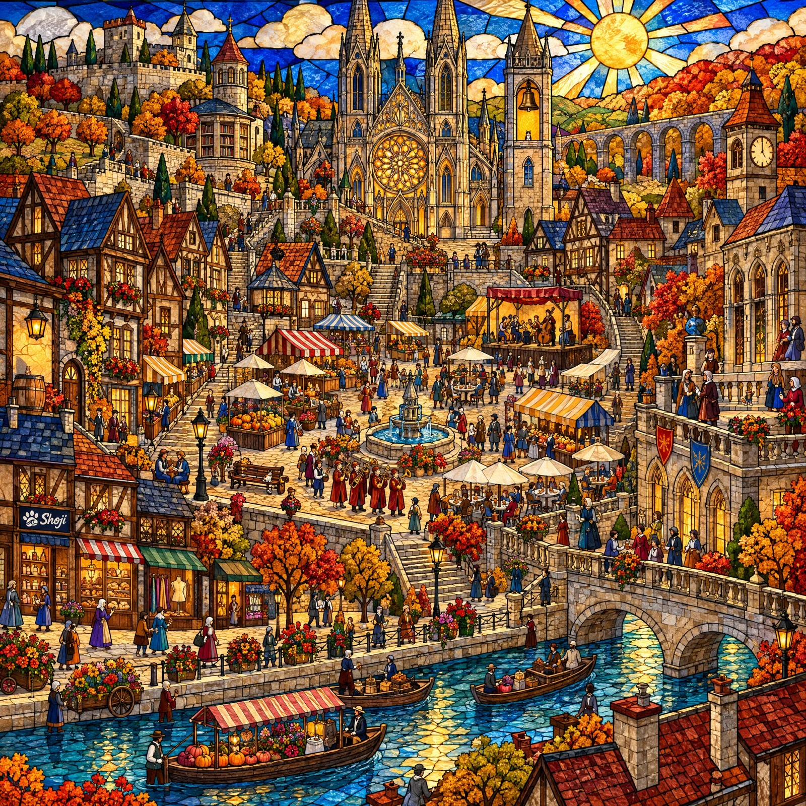

# Seek-and-Find Stained-Glass Autumn Market

**中文标题：** 找猫·彩色玻璃秋日集市（寻物图）  
**ID:** `gi25-x-1263` · **Mode:** `generate`  
**Categories:** `general`  
**Tags:** `x-twitter`, `community`, `gpt-image-2.5`, `x-direct`, `en`



### Seek-and-Find Stained-Glass Autumn Market

```text
A stained-glass artwork of an autumn market fair in a medieval cathedral city, square 1:1, in the spirit of a classic seek-and-find book: one enormous backlit leaded-glass panel seen from an extremely high and wide oblique bird's-eye angle so that the whole city fits in one picture, everything is tiny and there is an enormous amount to look at. The city is divided into clear districts by long stairways, terrace walls, a winding avenue and a canal. Top centre: a great Gothic cathedral with a glowing rose window and two spires, and a slender bell tower beside it with an open arched belfry window holding a golden bell. Top left: a hill with a castle wall, a round library tower and orchards. Top right: a clock tower, a stone aqueduct and a hillside of red-and-gold maples. Centre: a big market plaza on a wide stepped terrace with a fountain, striped-awning stalls (bread, pumpkins, apples, lanterns, cloth, flowers), cafe tables, a small stage with a band, a street lamp, benches and a procession. Left and right of the plaza: half-timbered houses with steep roofs packed up the hillside, flower boxes, narrow lanes and steep stairs with people on them; on the right a guildhall with a stone terrace and balustrade. Lower left: a row of small shops (a bookbinder, a baker, a tailor). The lower third of the picture is only the canal side: a canal of rippled blue glass with small boats and market barges, an arched stone bridge, a tree-lined promenade, flower carts and strolling people. About 180 minuscule glass people, each doing something: stall keepers, a band, shoppers with baskets of apples and pumpkins, cafe guests, children on the stairs, painters, readers on benches, strollers, boatmen. A standing person is only about 3% of the picture height.

The look is the point: coloured hand-blown glass with rippled streaky texture, thin dark lead lines only 1 to 2 pixels wide so tiny figures stay readable, hand-painted black-brown grisaille detail for faces, hands, roof tiles and stone, strong sunlight shining through from behind, sharp focus everywhere. Deep cobalt sky with a big golden sun and cream cloud pieces; ruby, sapphire, emerald and amber glass glowing. Not a flat digital vector, not a 3D render, not an oil painting. The glass fills the whole frame to all four edges: no window frame, no stone arch, no border, no caption.

Exactly one small logo: a small dark navy glass signboard above the door of the bookbinder's shop in the lower left of the town, about 4% of the picture width, painted in cream enamel on a single uncut pane (no lead line crossing it) with a cat paw print whose big pad holds a swirling ocean wave, and the word "Shoji" in cream cursive brush lettering to its right. Apart from that board there are no letters, words, numbers or digits anywhere: no signs with writing, no banners, no book titles; the clock face has plain tick marks only.

THE ONLY ANIMALS IN THE WHOLE PICTURE ARE FOUR CATS, and there are NEVER MORE THAN FOUR: not five, not a spare one, no look-alike twin of any cat. No other animal at all: no birds, doves, ravens, owls, bats, cock weather-vanes, lambs, lions, horses, dogs, fish, butterflies, dragons or gargoyles shaped like animals; no animal-shaped signs, statues, fountains, flags or coats of arms; no winged figures or angels; nobody wears an animal head, animal ears, a tail or cat ears. The four cats are tiny glass figures like the people, all at the same distance from the viewer, each in a DIFFERENT kind of place and at a DIFFERENT height: their feet are between about 15% and 60% of the picture height measured from the top, and NONE is in the lower third. Each cat is in the open, never hidden behind anything, and each appears only ONCE. The three real cats are each TINY: only about 0.7% of the picture height (about 14 pixels in a 2048-pixel-high picture), about a quarter of the height of a standing person, a bare cat with only a thin red collar with a tiny gold bell. From left to right:
1. ONE brown mackerel tabby (warm brown fur with dark stripes, white muzzle and chest) sitting upright on top of a pale oak barrel beside a tavern door at the far left edge, feet at about 42% of the height. This is the only tabby;
2. ONE calico cat (white with orange and black patches) sitting upright on a wooden bench under a street lamp at the edge of the market plaza, left of the fountain, feet at about 56%. This is the only calico;
3. ONE black-and-white "hachiware" cat (black head and back, a white blaze splitting the face, white chest and paws) sitting upright in the open arched belfry window of the slender bell tower, upper middle-right, feet at about 20%. This is the only hachiware cat;
4. Shoji Cat, an upright standing orange tabby cat about three heads tall in a black leather jacket, denim shorts, cream sneakers and black wayfarer sunglasses with blue and red lenses, dancing with one arm raised on the stone terrace of the guildhall at the far right edge, among a few people, feet at about 34%, about one and a half times as tall as each of the other three cats.
No black or dark round objects, no piles of dark cloth, and no dark animal-like shapes that could be mistaken for a cat. No watermark.
```

- **Recommended model:** `gpt-image-2.5-sunburst`
- **Settings:** _(defaults)_
- **Source:** [community](https://x.com/Shoji_ai/status/2116840175083073613) — @Shoji_ai
- **License note:** Original public X post; quoted with attribution — remix with attribution
- **Notes:** Collected directly from X; prompt posted as the author's own reply https://x.com/Shoji_ai/status/2116840175083073613 to https://x.com/Shoji_ai/status/2116840173589983590, which carries the images; GPT Image 2.5 is named in the parent post; discovered via X search, prompt re-verified against the original X post via api.fxtwitter.com; verified=True
- **Preview:** `previews/gi25-x-1263.webp`
