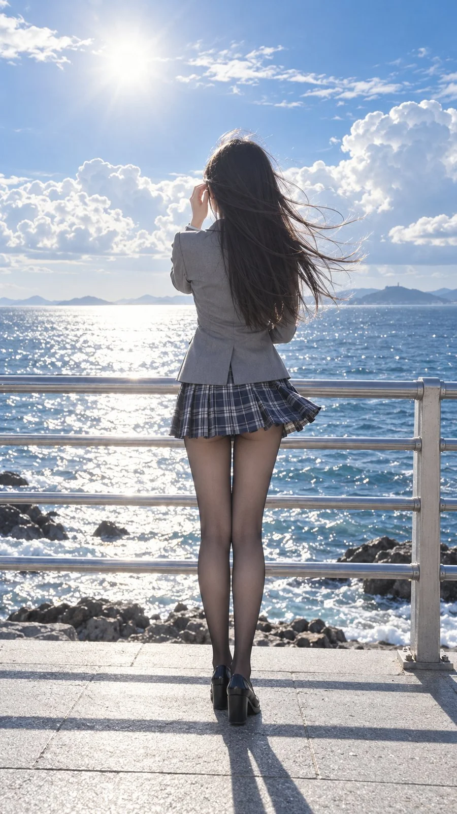

# Seaside Railing Backlit Portrait in the Wind

**中文标题：** 海边护栏逆光迎风人像  
**ID:** `gi25-x-1265` · **Mode:** `generate`  
**Categories:** `general`  
**Tags:** `x-twitter`, `community`, `gpt-image-2.5`, `x-direct`, `zh`



### Seaside Railing Backlit Portrait in the Wind

```text
9:16竖画幅。真人光学日间海滨逆光写实摄影结合日系清透精修质感，整体呈高明度澄澈海天蓝、纯净云白与冷灰黑交织的治愈冷调。采用平视全身中远景背影机位，画面无前景遮挡，一位兼具御姐与辣妹气质且带冷娇与傲沉复合气场的纤细冷白皮女性居中背对镜头独立于海边护栏前。她躯干挺拔正对大海，左肩微抬，头颈端正面向远方海面，呈迎风远眺的静谧动势。左臂屈肘抬至脸侧，左手指尖轻挽左侧耳畔被海风吹乱的发丝，右臂自然曲收于身前，修长双腿笔直并拢，双脚稳踩于浅灰石板地面。乌黑顺滑长直发与蓝白格纹百褶短裙右侧裙摆一同被海风吹向右侧飞扬，身穿浅灰色修身JK西装外套，双腿包裹于极薄半透明黑色连裤丝袜中并脚踩黑色粗跟乐福皮鞋，挺括呢料、柔滑黑丝与冷硬金属护栏形成材质反差。她面部完全背对镜头隐于黑发之后，左手手指轻触左脸颊边缘，指尖想要将风中凌乱的发丝彻底别入耳后却在触及脸颊边缘时轻柔停驻。前上方海面强日光逆向倾泻而下，在飞扬发梢、西装肩线与双腿丝袜外缘勾勒出清亮轮廓高光，冷白肌肤透过极薄黑丝透出温润的次表面漫反射质感，脚下石板地面投射出清晰深色人影与护栏横纹。空灵、浮生与留白的美学意境融汇于波光粼粼的日光之中，极简勾勒出由银灰横杆护栏、闪烁细碎璀璨光斑的蔚蓝海面以及悬浮巨大蓬松积云的湛蓝天空构成的户外背景。
```

- **Recommended model:** `gpt-image-2.5-sunburst`
- **Settings:** _(defaults)_
- **Source:** [community](https://x.com/alanblogsooooo/status/2116154653633323423) — @alanblogsooooo
- **License note:** Original public X post; quoted with attribution — remix with attribution
- **Notes:** Collected directly from X; original post https://x.com/alanblogsooooo/status/2116154653633323423; post text names GPT Image 2.5; discovered via X search, prompt re-verified against the original X post via api.fxtwitter.com; verified=True
- **Preview:** `previews/gi25-x-1265.webp`
