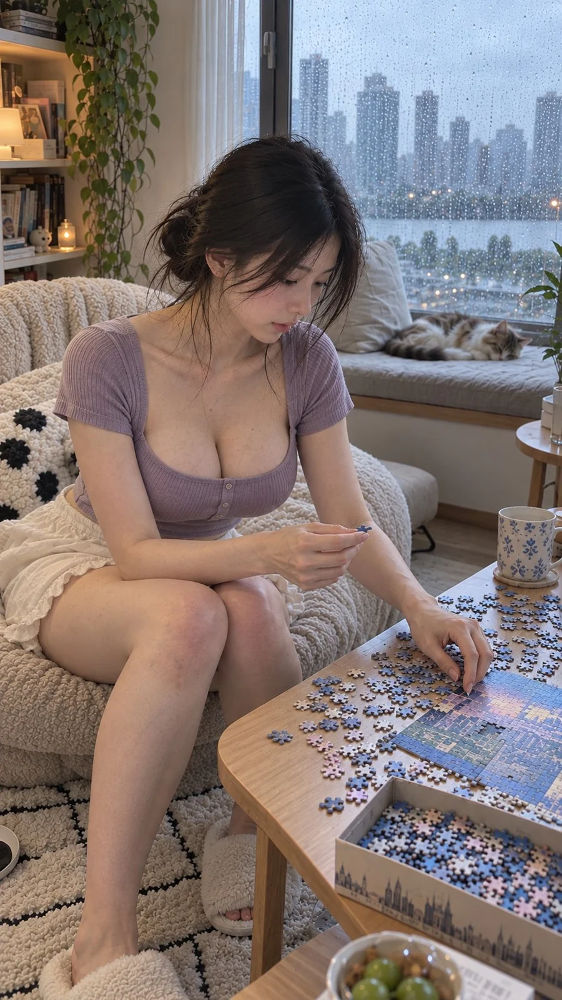

# Rainy Afternoon Jigsaw Puzzle Candid Photo

**中文标题：** 雨天午后拼图写实生活照  
**ID:** `gi25-x-1266` · **Mode:** `generate`  
**Categories:** `general`  
**Tags:** `x-twitter`, `community`, `gpt-image-2.5`, `x-direct`, `zh`



### Rainy Afternoon Jigsaw Puzzle Candid Photo

```text
风格方向： 雨天午后慢生活情绪
场景方向： 公寓客厅飘窗旁 / 浅木拼图桌 / 窗外细雨 / 柔软地毯
服装方向： 淡薰衣草紫修身方领短袖针织上衣 + 奶白色柔软高腰家居短裙
气质标签： 慵懒、安静、温柔、专注、若有所思
五官方向： 清透初恋感淡颜，柔和鹅蛋脸，清亮杏眼，鼻梁清秀，淡裸粉唇
发型方向： 黑色长发松散低扎，脸侧保留自然碎发
身形方向： 轻盈匀称曲线，上围饱满自然，腰腹纤细
线条强调： 强
镜头方向： 女生坐在拼图桌旁的低矮软椅上，双脚自然落地，身体略微偏向镜头。一只手拿着拼图碎片，另一只手搭在桌沿，正在犹豫该把拼图放在哪里。头部微低，视线专注于桌面。
光线氛围： 阴天冷白自然窗光，室内明亮通透，皮肤保持自然白皙。
画幅比例： 9:16
曲线重点： 修身方领自然衬托胸部轮廓，轻微前倾形成胸腰比例，坐姿让腰胯与大腿线条自然衔接。
```

- **Recommended model:** `gpt-image-2.5-sunburst`
- **Settings:** _(defaults)_
- **Source:** [community](https://x.com/liyue_ai/status/2116161404923220295) — @liyue_ai
- **License note:** Original public X post; quoted with attribution — remix with attribution
- **Notes:** Collected directly from X; original post https://x.com/liyue_ai/status/2116161404923220295; post text names GPT Image 2.5; discovered via X search, prompt re-verified against the original X post via api.fxtwitter.com; verified=True
- **Preview:** `previews/gi25-x-1266.webp`
