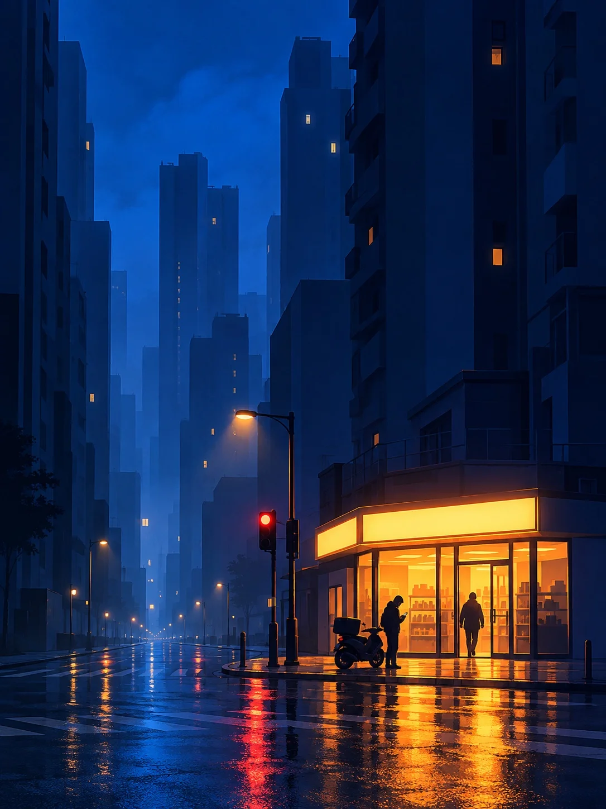

# Late-Night Blue Flat Illustration With One Warm Light

**中文标题：** 深夜蓝调扁平插画·唯一暖光  
**ID:** `gi25-x-1267` · **Mode:** `generate`  
**Categories:** `general`  
**Tags:** `x-twitter`, `community`, `gpt-image-2.5`, `x-direct`, `zh`



### Late-Night Blue Flat Illustration With One Warm Light

```text
Create an image with the following visual system. Replace the subject as specified.

Visual system (light, color, composition, medium, mood):
一幅竖幅 3:4 的城市深夜扁平插画，像电影概念设计里一帧安静的夜景。接近行人视线高度的平视远景，透视克制，主体和它的那一处暖光压在画面下方四分之一到三分之一的位置，上方大约三分之二留给高大的楼体和夜空里的青蓝雾气，楼体是几乎没有窗格的大面积纯色竖向块面，最多两三扇暗淡的小窗，画面上方大片干净的负空间，两侧的建筑从画面边缘切进来，把主体夹在一条狭长的城市峡谷里，尺度悬殊。人物只是很小的黑色剪影，不画五官，只用来给出尺度。冷色的低照度环境光从上方和街道深处柔和漫下来，整体明度压低；全画只有一个强暖光核心，是从主体内部或背后透出的高饱和琥珀橙光，在门口或地面形成一小片柔亮光池，并在湿润路面上拉出纵向、断续的橙色倒影。暖光擦过离它最近的物体和剪影的外轮廓，留下一道窄而亮的橙黄轮廓光，明暗交界处只渗出一点点洋红。远处只留几颗极小的暖白路灯或红橙信号灯点。颜色秩序：饱和的电蓝、钴蓝到深海蓝约占六到七成，蓝色要纯、要亮，不发灰发黑，青蓝和靛紫负责纵深和空气感约两成多，近黑蓝压住剪影和暗部，琥珀橙和金黄只占不到一成，而且最亮最纯的橙色只集中在一个地方。阴影是深藏蓝和蓝黑，不用中性灰或棕色。媒介是极简的扁平矢量插画，像一张夜景海报：大块干净的纯色面和柔和渐变，边缘利落，形体高度概括，不画树木枝叶、空调外机、电线、密集车流这些繁杂细节，玻璃和地面的反光柔化成雾状，带极轻微的颗粒，不要写实照片质感，也不要 3D 渲染。整体寂静、疏离，又有一处让人想走过去的暖光。画面里不要任何可读文字、招牌字、门牌、车牌、品牌标志、签名、水印或边框；招牌和灯箱只保留发光的空白色块。

New subject:
中国城市老小区门口的街角，一家 24 小时便利店是画面里唯一亮着的地方，整面玻璃门窗透出橙色暖光，能看到里面货架的简化剪影，门头灯箱只是一条发光的空白色块。店门口停着一辆外卖电动车，一个骑手的小剪影站在门口低头看手机，另一个人影推门进去。两侧是高耸的住宅楼块面，街角有一根路灯和一个红色信号灯点，路面刚下过雨。
```

- **Recommended model:** `gpt-image-2.5-sunburst`
- **Settings:** _(defaults)_
- **Source:** [community](https://x.com/static_stare/status/2116171278977561030) — @static_stare
- **License note:** Original public X post; quoted with attribution — remix with attribution
- **Notes:** Collected directly from X; original post https://x.com/static_stare/status/2116171278977561030; post text names GPT Image 2.5; discovered via X search, prompt re-verified against the original X post via api.fxtwitter.com; verified=True; prompt for image 1 of 4 (the author shares the other three on request); preview is image 1
- **Preview:** `previews/gi25-x-1267.webp`
