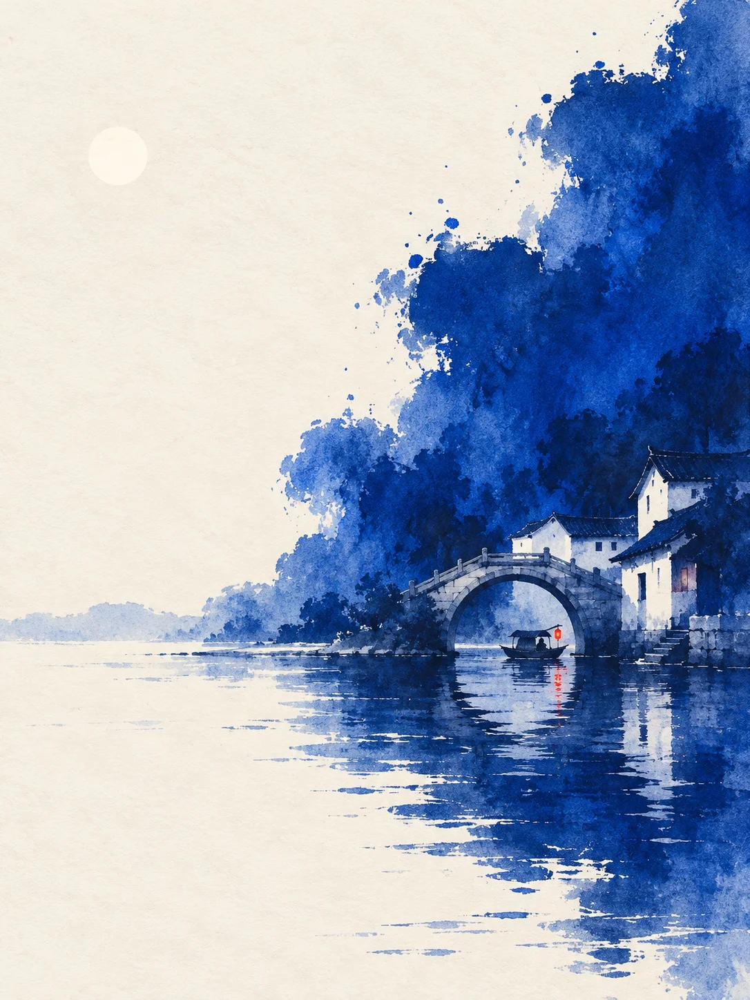

# Indigo Ink Monochrome Landscape With One Red Accent

**中文标题：** 靛蓝水墨单色风景·一点红  
**ID:** `gi25-x-1268` · **Mode:** `generate`  
**Categories:** `general`  
**Tags:** `x-twitter`, `community`, `gpt-image-2.5`, `x-direct`, `zh`



### Indigo Ink Monochrome Landscape With One Red Accent

```text
Create an image with the following visual system. Replace the subject as specified.

Visual system (light, color, composition, medium, mood):
一幅竖幅 3:4 的纸本水墨风景插画，像一张当代极简水墨小品。平视远景，近乎正立面的观看方式，透视克制，水岸或地平线压在画面下方三分之一处，主体很小，安静地停在画面一侧，尺度克制。画面一侧是一大团不规则的饱和钴蓝墨团，从画面边缘向内扩展，像夜里的云、山影或树影，把浅色的主体包在里面；墨团边界疏密错落，边缘有渗化、干裂、飞白和零星溅点，内部浓淡不均。另一侧和上方保留连贯干净、偏浅的奶油白纸面（不要发黄发旧），约占全幅一半，什么都不画，这片空白就是夜空和水面。前景是稀疏的横向碎笔水纹和断续的倒影，蓝色墨团在水里倒出一大片不完整的影子，主体下方的倒影只用几笔横向短笔。光是微暖的乳白散射光，没有光束和硬阴影，主体亮部直接用纸面留白表现，阴影压进深靛蓝。颜色秩序：浅奶油白纸底约五成，饱和明亮的钴蓝、群青到靛蓝的同一蓝色谱系约四成多，蓝色要纯、要鲜，像刚化开的钴蓝颜料，不要发灰、发黑的藏青，只靠浓淡做出远近，最深处是深靛蓝而不是黑；全画只有一处醒目的胭脂红到朱红，约占画面百分之三，一眼就能看到，集中在主体旁边一个紧凑的位置，水里可以有一点它的淡红倒影，除此之外不出现任何别的颜色，不要橙色灯光、绿色、黄色或棕色。质感是可见纤维的哑光纸纹、墨色渗化、细颗粒积色和干笔飞白，墨团内部是大块平涂和晕染的色块，不画一棵棵树、枝叶和岩石纹理，形体高度概括，建筑和景物只画到能认出来的程度，整体更像平面的水彩插画，不要写实照片质感，不要 3D 渲染，不要光滑的镜面水面。整体寂静、疏离，像深夜里一切都停下来的那一刻。画面里不要任何可读文字、印章、落款、签名、水印或边框，人物如果出现只是极小的剪影，不画五官。

New subject:
江南水乡的深夜：画面右侧，一座单孔石拱桥连着两三间白墙黛瓦的临水民居，拱桥和水中倒影合成一个完整的圆，桥洞下停着一条乌篷船，船头挂着一盏小小的朱红灯笼，是全画唯一的红色。大团靛蓝墨团从右边缘漫进来，像民居背后的夜色和树影，左侧和上方是大片空白的纸面，左上角留一枚极淡的、用留白表现的小圆月。
```

- **Recommended model:** `gpt-image-2.5-sunburst`
- **Settings:** _(defaults)_
- **Source:** [community](https://x.com/static_stare/status/2116198462827970826) — @static_stare
- **License note:** Original public X post; quoted with attribution — remix with attribution
- **Notes:** Collected directly from X; original post https://x.com/static_stare/status/2116198462827970826; post text names GPT Image 2.5; discovered via X search, prompt re-verified against the original X post via api.fxtwitter.com; verified=True; prompt for image 1 of 4 (the author shares the other three on request); preview is image 1
- **Preview:** `previews/gi25-x-1268.webp`
