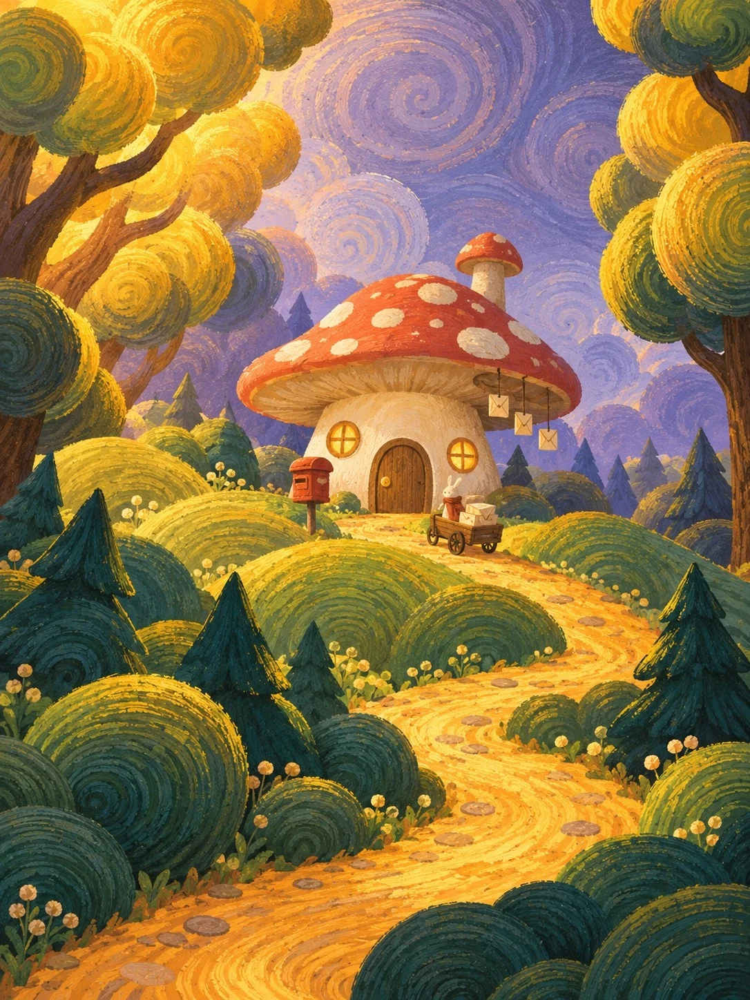

# Picture-Book Impasto Fairy-Tale Cottage

**中文标题：** 绘本厚涂童话小屋  
**ID:** `gi25-x-1271` · **Mode:** `generate`  
**Categories:** `general`  
**Tags:** `x-twitter`, `community`, `gpt-image-2.5`, `x-direct`, `zh`



### Picture-Book Impasto Fairy-Tale Cottage

```text
Create an image with the following visual system. Replace the subject as specified.

Visual system (light, color, composition, medium, mood):
一幅竖幅 3:4 的风格化童书插画，数字厚涂绘本页，装饰性很强，像一张平面感的绘本插图，而不是写实风景画或奇幻概念画。接近人眼高度、略微仰视的中远景：一间造型夸张、线条歪歪扭扭的童话小房子坐在中景，居中偏上，只占画面约五分之一，屋顶高而尖、门窗小而圆润，形体简化成几个干净的色块；左右两侧各有一两棵高树，树冠是一团团叠起来的圆滚滚的球形叶簇，向内合围成不完全对称的画框，中间露出一块灰紫色的天空，天空里画着一圈圈淡淡的同心旋涡弧线，像风的纹路。一条赭金色小径从画面下缘弯弯曲曲穿过一层层圆鼓鼓的草丘通到门口，近景是几棵造型简化成三角形的深青绿小杉树和圆灌木，遮住一部分路。最重要的是笔触语言：画面里每一团树冠、每一个草丘、天空和地面都由大量明显的短弧线、C 形卷曲笔触和一圈圈同心旋涡线条堆出来，每个球形叶簇里都有亮色的卷曲高光线，草丘上是成排顺着地形走的平行弧线笔触，笔触粗、方向感强、带干刷颗粒，像用平头笔和铅笔刷在画面上画圈；卷纹大小和方向随形体变化，不要平铺成均匀图案。形体是平面化的大色块加装饰笔触，不画一片片叶子，不画写实树干纹理、岩石和光影细节，不要照片感、3D 感、光滑渐变或柔焦景深。左上方暖金色光把树冠和小径照亮，阴影柔和，用冷暖色块区分，不用写实投影。颜色饱和、明快：金黄、蜂蜜黄到橙黄约四成，集中在两侧树冠和小径；橄榄绿、草绿到深青绿约三成半，在草丘和前景；灰紫、蓝紫约两成，给天空、远处的树和背光面；砖红和奶油米白合计约百分之五，只点在房子上。树是常绿的幻想树，金黄只是被暖光照亮的颜色，不要红叶、枫叶、落叶铺地这类秋天符号。整体温暖、安静、有点神秘，像童话书翻到的一页。画面里不要任何文字、字母、招牌字、标识或水印；信箱、招牌只画成无字的形状。人物如果出现只是很小的身影。

New subject:
一间蘑菇邮局：一朵巨大的砖红色蘑菇伞盖当屋顶，伞盖上有奶油白圆点，粗壮的米白蘑菇柄是墙，开一扇圆顶小木门和两扇亮着暖光的小圆窗，门口立着一个无字的旧铁皮信箱，屋檐下挂着一串小信封形状的风铃，门前小径上有一辆小小的送信木推车。
```

- **Recommended model:** `gpt-image-2.5-sunburst`
- **Settings:** _(defaults)_
- **Source:** [community](https://x.com/static_stare/status/2116390384288895340) — @static_stare
- **License note:** Original public X post; quoted with attribution — remix with attribution
- **Notes:** Collected directly from X; original post https://x.com/static_stare/status/2116390384288895340; post text names GPT Image 2.5; discovered via X search, prompt re-verified against the original X post via api.fxtwitter.com; verified=True; prompt for image 1 of 4 (the author shares the other three on request); preview is image 1
- **Preview:** `previews/gi25-x-1271.webp`
