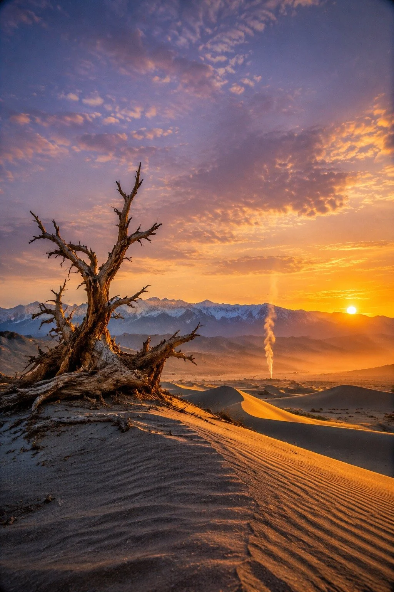

# Desert Lone Smoke Northwest Sunset Landscape

**中文标题：** 大漠孤烟西北落日风光  
**ID:** `gi25-x-1272` · **Mode:** `generate`  
**Categories:** `general`  
**Tags:** `x-twitter`, `community`, `gpt-image-2.5`, `x-direct`, `zh`



### Desert Lone Smoke Northwest Sunset Landscape

```text
大漠孤烟西北风光大片，甘肃敦煌鸣沙山边缘的黄昏时分，晴朗干燥的西北秋日傍晚。前景是风蚀刻出的沙丘脊线与一株枯死的胡杨，枝干虬曲指向天空，沙面有清晰的风纹；中景一道笔直的孤烟从沙丘后袅袅升起，在逆光中拉出细长的烟柱；远景连绵的金色沙海与祁连山雪线分层，天边一轮低悬的落日，云层染成淡紫与蜜金。空气中漂浮着细沙微粒与暖色尘雾，逆光勾勒出沙丘的明暗分界。光线：低角度暖金色侧逆光，色温约3200K，沙丘阳面蜜金、阴面冷灰蓝，形成暖冷对撞。相机：24mm广角，低机位贴近沙面，f/8深景深，三分法构图，地平线压在画面下三分之一处，天空留白占三分之二。调色：Eastmancolor胶片模拟，暖金与灰蓝对撞，轻微film grain，暗角轻微。ultra detailed, photorealistic landscape photography, National Geographic style. No people, No oil painting, No anime, No 3D render, No text, No watermark.
```

- **Recommended model:** `gpt-image-2.5-sunburst`
- **Settings:** _(defaults)_
- **Source:** [community](https://x.com/CandyTravelight/status/2116394742002987101) — @CandyTravelight
- **License note:** Original public X post; quoted with attribution — remix with attribution
- **Notes:** Collected directly from X; original post https://x.com/CandyTravelight/status/2116394742002987101; post text names GPT Image 2.5; discovered via X search, prompt re-verified against the original X post via api.fxtwitter.com; verified=True; the same prompt is also run on two other models in the post; preview is image 1, the GPT Image 2.5 result
- **Preview:** `previews/gi25-x-1272.webp`
