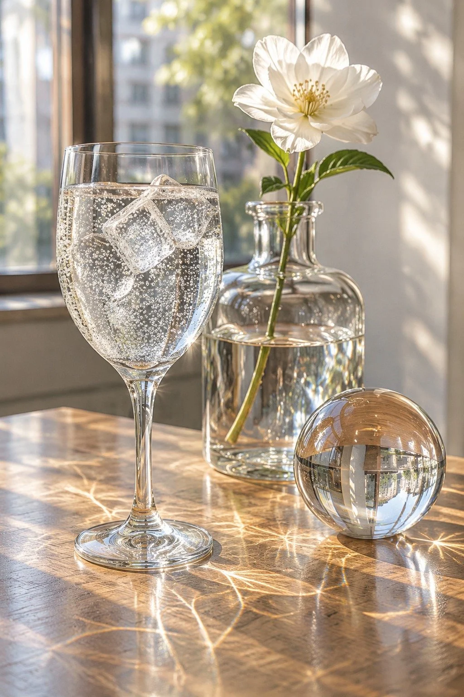

# Transparent Glass and Water Still Life With Caustics

**中文标题：** 午后透明材质焦散静物  
**ID:** `gi25-x-1273` · **Mode:** `generate`  
**Categories:** `general`, `ecommerce`  
**Tags:** `x-twitter`, `community`, `gpt-image-2.5`, `x-direct`, `zh`



### Transparent Glass and Water Still Life With Caustics

```text
午后阳光下的透明材质静物实测：一张木桌上并置三件透明器物——高脚玻璃杯盛着气泡水、冰块悬浮其中；一只厚壁玻璃花瓶插着一枝白花，瓶身折射出扭曲的光斑；一颗水晶球立在窗边，球内倒映出窗外颠倒的街景。阳光穿过玻璃在桌面投下明亮的焦散光纹（caustics），气泡沿杯壁细密上升，冰块棱角处有细微裂纹与气泡。光线：午后自然光从左侧窗户斜射，色温约4500K，透过玻璃产生真实的折射与高光。相机：50mm定焦，f/2.8，浅景深，焦点落在玻璃杯的气泡上，背景柔和虚化，bokeh自然。调色：干净明亮的自然色，轻微film grain。ultra detailed, photorealistic product photography. No oil painting, No anime, No 3D render, No deformed glass, No extra objects, No text, No watermark.
```

- **Recommended model:** `gpt-image-2.5-sunburst`
- **Settings:** _(defaults)_
- **Source:** [community](https://x.com/CandyTravelight/status/2116409841254277478) — @CandyTravelight
- **License note:** Original public X post; quoted with attribution — remix with attribution
- **Notes:** Collected directly from X; original post https://x.com/CandyTravelight/status/2116409841254277478; post text names GPT Image 2.5; discovered via X search, prompt re-verified against the original X post via api.fxtwitter.com; verified=True; the same prompt is also run on two other models in the post; preview is image 1, the GPT Image 2.5 result
- **Preview:** `previews/gi25-x-1273.webp`
