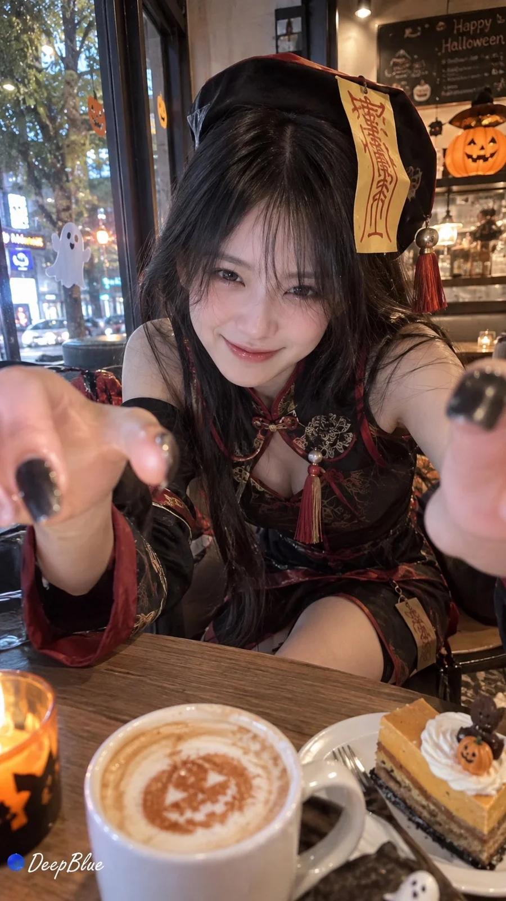

# Boyfriend-POV Halloween Date Snapshot (Gacha, n=10)

**中文标题：** 男友视角万圣节约会抓拍抽卡（n=10）  
**ID:** `gi25-x-1274` · **Mode:** `generate`  
**Categories:** `general`  
**Tags:** `x-twitter`, `community`, `gpt-image-2.5`, `x-direct`, `zh`



### Boyfriend-POV Halloween Date Snapshot (Gacha, n=10)

```text
男友 POV × 露脸幽灵娘或改良清宫僵尸娘 × 万圣节亲密约会 × iPhone私密抓拍

20多岁成年东亚女性，白皙，高挑修长，夸张身材，腰细腿长，比例协调。

每张随机选择一种穿搭：

床单幽灵娘：白色幽灵罩布松散披在头顶、发侧或肩上，露出全脸或半边脸，保留清晰五官与神情。罩布带黑色椭圆眼睛和淡粉腮红图案，搭配轻薄白色修身连衣裙。

改良清宫僵尸娘：融合僵尸帽、符纸、流苏、立领、宽袖与中式刺绣，以修身短裙呈现清宫僵尸风格。

服饰结构自然，衬托身形曲线，细节与搭配随机变化。

随机探索约会场景、生活事件、亲密互动与微妙情绪。男友手持iPhone第一人称抓拍，摄影者保持画外，按需露出手部。

人物自然松弛、可爱灵动，带有情侣独处时的羞涩、依恋与暧昧感。随机变化景别、机位和构图，捕捉彼此靠近、眼神交流与不经意的小动作。

真实手机随拍质感，环境光影自然，保留皮肤与衣料纹理、偶然遮挡及轻微失败抓拍感。

n=10，9:16竖版，每张独立随机，穿搭、事件与构图避免重复。

左下签名：深蓝色实心圆点＋白色手写体「DeepBlue」。
```

- **Recommended model:** `gpt-image-2.5-sunburst`
- **Settings:** _(defaults)_
- **Source:** [community](https://x.com/DeepBlueX0/status/2116445874884677706) — @DeepBlueX0
- **License note:** Original public X post; quoted with attribution — remix with attribution
- **Notes:** Collected directly from X; original post https://x.com/DeepBlueX0/status/2116445874884677706; post text names GPT Image 2.5; discovered via X search, prompt re-verified against the original X post via api.fxtwitter.com; verified=True
- **Preview:** `previews/gi25-x-1274.webp`
