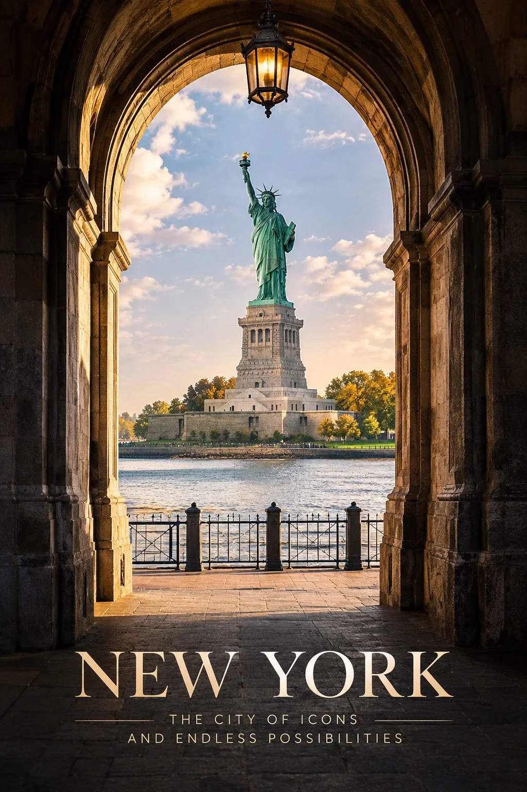

# Monumental Archway-Framed Travel Photo Template

**中文标题：** 宏伟拱门框景旅行摄影模板  
**ID:** `gi25-x-1281` · **Mode:** `generate`  
**Categories:** `general`  
**Tags:** `x-twitter`, `community`, `gpt-image-2.5`, `x-direct`, `en`



### Monumental Archway-Framed Travel Photo Template

```text
Create an extraordinarily beautiful, photorealistic architectural travel photograph featuring [CITY / COUNTRY / LANDMARK], inspired by luxury travel photography, cinematic architectural composition and timeless fine-art photography.

1. The architectural framing

Create a dramatic foreground using a monumental traditional archway, historic doorway, stone corridor or distinctive architectural entrance associated with the destination.

The foreground should be dark, richly textured and intricately detailed, creating a natural frame around the landmark.

2. The magnificent reveal

Through the centre of the archway, reveal the destination’s most iconic landmark in all its glory.

Position the landmark as the central focal point, beautifully illuminated by soft natural daylight.

Preserve its authentic architectural details, proportions, materials and recognizable silhouette.

3. Composition and perspective

* Strong central symmetry and balanced architectural framing.
* A beautiful stone pathway or courtyard leading towards the landmark.
* Dark foreground contrasting with the softly illuminated background.
* Natural depth, realistic perspective and architectural scale.
* An elegant visual transition from shadow into light.

4. Lighting and atmosphere

Use soft golden daylight, subtle atmospheric haze and natural shadows. Create a beautiful contrast between the deep shadows of the foreground and the luminous landmark beyond.

The atmosphere should feel peaceful, timeless, majestic and slightly mysterious.

5. Photography style

Luxury architectural photography, cinematic fine-art photography, realistic stone textures, intricate craftsmanship, natural lighting, sophisticated tonal contrast, exceptional detail and professional travel-magazine quality.

6. Typography and destination identity

Add the destination name in large, bold, elegant uppercase lettering at the bottom of the composition.

Example: [DESTINATION NAME]

Below it, add a beautiful, meaningful tagline in smaller sophisticated typography.

Choose a tagline that reflects the history, beauty, identity or atmosphere of the destination.

Examples:

* PARIS — Where Every Street Tells a Story.
* EGYPT — Where Eternity Meets the Earth.
* JAPAN — Where Tradition Meets Tomorrow.
* ITALY — A Timeless Masterpiece.
* KASHMIR — Heaven Woven in Mountains.

Keep typography elegant, perfectly spelled, well-spaced and visually integrated without obstructing the architecture.

7. Final presentation

Vertical 2:3 premium collectible travel-art photograph, cinematic architectural framing, photorealistic details, luxury editorial finish and timeless composition.

Important: Select an authentic architectural frame appropriate to the chosen destination. Do not use the same archway for every location. The landmark must remain historically and architecturally accurate. Avoid artificial fantasy architecture, excessive decoration and cartoon illustrations
```

- **Recommended model:** `gpt-image-2.5-sunburst`
- **Settings:** _(defaults)_
- **Source:** [community](https://x.com/Naiknelofar788/status/2116732073432285320) — @Naiknelofar788
- **License note:** Original public X post; quoted with attribution — remix with attribution
- **Notes:** Collected directly from X; original post https://x.com/Naiknelofar788/status/2116732073432285320; post text names GPT Image 2.5; discovered via X search, prompt re-verified against the original X post via api.fxtwitter.com; verified=True
- **Preview:** `previews/gi25-x-1281.webp`
