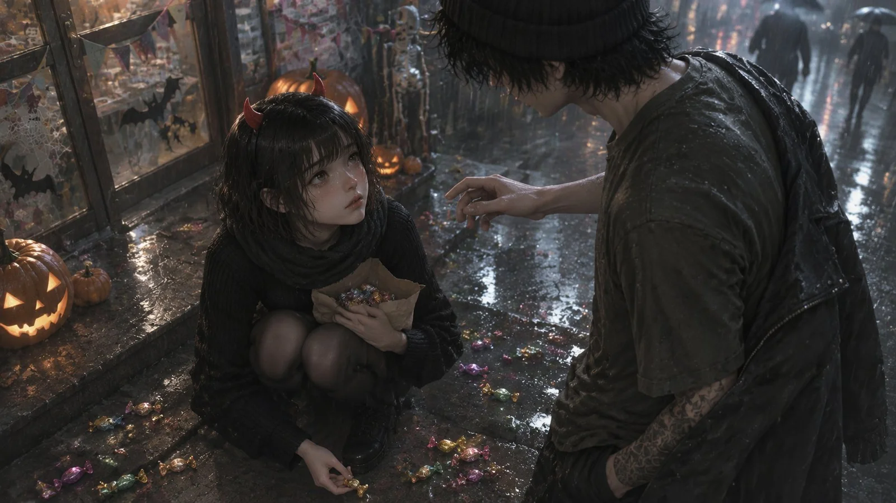

# Rainy Halloween Convenience Store Couple 3D CG Still

**中文标题：** 万圣雨夜便利店情侣 3D 动画静帧  
**ID:** `gi25-x-1283` · **Mode:** `generate`  
**Categories:** `general`  
**Tags:** `x-twitter`, `community`, `gpt-image-2.5`, `x-direct`, `zh`



### Rainy Halloween Convenience Store Couple 3D CG Still

```text
单帧写实 3D 动画电影 CG 静帧，虚幻引擎 5 级物理材质、光线追踪全局光照、次表面散射皮肤，不是 2D、没有线稿、不要分镜和边框。
整体调子严格照风格样图那套滤镜（低饱和暖灰、暗部抬亮、奶油高光、35mm 细颗粒），不要橙色调、不要青橙对比、不要彩色泛光——滤镜本身不变。滤镜之下，这一场的光是冷的：深夜、冷雨、阴冷潮湿；阴影和小店的背光面压成淡淡的青灰，湿地面反射出冷白光，人物皮肤上也有薄薄一层冷调。
场景：万圣夜深夜，安静的居民区街角，一家小便利店门外。台阶上堆着一群大大小小的南瓜灯，有的亮着蜡烛、有的熄了，被雨淋得亮闪闪的；玻璃门上贴着黑色蝙蝠纸贴，上方拉着一串褪了色的三角纸彩旗；门框一侧挂着灰白的假蜘蛛网和一只小小的塑料骷髅。街那头一群盛装打扮的人打着伞一起走远，虚焦，只剩被雨雾晕开的浅灰剪影。
**这一地的糖要看得清清楚楚，它是画面的焦点之一**：她脚边的湿台阶和水洼里散着二三十颗裹着彩色玻璃纸的糖——金的、紫的、粉的、薄荷绿，糖纸在冷光里反着一点亮，被雨水泡得半透明、贴在石面上。有几颗正好在她伸出手的前方：一颗金色的水果糖躺在浅水洼里，水面映着它；一颗紫色糖纸的糖卡在台阶缝里；一颗剥开一半的糖露着里面的软糖。她指尖正捏住离得最近的那一颗，糖已经被捏起来一点，离开地面。
她的长相按女主角设定图：齐刘海黑色短波波头被雨打湿贴在脸颊，黑色罗纹针织裙、黑丝、旧黑靴、厚围巾，头顶戴着廉价塑料小红恶魔角发箍。他按男主角设定图：湿透的橄榄灰 T 恤、黑色毛线帽、黑工装裤、右前臂纹身，肩上搭着湿透的深灰外套。
她蹲在湿台阶上，膝盖并拢，怀里抱着袋角磨破的纸袋、袋里露出一把糖；另一只手伸向地面，指尖刚碰到一颗糖。头抬起来望着他，眼眶红、眼里含着泪，一滴正顺着脸颊滑下来，眉间轻皱，抿着嘴——委屈又倔强。他站在她半步外，身体微微前倾，一只手插在外套口袋里，另一只手伸到一半停在她上方，像没了胆子。
雨下得比刚才大：雨丝在冷光里又细又密，斜斜落下，地面砸出细小的水花、水洼一圈圈荡开；她的刘海和睫毛上挂着水珠，他帽檐和外套下摆都在滴水。远处店里透出来的一点暖光只落在玻璃上，暖色只出现在南瓜灯、店里的光和糖纸上，其余全是冷的。
35mm，中景双人，机位在她头顶上方往下压：湿地面占画面下三分之一，她缩成小小一团，他从大腿往上入画。**她手边那几颗糖和她捏住的那一颗要清晰、有细节**，别糊成一片背景光点。浅景深，两张脸都清楚。画面里没有任何文字。
```

- **Recommended model:** `gpt-image-2.5-sunburst`
- **Settings:** _(defaults)_
- **Source:** [community](https://x.com/alanblogsooo/status/2116743989739274595) — @alanblogsooo
- **License note:** Original public X post; quoted with attribution — remix with attribution
- **Notes:** Collected directly from X; original post https://x.com/alanblogsooo/status/2116743989739274595; post text names GPT Image 2.5; discovered via X search, prompt re-verified against the original X post via api.fxtwitter.com; verified=True
- **Preview:** `previews/gi25-x-1283.webp`
